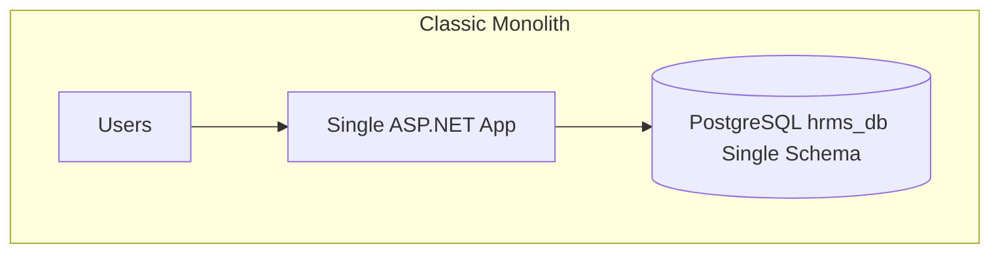
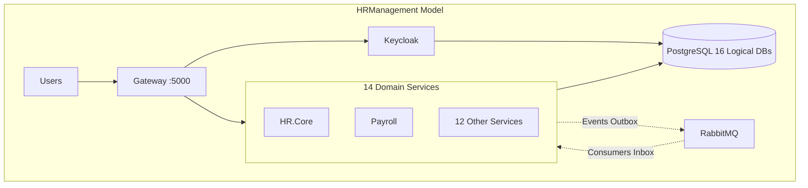
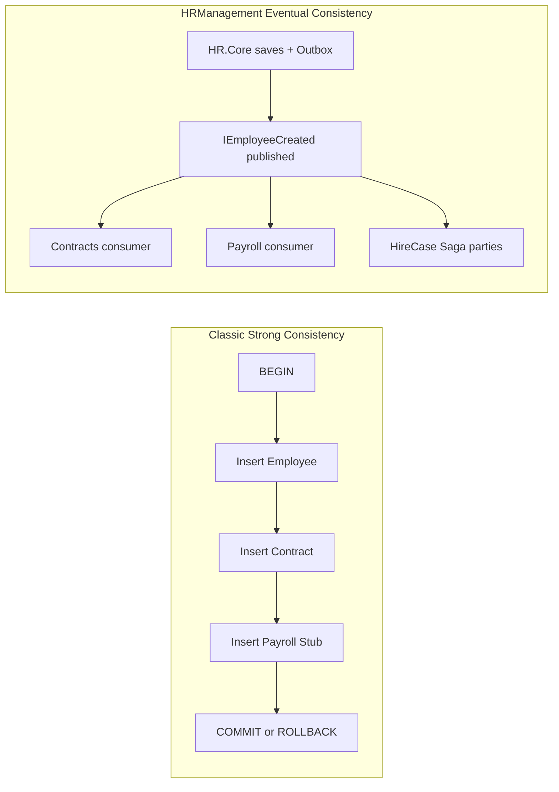
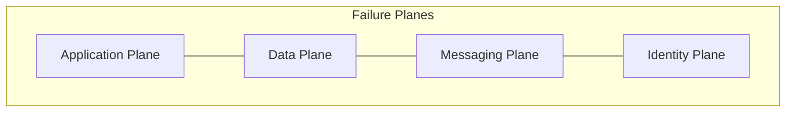

# ARC-003 — دراسة جودة ووثوقية المعمارية: قاعدة بيانات مركزية vs قاعدة لكل خدمة

| الحقل   | القيمة                                                                                                                                                                                    |
| ------- | ----------------------------------------------------------------------------------------------------------------------------------------------------------------------------------------- |
| البطاقة | ARC-003                                                                                                                                                                                   |
| الحالة  | Draft — دراسة نظرية                                                                                                                                                                       |
| التاريخ | 2026-08-07                                                                                                                                                                                |
| النطاق  | طبقة البيانات + التكامل (بدون UI، بدون benchmarks أداء)                                                                                                                                   |
| المراجع | [00-overview.md](./database/00-overview.md)، [ADR-001](./decisions/ADR-001-tenant-model.md)، [PROCESS_SAGAS.md](./PROCESS_SAGAS.md)، [OPS_DATA_HA_TOPOLOGY.md](./OPS_DATA_HA_TOPOLOGY.md) |

---

## 1. المقدمة والنطاق

### 1.1 الهدف

تقدّم هذه الوثيقة **دراسة نظرية مقارنة** بين نموذجين معماريين لنظام معلومات الموارد البشرية (HRMS):

1. **النموذج الكلاسيكي (Baseline):** تطبيق Monolith واحد + قاعدة PostgreSQL مركزية (مخطط/schema موحّد، مفاتيح أجنبية عابرة للوحدات، معاملات ACID داخل قاعدة واحدة).
2. **نموذج HRManagement:** 14 خدمة مستقلة + بوابة Gateway + **16 قاعدة بيانات منطقية** على **مثيل PostgreSQL واحد** (بيئة التطوير) أو **عنقود CloudNativePG** (الإنتاج)، مع تكامل **Event-Driven** عبر RabbitMQ/MassTransit، وOutbox/Inbox، وSagas للمسارات متعددة الأطراف.

التركيز على **الجودة** و**الوثوقية** من منظور:

- **نقاط الفشل (Failure Points)** و**نطاق الأثر (Blast Radius)**
- **الاتساق (Consistency)** — فوري vs نهائي
- **العزل (Isolation)** — بيانات، أعطال، أمان
- **قابلية التشغيل والاسترداد (Operability & Recoverability)**

### 1.2 تعريف الجودة والوثوقية

نستخدم إطار **ISO/IEC 25010** بشكل نوعي (qualitative) دون قياس رقمي:

| السمة                                 | التعريف في سياق HRMS                                       |
| ------------------------------------- | ---------------------------------------------------------- |
| **Availability (التوفر)**             | قدرة النظام على تقديم الخدمة عند الطلب — كاملاً أو جزئياً  |
| **Reliability (الوثوقية)**            | استمرار التشغيل دون فشل غير متوقع؛ التعامل مع الأخطاء      |
| **Maintainability (قابلية الصيانة)**  | سهولة التعديل، الترحيل، والنشر دون كسر النظام              |
| **Security (الأمان)**                 | سرية البيانات، العزل بين الجهات والمجالات، least privilege |
| **Recoverability (قابلية الاسترداد)** | استعادة البيانات والعمليات بعد العطل                       |

### 1.3 حدود الدراسة

- **داخل النطاق:** نموذج البيانات، التكامل بين الخدمات، نقاط الفشل، المزايا/العيوب، مصفوفة القرار.
- **خارج النطاق:** واجهات المستخدم، benchmarks أداء، تجارب Chaos جديدة (NFR-002)، تفاصيل CI/CD.
- **لا تُعدّ هذه الدراسة** بديلاً عن [ARC_001_FAILURE_DOMAINS.md](./ARC_001_FAILURE_DOMAINS.md) أو [ARC_001_SPOF.md](./ARC_001_SPOF.md) — بل توسّعهما بمحتوى تحليلي.

### 1.4 توضيح مصطلحي حاسم

| المصطلح                  | المعنى في HRManagement                                                                      | ما **ليس** مقصوداً                                  |
| ------------------------ | ------------------------------------------------------------------------------------------- | --------------------------------------------------- |
| **Database-per-Service** | كل خدمة تملك قاعدة PostgreSQL منطقية مستقلة (`hr_core_db`, `payroll_db`, …)                 | —                                                   |
| **مثيل Postgres مشترك**  | في Docker dev: 16 قاعدة على حاوية `hrm-postgresql` واحدة                                    | ليس «قاعدة schema واحدة»                            |
| **Database-per-Tenant**  | **مرفوض** — العزل بين الوزارات عبر `TenantId` + EF filters + RLS داخل **نفس** قاعدة كل خدمة | انظر [ADR-001](./decisions/ADR-001-tenant-model.md) |

---

## 2. وصف النموذجين

### 2.1 النموذج الكلاسيكي (Baseline المرجعي)

**الافتراضات:**

- تطبيق ASP.NET Core **Monolith** واحد (عملية واحدة أو cluster متجانس).
- قاعدة PostgreSQL **واحدة** (`hrms_db`) بمخطط موحّد يجمع جداول: الموظفين، العقود، الرواتب، الصحة، التنقلات، …
- **FK عابرة للوحدات:** `payroll_lines.employee_id → employees.id`
- **تكامل داخلي:** استدعاءات in-process أو JOINs SQL — **لا RabbitMQ**
- **معاملات موزّعة:** `BEGIN … COMMIT` واحدة لمسارات مثل التعيين أو الفصل
- **مصادقة:** مدمجة في التطبيق أو LDAP مباشر — بدون Keycloak منفصل (تبسيط للمقارنة)
- **نسخ احتياطي:** dump واحد لقاعدة واحدة

**نموذج فرضي لـ HRManagement-as-Monolith:**

لو اُدمج المشروع الحالي في Monolith، لكان المخطط يحتوي ~111 كياناً (مجموع ERD الخدمات) في schema واحد، مع FKs مثل:

- `contracts.employee_id → employees.id`
- `payroll_lines.employee_id → employees.id`
- `medical_records.employee_id → employees.id`
- `disciplinary_actions.employee_id → employees.id`

هذا يحقق **اتساقاً فورياً** لكن يرفع **الاقتران** و**نطاق الأثر** عند أي تغيير schema أو bug.

### 2.2 نموذج HRManagement

**الواقع المنفّذ:**

| المكوّن                 | العدد / الوصف                                                                      |
| ----------------------- | ---------------------------------------------------------------------------------- |
| خدمات مجال              | 14 (HR.Core … File.Storage)                                                        |
| Gateway                 | 1 (YARP + OIDC + audit)                                                            |
| قواعد PostgreSQL منطقية | **16** (14 خدمة + `gateway_audit_db` + `keycloak_db`)                              |
| أحداث تكامل             | 44+ عقد في `HRManagement.MessageContracts`                                         |
| Process Sagas           | 4 (Hire, Separation, Transfer, Secondment)                                         |
| Outbox (EF + Postgres)  | 8 خدمات: Core, Contracts, Payroll, Movements, Health, Training, IDCard, Compliance |
| وسيط رسائل              | RabbitMQ 3.13 + MassTransit (quorum queues, publisher confirms)                    |
| هوية                    | Keycloak 24 — realm واحد، `tenant_id` في JWT                                       |

**مصدر الأرقام:** `[docker/init-databases.sql](../docker/init-databases.sql)`، `[README.md](../README.md)`، `[docs/database/README.md](./database/README.md)`.

### 2.3 جدول مقارنة سريع

| البعد                    | كلاسيكي                        | HRManagement                                      |
| ------------------------ | ------------------------------ | ------------------------------------------------- |
| عمليات النشر             | 1                              | 15 (14 + Gateway)                                 |
| مخططات DB / مسارات ترحيل | 1                              | 16 (14 + audit + Keycloak)                        |
| نمط التكامل              | In-process / SQL JOIN          | RabbitMQ events + HTTP S2S محدود                  |
| نموذج الاتساق            | ACID فوري                      | Eventual consistency + Sagas                      |
| عزل DB على مستوى IAM     | دور DB واحد للتطبيق            | `{service}_app` + REVOKE CONNECT على قواعد أخرى   |
| عزل بين الجهات (Tenant)  | `TenantId` column + app filter | `TenantId` + EF filters + PostgreSQL RLS          |
| نقاط مركزية              | DB + App                       | Gateway + Keycloak + Postgres instance + RabbitMQ |

---

## 3. نموذج البيانات: مركزي vs لكل خدمة

### 3.1 الاقتران (Coupling)

| الجانب                 | كلاسيكي                                                   | HRManagement                                           |
| ---------------------- | --------------------------------------------------------- | ------------------------------------------------------ |
| **Schema coupling**    | تغيير جدول `employees` قد يكسر Payroll وHealth وContracts | تغيير `hr_core_db` لا يمس `payroll_db`                 |
| **Runtime coupling**   | Bug في Payroll قد يُسقط العملية كلها                      | Payroll معزولة في عملية منفصلة                         |
| **Ref integrity**      | FK على DB — رفض INSERT فوري                               | مراجع `Guid` منطقية — التحقق في التطبيق أو عبر الأحداث |
| **Cross-domain query** | `SELECT … JOIN` مباشر                                     | تجميع عبر Dev.Analytics أو HTTP lookup محدود           |

### 3.2 الاتساق (Consistency)

| النمط                      | كلاسيكي                                                        | HRManagement                                                                           |
| -------------------------- | -------------------------------------------------------------- | -------------------------------------------------------------------------------------- |
| **Strong consistency**     | معاملة واحدة لمسار التعيين: employee + contract + payroll stub | غير متاح عبر DBs — يُستبدل بـ Saga                                                     |
| **Eventual consistency**   | غير مطلوب (أو نادر)                                            | افتراضي — Outbox يضمن النشر بعد commit؛ Inbox يمنع التكرار                             |
| **فترة عدم اتساق**         | ~0                                                             | ثوانٍ إلى دقائق (retry، saga parties)                                                  |
| **التعويض (Compensation)** | `ROLLBACK`                                                     | Saga compensate + `ProcessInterventions` — انظر [PROCESS_SAGAS.md](./PROCESS_SAGAS.md) |

### 3.3 الترحيل (Migration) والنشر

| السيناريو             | كلاسيكي                                    | HRManagement                             |
| --------------------- | ------------------------------------------ | ---------------------------------------- |
| إضافة عمود لـ Payroll | migration على schema ضخم — قفل جداول محتمل | migration على `payroll_db` فقط           |
| migration فاشل        | تعطيل **كل** النظام                        | تعطيل **خدمة واحدة** (blast radius أصغر) |
| نشر feature Payroll   | نشر التطبيق كاملاً                         | نشر `Payroll.Web` فقط                    |
| تنسيق migrations      | تسلسل واحد                                 | 16 مسار مستقل + Job migrate per-service  |

### 3.4 الأمان وعزل البيانات

| الطبقة               | كلاسيكي                                              | HRManagement                                                                                                |
| -------------------- | ---------------------------------------------------- | ----------------------------------------------------------------------------------------------------------- |
| **Application RBAC** | ASP.NET policies                                     | policies + Keycloak roles                                                                                   |
| **Database IAM**     | مستخدم DB واحد يرى كل الجداول                        | `payroll_app` لا يملك CONNECT على `hr_core_db` — `[init-service-roles.sh](../docker/init-service-roles.sh)` |
| **بيانات حساسة**     | Health/Compliance في نفس schema — خطر JOIN غير مقصود | `hr_health_db` / `compliance_db` منفصلتان                                                                   |
| **Tenant isolation** | `WHERE TenantId = …` في التطبيق                      | EF filters + RLS + `app.current_tenant` — ADR-001                                                           |
| **S2S HTTP**         | غير مطبّق (داخل العملية)                             | allowlist + scopes — [SERVICE_TRUST_INVENTORY.md](./SERVICE_TRUST_INVENTORY.md)                             |

### 3.5 التقارير والاستعلامات الشاملة

| الحاجة                    | كلاسيكي                | HRManagement                           |
| ------------------------- | ---------------------- | -------------------------------------- |
| تقرير «موظف + راتب + عقد» | SQL واحد               | events → `analytics_db` أو export jobs |
| **التكلفة**               | منخفضة للتقارير ad-hoc | أعلى — يحتاج pipeline تجميع            |
| **الدقة اللحظية**         | لحظية                  | قد تتأخر حتى معالجة Outbox/consumer    |

### 3.6 ملاحظة: SPoF على مستوى المثيل

«قاعدة لكل خدمة» في HRManagement **لا تعني** مثيل Postgres منفصل لكل خدمة في بيئة التطوير. جميع الـ16 قاعدة على **مثيل واحد**. لذلك:

- **عزل الأعطال على مستوى الخدمة/المخطط:** أقوى من Monolith (migration، bug، صلاحيات).
- **SPoF على مستوى المثيل:** **لا يزال موجوداً** — سقوط Postgres يوقف كل الخدمات.

**Mitigation في الإنتاج:** CNPG (primary + replicas) + PgBouncer، RPO ≈ 0، RTO ≤ 60s — [OPS_DATA_HA_TOPOLOGY.md](./OPS_DATA_HA_TOPOLOGY.md).

---

## 4. خريطة نقاط الفشل (Failure Domain Map)

### 4.1 المستويات الأربعة (Failure Planes)

| Plane           | كلاسيكي — مكوّنات      | HRManagement — مكوّنات           |
| --------------- | ---------------------- | -------------------------------- |
| **Application** | عملية Monolith واحدة   | 14 خدمة + Gateway                |
| **Data**        | Postgres + schema واحد | Postgres (16 DB) + MinIO (ملفات) |
| **Messaging**   | — (غير موجود)          | RabbitMQ + Outbox/Inbox          |
| **Identity**    | مدمج / LDAP            | Keycloak + Auth.Directory        |

### 4.2 جدول نقاط الفشل الرئيسية

| نقطة الفشل            | كلاسيكي — الأثر                    | HRManagement — الأثر                           | Blast radius                          | Mitigation (HRManagement)                                                                           |
| --------------------- | ---------------------------------- | ---------------------------------------------- | ------------------------------------- | --------------------------------------------------------------------------------------------------- |
| **PostgreSQL down**   | النظام كاملاً متوقف                | كل الخدمات متوقفة (مثيل مشترك)                 | **عالٍ** (كلا النموذجين على مستوى DB) | CNPG HA + pooler reconnect                                                                          |
| **Migration خاطئ**    | تعطيل شامل؛ rollback معقد          | تعطيل خدمة واحدة                               | **منخفض** في HRManagement             | migrate per-DB + advisory lock                                                                      |
| **Bug في Payroll**    | قد يفسد `employees` عبر FK/trigger | محصور في `payroll_db`                          | **عالٍ** vs **منخفض**                 | DB role isolation                                                                                   |
| **RabbitMQ down**     | N/A                                | تأخر أحداث؛ Sagas متوقفة؛ Outbox يتراكم        | **متوسط** (async paths)               | Quorum cluster؛ replay outbox بعد الاسترداد                                                         |
| **Gateway down**      | N/A (وصول مباشر للتطبيق)           | لا routing ولا login موحّد                     | **عالٍ** للمستخدمين                   | HA Gateway؛ health probes                                                                           |
| **Keycloak down**     | login فاشل (إن وُجد IdP)           | login فاشل لكل الوحدات                         | **عالٍ**                              | Keycloak cluster + ISPN                                                                             |
| **خدمة واحدة down**   | Monolith = كل شيء down             | باقي الخدمات قد تعمل*                          | **منخفض** جزئياً                      | *مشروط بعدم فشل Postgres/RabbitMQ/Gateway                                                           |
| **اتساق جزئي (Hire)** | ROLLBACK واحد                      | Saga timeout → `AwaitingIntervention`          | **متوسط**                             | Inbox + compensation + [FUN_001_RECONCILIATION_CHECKLIST.md](./FUN_001_RECONCILIATION_CHECKLIST.md) |
| **تسريب Tenant**      | خطأ في query واحد                  | خطأ في filter/RLS — 14 سطح                     | **عالٍ** في HRManagement (أسطح أكثر)  | RLS + tests + TEN threat model                                                                      |
| **MinIO down**        | ملفات في DB أو filesystem          | File.Storage فقط؛ مراجع `FileId` في domain DBs | **متوسط**                             | MinIO erasure coding 4-node                                                                         |

### 4.3 سيناريوهات فشل contrastive (5 حالات)

#### السيناريو 1 — Migration خاطئ على Payroll

|               | كلاسيكي                                             | HRManagement                             |
| ------------- | --------------------------------------------------- | ---------------------------------------- |
| **الحدث**     | `ALTER TABLE payroll_lines` يفشل أو يُفسد بيانات    | نفس التغيير على `payroll_db` فقط         |
| **الأثر**     | قد يقفل جداول مرتبطة؛ التطبيق كله معطّل             | Payroll فقط unhealthy؛ HR.Core يعمل      |
| **الاسترداد** | restore كامل أو rollback migration مع downtime طويل | rollback `payroll_db`؛ باقي الخدمات تعمل |

#### السيناريو 2 — Bug يحذف بيانات موظف

|              | كلاسيكي                                     | HRManagement                                                |
| ------------ | ------------------------------------------- | ----------------------------------------------------------- |
| **الحدث**    | DELETE cascade من `employees`               | DELETE في `hr_core_db` فقط                                  |
| **الأثر**    | حذف عقود ورواتب وصحة **فوراً** (FK CASCADE) | بيانات يتيمة في `payroll_db` (refs بدون FK) — inconsistency |
| **الوثوقية** | اتساق «خاطئ لكن متسق»                       | اتساق نهائي يحتاج reconciliation                            |

#### السيناريو 3 — مسار التعيين (Hire)

|                      | كلاسيكي                                                               | HRManagement                                                                           |
| -------------------- | --------------------------------------------------------------------- | -------------------------------------------------------------------------------------- |
| **التدفق**           | `BEGIN` → insert employee → contract → payroll → auth user → `COMMIT` | HR.Core → Outbox → `IEmployeeCreated` → consumers + `HireCaseStateMachine` (6 parties) |
| **فشل منتصف المسار** | `ROLLBACK` — لا شيء يُحفظ                                             | بعض parties أكملت؛ Saga → `AwaitingIntervention`                                       |
| **التعقيد التشغيلي** | منخفض                                                                 | أعلى — يحتاج ops مدرب على Sagas                                                        |

#### السيناريو 4 — Postgres instance failure

|                     | كلاسيكي       | HRManagement                                               |
| ------------------- | ------------- | ---------------------------------------------------------- |
| **الأثر**           | 100% downtime | 100% downtime (مثيل مشترك)                                 |
| **الفرق**           | backup واحد   | 16 logical dumps + Keycloak DB؛ تنسيق استرداد أكثر تعقيداً |
| **بعد HA failover** | restore app   | reconnect pooler؛ outbox replay                            |

#### السيناريو 5 — تسريب بيانات جهة (Tenant)

|            | كلاسيكي                      | HRManagement                                |
| ---------- | ---------------------------- | ------------------------------------------- |
| **السبب**  | `WHERE` ناقص في report query | RLS misconfig أو bypass في خدمة واحدة       |
| **الأثر**  | كل البيانات في schema        | محصور بما تراه الخدمة المعطوبة — لكن 14 سطح |
| **الدفاع** | app-only                     | app + PostgreSQL RLS (defense in depth)     |

---

## 5. المزايا والعيوب — ملخص تنفيذي

### 5.1 النموذج الكلاسيكي

**المزايا:**

- بساطة التطوير الأولي والتشغيل (DB واحدة، backup واحد، deploy واحد).
- **اتساق ACID فوري** — لا فجوات بين employee وpayroll.
- استعلامات cross-domain مباشرة — تقارير وBI أسهل.
- لا RabbitMQ — لا outbox backlog ولا saga intervention.
- فريق صغير يمكنه إدارته.

**العيوب:**

- **Blast radius كبير** — أي migration أو bug أو deadlock يؤثر على كل الوحدات.
- **Schema coupling** — 111+ كيان في schema واحد يصعب صيانته.
- **نشر غير مستقل** — لا يمكن نشر Payroll دون باقي النظام.
- **عزل البيانات الحساسة** أضعف — Health وCompliance في نفس DB.
- **Availability جزئية** مستحيلة — Monolith إما يعمل أو لا.
- **Scaling** عمودي غالباً — تكرار التطبيق كاملاً.

### 5.2 نموذج HRManagement

**المزايا:**

- **Bounded contexts** — 14 مجالاً يطابق الهيكل التنظيمي للشعبة.
- **نشر وتطوير مستقل** — BLD-002، docker per-service.
- **عزل أعطال على مستوى الخدمة** — Payroll down ≠ Core down (مع استثناءات البنية التحتية).
- **أمان متعدد الطبقات** — DB roles، RLS، S2S scopes، Keycloak.
- **Eventual consistency مُدارة** — Outbox، Inbox، Sagas، metrics.
- **توسع أفقي** — scale خدمة دون أخرى (مع HA infra).

**العيوب:**

- **تعقيد تشغيل** — 16 DB + RabbitMQ + Keycloak + MinIO + Gateway.
- **Eventual consistency** — فجوات زمنية؛ حاجة reconciliation checklists.
- **SPoF بنية تحتية** — Postgres instance، RabbitMQ، Gateway (mitigated بـ HA لكن لا يُلغى).
- **حاجة DevOps/SRE** — runbooks، on-call، observability stack.
- **تقارير شاملة** — تحتاج Analytics pipeline لا SQL واحد.
- **اختبار التكامل** — Testcontainers، saga tests، 100+ validation scripts.

---

## 6. الجودة والوثوقية عبر سمات ISO 25010

| السمة                         | كلاسيكي                | HRManagement                                  | الحكم النسبي                              |
| ----------------------------- | ---------------------- | --------------------------------------------- | ----------------------------------------- |
| **Availability (جزئي)**       | منخفض — all-or-nothing | أعلى **نظرياً** لخدمة واحدة                   | HRManagement *إذا* infra سليمة            |
| **Availability (كلي)**        | يعتمد على DB + app     | يعتمد على DB + RMQ + GW + KC                  | متقارب عند فشل Postgres                   |
| **Fault tolerance**           | process واحد           | 14 process + Polly CB على Gateway probes      | HRManagement                              |
| **Recoverability**            | backup/restore واحد    | 16 backup paths + outbox replay + saga resume | كلاسيكي أبسط؛ HRManagement أدق per-domain |
| **Maintainability**           | يتراجع مع نمو schema   | أفضل per-domain migrations                    | HRManagement                              |
| **Security**                  | surface واحد           | defense in depth                              | HRManagement                              |
| **Operability**               | منخفضة التعقيد         | عالية التعقيد — runbooks مطلوبة               | كلاسيكي للفرق الصغيرة                     |
| **Consistency (correctness)** | strong — أسهل للمبرمج  | eventual — يحتاج idempotency discipline       | كلاسيكي للمسارات البسيطة                  |
| **Scalability**               | عمودي                  | أفقي per-service                              | HRManagement                              |

---

## 7. مصفوفة القرار — متى يُفضّل كل نموذج؟

### 7.1 يُفضّل النموذج الكلاسيكي عندما:

- فريق تطوير **صغير** (< 5 مطورين) بدون DevOps مخصص.
- **مجال وظيفي واحد** أو اثنان — لا 13 bounded context.
- **SLA بسيط** — لا حاجة لنشر مستقل أو availability جزئية.
- **تقارير ad-hoc** كثيرة عبر SQL cross-domain.
- **حجم بيانات** متوسط (< 50k موظف) بدون متطلبات عزل جهات معقدة.

### 7.2 يُفضّل نموذج HRManagement عندما:

- مؤسسة **متعددة الفروع والمجالات** — 13+ وحدة وظيفية مستقلة.
- **حساسية بيانات متفاوتة** — Health، Compliance، Payroll.
- **نشر تدريجي** وrelease trains — REL-006.
- **منصة وطنية multi-tenant** — ADR-001 (RLS بين الوزارات).
- **مسارات متعددة الأطراف** — Hire/Separation/Transfer تحتاج Sagas.
- **امتثال zero-trust** — ADR-SOV-004، SERVICE_TRUST_INVENTORY.

### 7.3 قرار المشروع

رفض Monolith وModular Monolith — 13 مجالاً وظيفياً + متطلبات نشر مستقل — [THESIS_TECH_STACK.md](./THESIS_TECH_STACK.md) §2.1 جدول البدائل.

---

## 8. التوصيات والحدود

### 8.1 ما يحققه HRManagement

- تقليل **blast radius** على مستوى التطبيق والمخطط.
- **استقلالية** التطوير والنشر per bounded context.
- **وثوقية async** مُدارة (Outbox/Inbox/Saga) بدلاً من distributed transactions.

### 8.2 ما لا يحققه HRManagement

- **لا يلغي SPoF** على PostgreSQL أو RabbitMQ أو Gateway — يخفّفها عبر HA.
- **Database-per-service ≠ zero shared infrastructure** — مثيل Postgres مشترك في dev.
- **لا يبسّط** التقارير الشاملة أو onboarding المطورين.

### 8.3 توصيات للتشغيل

1. **HA إلزامي للإنتاج** — CNPG + RabbitMQ quorum + Keycloak cluster — OPS-002.
2. **مراقبة Outbox age** — SLO J3 في [OBS_SLO_CATALOG.md](./OBS_SLO_CATALOG.md).
3. **تدريب ops على Sagas** — [PROCESS_SAGAS.md](./PROCESS_SAGAS.md)، [REL_003_INCIDENT_PROCESS.md](./REL_003_INCIDENT_PROCESS.md).
4. **Reconciliation دوري** — checklists FUN-001..005.
5. **لا تخلط** DB-per-service مع DB-per-tenant — ADR-001.

### 8.4 follow-up (خارج نطاق هذه الدراسة)

- تجارب **NFR-002 Chaos** لإثبات empirically مقارنة RTO/RPO.
- benchmarks أداء: Monolith hypothetic vs current stack.
- إكمال [ARC_001_FAILURE_DOMAINS.md](./ARC_001_FAILURE_DOMAINS.md) بملخص من هذه الدراسة.

---

## 9. المراجع

| الوثيقة                                                                  | الموضوع                       |
| ------------------------------------------------------------------------ | ----------------------------- |
| [database/00-overview.md](./database/00-overview.md)                     | Database-per-service overview |
| [decisions/ADR-001-tenant-model.md](./decisions/ADR-001-tenant-model.md) | Tenant vs DB-per-tenant       |
| [SERVICE_TRUST_INVENTORY.md](./SERVICE_TRUST_INVENTORY.md)               | DB roles، S2S، RabbitMQ users |
| [MESSAGE_EVENT_MATRIX.md](./MESSAGE_EVENT_MATRIX.md)                     | Event catalog                 |
| [PROCESS_SAGAS.md](./PROCESS_SAGAS.md)                                   | Saga flows                    |
| [INBOX_IDEMPOTENCY.md](./INBOX_IDEMPOTENCY.md)                           | Consumer idempotency          |
| [OPS_DATA_HA_TOPOLOGY.md](./OPS_DATA_HA_TOPOLOGY.md)                     | HA، RPO/RTO                   |
| [THESIS_TECH_STACK.md](./THESIS_TECH_STACK.md)                           | Monolith vs Microservices     |
| [runbooks/db-connection-failure.md](./runbooks/db-connection-failure.md) | DB failure runbook            |
| [runbooks/queue-backup.md](./runbooks/queue-backup.md)                   | Queue backlog runbook         |

---

## ملحق أ — جدول القواعد والخدمات (16)

| #   | قاعدة البيانات      | المالك           | المنفذ |
| --- | ------------------- | ---------------- | ------ |
| —   | `keycloak_db`       | Keycloak (infra) | 8088   |
| —   | `gateway_audit_db`  | Gateway          | 5000   |
| 1   | `hr_core_db`        | HR.Core          | 5010   |
| 2   | `hr_contracts_db`   | HR.Contracts     | 5020   |
| 3   | `hr_health_db`      | HR.Health        | 5030   |
| 4   | `hr_movements_db`   | HR.Movements     | 5040   |
| 5   | `hr_training_db`    | HR.Training      | 5050   |
| 6   | `payroll_db`        | Payroll          | 5060   |
| 7   | `idcard_db`         | IDCard           | 5070   |
| 8   | `archive_db`        | Records.Archive  | 5080   |
| 9   | `admin_db`          | Admin.Logistics  | 5090   |
| 10  | `it_infra_db`       | IT.Infra         | 5100   |
| 11  | `analytics_db`      | Dev.Analytics    | 5110   |
| 12  | `compliance_db`     | Compliance       | 5120   |
| 13  | `auth_directory_db` | Auth.Directory   | 5130   |
| 14  | `file_storage_db`   | File.Storage     | 5140   |

**المصدر:** `[docker/init-databases.sql](../docker/init-databases.sql)`

---

## ملحق ب — أحداث التكامل (ملخص)

| الفئة                     | أمثلة                                                           | العدد التقريبي |
| ------------------------- | --------------------------------------------------------------- | -------------- |
| Domain events             | `IEmployeeCreated`, `ISeparationCompleted`, `IPayrollProcessed` | ~20 wired      |
| Workflow integration      | `ITransferExecuted`, `IHireCaseCompleted`, `ILeaveApproved`     | ~15            |
| External seams            | `ILeaveRequested`, `IResignationSubmitted`                      | ~6             |
| Commands / Sagas          | `ProcessSagaCommands`, `IExportJobRequested`                    | ~5             |
| Policy / Assets (FUN-005) | `IAssetAssignmentApproved`, `IAssetLossApproved`                | ~4             |

**إجمالي عقود MessageContracts:** 44 ملف — `[src/Shared/HRManagement.MessageContracts/](../src/Shared/HRManagement.MessageContracts/)`

**تفاصيل:** [MESSAGE_EVENT_MATRIX.md](./MESSAGE_EVENT_MATRIX.md)

---

## ملحق ج — آليات التخفيف المطبّقة في HRManagement

| الآلية                               | الغرض                            | الموقع                                              |
| ------------------------------------ | -------------------------------- | --------------------------------------------------- |
| **PostgreSQL Outbox**                | نشر الأحداث atomically مع commit | `MassTransitExtensions.AddPostgresOutbox` — 8 خدمات |
| **Inbox + IdempotentConsumerFilter** | at-most-once side effects        | `IdempotentConsumerFilter.cs`                       |
| **Process Sagas**                    | تنسيق multi-party journeys       | Hire, Separation, Transfer, Secondment              |
| **Party ACK + timeout**              | كشف الأطراف المتوقفة             | `PartyAckConsumerBase`                              |
| **ProcessInterventions**             | تدخل بشري عند fault              | `ProcessIntervention` entity                        |
| **Polly circuit breaker**            | Gateway health probes            | `GatewayHttpResilience.cs`                          |
| **Health checks**                    | `/health/live`, `/health/ready`  | `HealthCheckExtensions.cs`                          |
| **Quorum queues + confirms**         | durability رسائل                 | `MassTransitExtensions.cs`                          |
| **DB role isolation**                | least privilege                  | `docker/init-service-roles.sh`                      |
| **Tenant RLS**                       | عزل جهات                         | ADR-001، `TenantAwareDbContext`                     |
| **CNPG + PgBouncer**                 | HA Postgres                      | `deploy/k8s/data/`                                  |

---

*نهاية الدراسة — ARC-003*