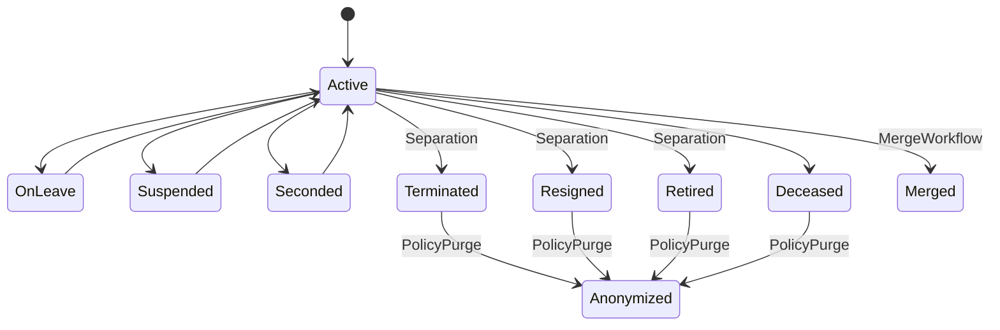

# دورة حياة الموظف (DATA-002)

## الحالات

| الحالة | المعنى |
|---|---|
| `Active` | على رأس العمل |
| `OnLeave` / `Suspended` / `Seconded` | حالات مؤقتة قابلة للعودة إلى Active |
| `Terminated` / `Resigned` / `Retired` | عائلة **Separated** (واجهة/تقارير) — قيم مخزّنة منفصلة |
| `Deceased` | وفاة |
| `Merged` | سجل مكرر أُغلق؛ انظر `MergedIntoEmployeeId` |
| `Anonymized` | PII مُستبدَل وفق سياسة — **ليس** hard delete |

القواعد في `EmploymentStatusRules` / `EmployeeLifecycleService`. الحالات الطرفية لا تُعاد إلا عبر مسار تصحيح إداري (`allowAdminOverride`).

## مصفوفة الأحداث

| حدث | الناشر | أثر HR.Core |
|---|---|---|
| `IEmployeeCreated` | `EmployeeIntegrationService` | تعيين أولي + تاريخ حالة |
| `IEmployeeStatusChanged` | `EmployeeIntegrationService.PublishStatusChangedIfNeededAsync` | يُنشر بعد كل انتقال عبر lifecycle (فصل، anonymize، merge، واجهة التعديل) |
| `ISeparationCompleted` | HR.Contracts | `SeparationCompletedConsumer`: سجل وظيفي + تعيين حالة طرفية (Terminated/Resigned/…) + `IEmployeeStatusChanged` |

## حذف قانوني

- **ممنوع:** hard delete لصف `Employee` (واجهة + API ترفضان).
- **Cascade:** `EmploymentStatusHistory` والسجلات الدليلية على `Restrict` حتى لا يضيع التاريخ إن حاول أحد الحذف.
- **Legal hold:** `Employee.LegalHold` يمنع anonymize/merge.
- **Anonymize / Merge:** `EmployeeLifecycleController` — anonymize يستبدل PII؛ merge يعلّم المصدر فقط داخل HR.Core (نقل الرواتب/العقود خارج النطاق).
- **تصحيح ديموغرافي:** جدول `EmployeeCorrection` (before/after JSON، reason، actor، approver).

## مصالحة اليتامى

`scripts/reconcile-employee-orphans.ps1` — يعدّ `EmployeeId` في Payroll / Contracts / Movements غير الموجودة في HR.Core.
