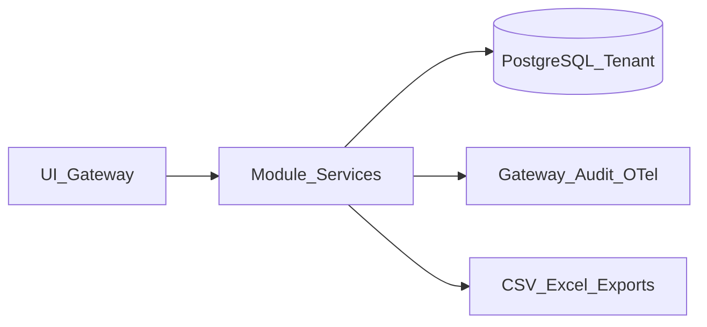

# DPIA — منصة إدارة الموارد البشرية (GOV-001)

| الحقل | القيمة |
|---|---|
| الحالة | **Approved** (منصة؛ ليس NAT-002) |
| البطاقة | GOV-001 |
| التاريخ | 2026-07-28 |
| ADR | [ADR-GOV-001-data-classification-privacy.md](./ADR-GOV-001-data-classification-privacy.md) |

## أغراض المعالجة

تشغيل موارد بشرية حكومية: هوية موظفين، عقود، رواتب، صحة مهنية، شكاوى، أرشفة، ومصادقة.

## تدفق بيانات (عينة)

## مخاطر رئيسية

| خطر | ضابط قائم | فجوة تُغلق |
|---|---|---|
| تسريب الرقم الوطني في تصدير | SEC-002 Lookup | قناع التصدير (B) |
| احتفاظ بلا تدقيق | Audit/File/Inbox jobs | جدول + dry-run (C) |
| نسخ إنتاج لـdev | بذور NFR | سياسة non-prod (D) |
| طلبات الذات | تصحيح موظف | DSAR (E) |

## ضوابط قائمة

Tenant (TEN-001)، AuditRedact، legal hold، anonymize (DATA-002)، PII scrub في OTel، AllowPurge.

## قرار

يُعتمد هذا DPIA للمنصة مع إكمال Stories B–E كضوابط متبقية.
