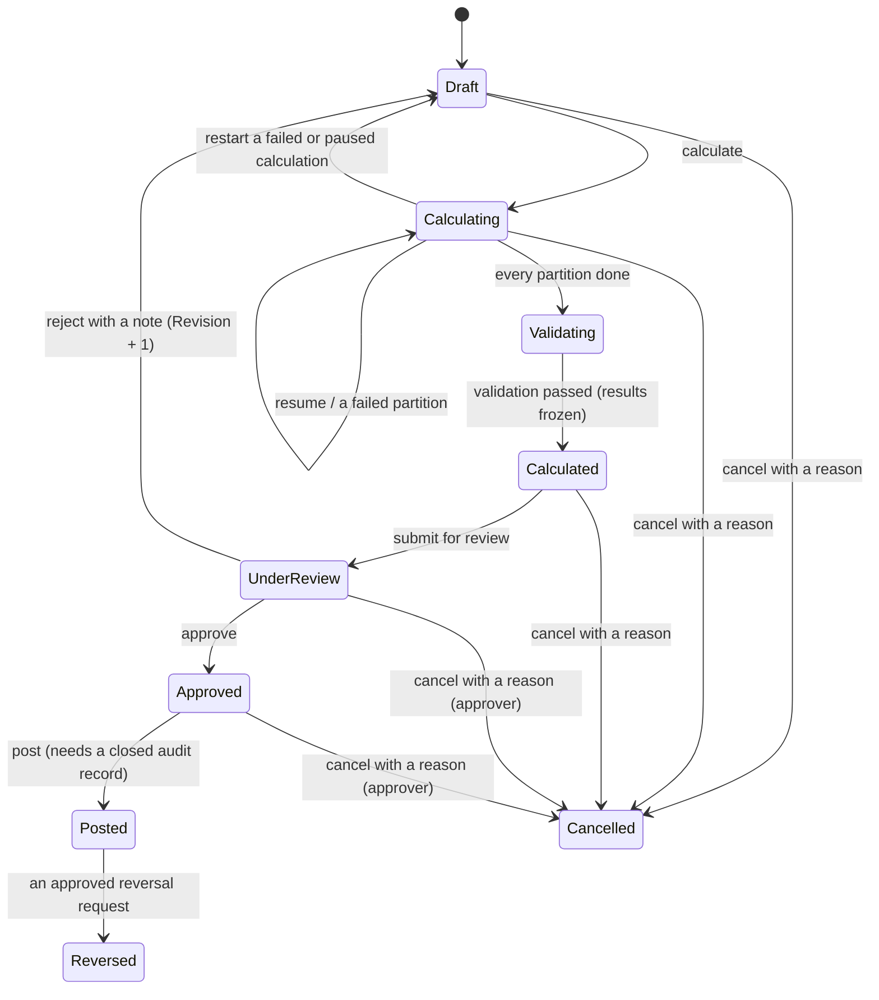

# Payroll Rules — Technical Reference

**Version:** 1.0  
**Scope:** Configurable payroll engine (placeholders until legal confirmation).

## Current vs Target

| Area | Before | Target (implemented) |
|------|--------|----------------------|
| Architecture | MVC → DbContext directly | Domain → Application (MediatR) → Infrastructure → Web |
| Engine | Static `PayrollCalculation` / `PayrollEngine` | `IPayrollEngine` pipeline with ordered `IPayrollRule` plugins |
| Run lifecycle | Pending → Processed → Posted | Draft → Calculating → Validating → Calculated → UnderReview → Approved → Posted → Reversed, with Cancelled (PLAN-56: see «Run Lifecycle») |
| Proration | `PayrollPeriodRules` unused in runs | `BaseSalaryRule` + `AbsenceRule` use working days |
| Tax | Hardcoded brackets | `PayrollConfiguration` + `TaxBracket` entities |
| Pay profile | DB only, broken dashboard link | CRUD UI + `EmployeePayProfileHistory` |
| Events | Marker idempotency | `IntegrationMessageReceipts` + MediatR handlers |
| Corrections | None | `PayrollRunType.Correction`: lines made of the adjustments aimed at the posted run (PLAN-56) |
| Payslips | EmployeeId only PDF | Name lookup + bulk ZIP export |

## Run Lifecycle (PLAN-56)

A run's state is written in one place: `PayrollRun.Move`, through `PayrollRunTransitions` (the table below). Product code
cannot assign a state: `Status` has no setter, a run is constructed as a draft by its two creators (and in a given state by
the seeds only), and no bulk statement updates the runs (`Pay056TransitionTests`, `scripts/pay056-validate.ps1`).



| Act | From | To | Who (policy) | Answers |
|---|---|---|---|---|
| Calculate / resume | Draft, Calculating, Calculated (not frozen) | Calculating → Validating → Calculated | `Payroll.Process` | 400 for any other state: an approved run is never calculated again without a rejection |
| Validate | Calculating, Calculated, Validating | Calculated | `Payroll.Process` | 400 for a run sent for review, approved, posted, reversed or cancelled: a validation revives nothing |
| Submit for review | Calculated (validated) | UnderReview | `Payroll.Process` | 400 |
| Approve | UnderReview | Approved | `Payroll.Approve`, not the run's creator | 400 |
| Reject | UnderReview | Draft | `Payroll.Approve` | 400 without a note or from another state |
| Post | Approved | Posted | `Payroll.Post`, neither creator nor approver | 400 |
| Cancel | any state but Posted, Reversed, Cancelled | Cancelled | `Payroll.RunCancel`; D-PAY-18: the processor before the run was sent for review, the approver after | 400 without a reason or for a posted run; 403 for the processor on a run under review or approved |
| Restart a calculation | a failed or paused job on a run that is not frozen | Draft, then a new calculation | `Payroll.Process` | 400 |
| Request a reversal | Posted | (the run does not move) | `Payroll.Reverse` | 400 without a reason; 409 while a request waits |
| Decide a reversal | Posted | Reversed (approval) | `Payroll.Approve`, neither the requester nor the poster | 400, 409 for a decided request |

Every refusal carries its Arabic message and changes nothing; another agency's run answers 404; a request that lost to
another answers 409. Every API write validates an antiforgery token (`GET api/payroll/run-lifecycle/antiforgery`).

**A rejection reopens the run.** The rejected version is kept as a `PayrollRunRevision` (its number, line count, total, a
SHA-256 fingerprint of its lines, the rejecter and the note); its lines and components are deleted, its inputs released, and
the run is a draft at `Revision + 1`. The processor corrects the inputs and calculates the same run again.

**A cancellation** (D-PAY-18) stops the run's jobs and partitions, releases its inputs, and records who cancelled it, when and
why (`CancelledBy`, `CancelledAt`, `CancellationReason`, and a `PayrollRunApproval` row with the decision `Cancelled`). A
cancelled run keeps its lines as its record; its period is free for a new run (the live-period index leaves cancelled and
reversed runs out). The calculation worker's save checks, in its own transaction, that its job is still running, so nothing
is written after a cancellation; and a resume takes its job by one conditional statement, so a resume that read the job before
a cancellation committed is refused.

**The release of inputs** (`PayrollInputRelease`) frees `DeductionRecord.AppliedInRunId`, `AbsenceDeduction.AppliedInRunId` and
`PayrollAdjustment.PayrollRunId` for the run, and deletes the recovery deductions the run created that no run applied. It
touches the applied markers only. Its callers: the cancellation, the rejection, the restart, the recalculation of a
correction and the reversal. No input stays attached to a cancelled run or a rejected revision.

**A reversal is a request and its decision** (D-PAY-16). The requester gives a reason; another person, who is neither the
requester nor the run's poster, decides. An approval, in one save: every disbursement batch that has not left (`Pending`,
`Failed`, `Rejected`) becomes `Voided` through `PaymentBatchTransitions` and its draft orders `Cancelled`; the inputs are
released; the run is `Reversed`; `IPayrollReversed` is staged in the outbox. If any batch was sent, acknowledged, settled,
processed or returned, or any order left, the decision is refused and nothing changes: what was paid is corrected by a
correction run. No reversal batch is written. A run with a funding decision or a partial batch is neither cancelled nor
reversed here (PLAN-58). A run that has a correction still standing is not reversed, and a posted correction whose recovery
a later run already took is not reversed.

## The net (PLAN-56)

One definition, `PayrollNet` (`Payroll.Domain/Services/PayrollNet.cs`):

```
net = round(max(0, gross − deductions + adjustments))
```

- `SalaryLine.TotalAdjustments` is stored beside `GrossPay`, `TotalDeductions` and `NetPay`; a line's components add up to
  `gross − deductions + adjustments` (an earning positive, a deduction negative, an adjustment with its sign).
- The engine (`RoundingRule`), the validation (`ValidateLineIntegrity`), the posting's check, the payslip, the run's page, the
  reports and the files all read this one net. No other code subtracts deductions from a gross
  (`Pay056NetComputationArchitectureTests`), and a line's net is written by three named writers only.
- The posting checks and writes nothing: the saved lines must still be sound and still add up to the total the validation
  froze, or the posting is refused. What is posted is what was approved.
- Migration `PAY056_NetFormula` filled `TotalAdjustments` from each line's referenced `Adjustment` components and changed no
  stored amount. A line posted before PLAN-56 keeps the net it was posted with.

## The correction run (PLAN-56, D-PAY-17)

- An adjustment can be aimed at one posted run (`PayrollAdjustment.TargetSourceRunId`, chosen on the adjustment's form,
  approved by a second person like any manual input). A regular run never takes a targeted adjustment; the correction of
  that run takes nothing else.
- `POST api/payroll/runs/{id}/corrections` (or «تصحيح رجعي» on the run's page) creates the correction from its source: pinned
  to the source's framework version, one line per employee of the source run who has approved adjustments aimed at it. The
  general creation of a run makes no correction. One correction not yet posted per source run (409 for a second).
- A correction line has no base, no deduction and no tax: only `AdjustmentRule` and `RoundingRule` apply. An adjustment is
  outside the tax and insurance base in a regular run and in a correction alike (D-PAY-17).
- The correction passes the validation a regular run passes before it is marked validated, then goes through review,
  approval and posting like every run. It is not posted beside a source that is no longer posted.
- **A negative difference is not lost.** The line pays nothing, and a `DeductionRecord` of type `CorrectionRecovery` is made
  in the same save for the shortfall: system-made, approved, naming its line, due on the first day of the period after the
  corrected one. A regular run takes it once its correction is posted (until then the correction can still be rejected,
  cancelled or calculated again, and each of those deletes its free recoveries). A recovery larger than that month's net is
  consumed whole: carrying a deduction above the salary is wave 2 (PAY-E).

## Rule Pipeline (deterministic order)

1. **BaseSalaryRule** — profile or PayGrade base; prorate by `EffectiveFrom`/`EffectiveTo` vs period working days  
2. **AllowanceRule** — effective allowances  
3. **AbsenceRule** — unpaid leave / absence deductions in period  
4. **StatutoryDeductionEngineRule** — for a run pinned to a **v2** framework version (PLAN-54): the version's own `StatutoryDeductionRule` rows and nothing else, each `min(base, ceiling) × EmployeePercent / 100 + FixedAmount`, the base being gross pay or the base salary paid this period. For a **v1** version (older than PLAN-54): `DeductionType.IsStatutory` from the general table, on gross pay, exactly as before  
5. **AdHocDeductionRule** — pending `DeductionRecord`  
6. **AdjustmentRule** — unassigned `PayrollAdjustment`  
7. **TaxRule** — progressive brackets from configuration  
8. **RoundingRule** — line totals `MidpointRounding.AwayFromZero`, 2 decimals  

Same inputs → same outputs. Rules do not access the database.

### What a run reads (PLAN-54)

| | v2 version (created, imported or cloned since PLAN-54) | v1 version (legacy) |
|---|---|---|
| Tax brackets | the version's; none means the version is not published | the version's, else the built-in defaults |
| Statutory deductions | the version's `StatutoryDeductionRules` | `DeductionTypes` where `IsStatutory` (general table) |
| Holidays | the version's `OfficialHolidays` | the version's and the general ones |
| Disbursement priority rules | the version's (a funding decision that names another rule set is refused) | the decision's rule set, else the active general rules |
| Insurance export shares | the version's rules that name an `InsuranceBody` | 7% / 14% and the deductions named «تأمين» |
| Interim gate | every STR-002 exception the version cites must be active today (Damascus), at start, at resume and for a correction | none: a v1 version cites nothing |

A v1 version, its fingerprint and every result computed with it are unchanged. The general statutory flag of a deduction type
is read-only on its screens: a statutory deduction now belongs to a framework version.

Manual inputs (PLAN-54 §4): an allowance, a deduction or an adjustment a person enters is `PendingApproval` until a second
person approves it; the loader, corrections and the separation settlement read `Approved` rows only.

## The employee's bank account (PLAN-55)

The destination of an employee's pay is an `EmployeeBankAccount`, not a field of the pay profile (the three old profile columns are
`[Obsolete]`, unread, and stay only for a rollback).

| State | How it is reached |
|-------|-------------------|
| `PendingVerification` | a payroll processor (`Payroll.Process`) registers the account; migration `PAY055` moved any number an older build left on a profile here, with no registrar |
| `Active` | a payroll approver (`Payroll.Approve`) **who is not the registrar** verifies it with the reference of the bank's confirmation (mandatory); the account that was in force becomes `Retired` in the same save |
| `Rejected` | an approver rejects a pending account, with a reason |
| `Retired` | an approver retires the account in force, with a reason; or its replacement is verified |

- **The identifier (D-PAY-11).** An IBAN is always accepted after the ISO 13616 check: its form, 15 to 34 characters, check digits
  02 to 98, mod 97 = 1. No length per country is assumed (Syria is outside the IBAN registry). A local account number is accepted
  only for a bank defined in `Payroll:Bank:Banks` (`Code`, `NameAr`, `AccountRegex`, matched whole). The list is **empty** in
  Production, Staging and the prod-like stack until the bank file is adopted (SYD-014): there, only an IBAN is accepted. The service
  refuses to start on a list it cannot use (a pattern that does not compile, a code twice).
- **One in force, one waiting.** One `Active` and one `PendingVerification` account per employee and agency
  (`IX_EmployeeBankAccounts_OneActiveOnePending`). A change of account is a new registration; the account in force stays in force
  until its replacement is verified. An account with no known registrar is never verified: it is rejected and registered again.
- **The answers.** A broken input rule 400; the registrar verifying his own registration 400; a second waiting account, a wrong
  state, a concurrent decision 409; an employee or account outside the caller's branch scope or agency 404. Every refusal is an
  Arabic message and changes nothing. Every write of the API validates an antiforgery token (`GET api/payroll/bank-accounts/antiforgery`).
- **The number is never shown whole** except on the approver's verification page, to a person who can verify it (never cached).
  Lists, the API and every other page show its last four characters. It is redacted in the entity audit log and written to no log
  line, error message, hold reason or URL. Each act is also a `PayrollOverride` security audit event that names the account's id only.

### The account a run pins (D-PAY-15)

- A run takes each employee's `Active` account **at its snapshot** (`PayrollRunInputSnapshot.BankAccountId`); the salary line copies
  it (`SalaryLine.BankAccountId`). A correction run, which writes no snapshot rows, pins the account in force when it is computed.
  The account is not an input of the amount: it is in neither the input fingerprint nor the profile version.
- **Every reader takes the line's account**, never the profile and never «the current account»: payment orders
  (`BeneficiaryIban`; a local number goes there too), the treasury file, FR-04 (one account shared by several employees), the
  readiness report. An account that changes after the calculation applies from the next cycle — or from this run if it is
  calculated again before it is frozen.
- **The readiness report**: `GET api/payroll/runs/{id}/bank-readiness` and the card on the run's page: the lines with a pinned
  account, the employees with none (ids on the API, names on the page), the lines whose pinned account was retired since, and which
  of those are still held. A line without an account blocks neither the calculation nor the approval; the treasury file is refused
  while one exists, naming the employees (leaving them out of the batch and the file is PLAN-58's).
- **Retiring a pinned account.** A retirement, whatever caused it, places one `Manual` payment hold per run on the employee,
  `ACCOUNT-RETIRED:` at the start of its reason, for every run that pinned the account and has not disbursed his line: a line that
  carries it, or a snapshot that carries it while his line is not written yet. «Disbursed» = a payment order of the line left for
  the channel (`Submitted`, `Acknowledged`, `Settled`, `PartiallySettled`) in a batch the channel did not reject, return, fail or
  reverse. A reversed or cancelled run gets none.
- **While that hold is active nothing is paid to the retired account:** the disbursement gate refuses the batch and the treasury
  file is refused. Both also refuse a retired pinned account that has no hold at all. Releasing the hold (the existing four-eyes
  release) is a person's decision to pay the account the line pinned. An approver's action that re-pins a frozen line is PLAN-58's.

### Pay profile versions (PLAN-55)

`EmployeePayProfileVersioning.CreateNextVersion` is the only place a pay profile is made (the seed apart). It starts from the profile
in force, else from the employee's latest profile, and makes the first one when there is none. It carries the unit and the regime
always; the salary and the grade only from a version in force. It closes an open previous version the day before the new one
starts. The activation of a contract goes through `IPayProfileChangeApplier.ApplySystemChangeAsync` (see
[PAYROLL_SALARY_CHANGE.md](./PAYROLL_SALARY_CHANGE.md)). Old profiles are repaired by
`POST api/payroll/admin/backfill-profile-orgunit` (`scripts/pay055-backfill-profile-orgunit.ps1`, dry run first; policy
`Payroll.Repair`, central only; on Production it signs in with a session cookie or a token, as
[OPS_VPS_SINGLE_HOST.md](./OPS_VPS_SINGLE_HOST.md) shows). It copies from the employee's own history only and invents no value.

## Configuration

Demo and acceptance seeds write v1 versions. A production agency (`Seed:Profile=None`) has none: it imports a legal pack
(`docs/syr/payroll-framework-packs/`), and three people approve, attest and publish it — see
[PAYROLL_CONFIG_VERSIONING.md](./PAYROLL_CONFIG_VERSIONING.md). Each of the nineteen governed fields then carries its legal
reference and status inside the version.

| Setting | Default | Notes |
|---------|---------|-------|
| `ProrationDaysBasis` | WorkingDays | GOV-002: LD-PRORATION-BASIS |
| `DailyRateDivisor` | 30 | GOV-002: LD-DAILY-DIVISOR |
| `MissionAllowanceAmount` | 0 | GOV-002: LD-MISSION-ALLOWANCE |
| `SecondmentAllowancePercent` | 0 | GOV-002: LD-SECONDMENT-PERCENT |
| `EnableTrainingPremiums` | false | GOV-002: LD-TRAINING-PREMIUM |
| `TrainingPremiumAmount` | 0 | GOV-002: LD-TRAINING-PREMIUM |

## Rounding

- Component amounts: rounded per rule application where applicable  
- Line `GrossPay`, `TotalDeductions`, `TotalAdjustments`, `NetPay`: single final pass in `RoundingRule`; the net is `PayrollNet`'s under the pinned framework's rounding  
- Policy: `MidpointRounding.AwayFromZero`, scale 2 — **LD-ROUNDING**

## Attendance: the receipt, the difference, the carry, the refund and the gate (PLAN-57)

HR.Core publishes each version of an employee's attendance summary for a period (`IAttendanceSummaryPublished`: absolute counts,
version 1 at the close, +1 per approved correction — [HCM_002_ATTENDANCE.md](./HCM_002_ATTENDANCE.md)). Payroll's side:

- **The receipt** (`AttendanceSummaryReceipt`, one per summary): the latest version seen, its absent days, and the absent days
  payroll has recorded for it. The consumer (`AttendanceSummaryPublishedConsumer`, through `AttendanceSummaryHandoff`) inserts it
  if new, locks it (`FOR UPDATE`), and works in one transaction with its inbox receipt.
- **A version is recorded once.** A version not newer than the receipt's is ignored (a redelivery, or an older version arriving
  late). The tenant of the receipt and of the row is the message's.
- **The difference:** `AbsentDays(version) − RecordedAbsentDays`. Zero writes no row (the receipt alone says the employee is
  closed). Otherwise one `AbsenceDeduction` with `SourceReference = ATT:{SummaryId}:v{Version}` (unique), `SourceVersion`,
  `OriginalPeriodStart/End` = the attendance period, and the difference in `AbsentDays` — negative for a refund. The amount is
  computed by the run that applies it, from that run's daily rate (the historical wage of a carried difference is PAY-H's).
- **The freeze** (`PayrollAttendanceFreeze`, the one reader of PLAN-56's guards for this): the period's regular run is calculated
  and validated, under review, approved or posted. A difference recorded then is marked `CarryForward`.
- **Who applies a row:** a row that is not carried belongs to its own period's regular run. A carried row is taken by the first
  regular run calculated after it, whatever its period, as «فرق غياب عن فترة yyyy-MM»; the frozen run never changes. A row the
  consumer left unmarked an instant before its period's run froze is taken the same way. A cancellation, a rejection or a
  reversal frees what the run applied (PLAN-56's release), and the next calculation takes it again. The row carries a row version
  (`xmin`): of two runs that calculate at once, one marks it.
- **The refund:** `AbsenceRule` consumes every row it reads. Negative days give a deduction component with a positive amount,
  «استرداد خصم غياب — فترة yyyy-MM».
- **The gate** (`Payroll:Attendance:Gate`; `PayrollAttendanceGate`), at the start of a regular run's calculation, before the run
  moves. «Not closed» is an employee the run gives a line to (an active pay profile) with no receipt whose period overlaps the
  run's.

  | Mode | A calculation while someone is not closed |
  |---|---|
  | `Warn` (default, D-LVA-10) | runs; one **open** audit record of the run carries the count and the employees. It is not a review: it has no auditor, the screens do not close it, and a closed one would not let the run be posted. A recalculation refreshes it, and removes it once everyone is closed |
  | `Block` | is refused with the count; the run stays as it was (no job row, no pinned framework, no audit record) |
  | `Off` | no check |

  A correction run and a final settlement are exempt. Under `Block`, an employee payroll pays whom HR.Core will never close for
  that month (HR.Core holds him as hired later, or as having left earlier) holds the run back until his pay profile says the
  same as HR.Core.
- **Reads:** `GET api/payroll/runs/{id}/attendance-status` (`gateMode`, `employeesInScope`, `missingAttendance`,
  `carryForwardApplied`, `carryForwardPending`) and `GET api/payroll/attendance/receipts?periodStart=yyyy-MM-dd`; the run's page
  shows the same under «الحضور», with names.

## Event Integration

| Event | Payroll action |
|-------|----------------|
| `IContractActivated` | An `Applied` salary change request of source `ContractActivated` (the contract's id in `SourceReference`) and a new profile version through `CreateNextVersion`: the prior version closed the day before, unit and regime kept; PAY-029's holds as before |
| `ISeparationCompleted` | Deactivate profile; EOS settlement; final deductions |
| `ITransferExecuted` | Update profile salary; single adjustment if salary change |
| `ILeaveApproved` | Unpaid leave deduction (configurable daily rate) |
| `IAttendanceSummaryPublished` | One difference row per summary version, applied once (the section above). It replaces `IAttendancePeriodClosed`, whose consumer is gone |
| `IAdvanceApproved` | Installment `DeductionRecord` rows |
| `ISecondmentExecuted` / `IMissionApproved` | Configurable allowance adjustment |
| `IDisciplinaryActionTaken` | Penalty day deduction |
| `ITrainingCompleted` | Optional premium allowance (feature flag) |
| `IEmployeeCreated` | The first, inactive, unpriced profile (unit and regime), dated today in the payroll calendar; arriving late, it fills the empty unit and regime of the employee's current profile and overwrites nothing |

## Legal decisions (GOV-002)

Former confirmation items are bound in [GOV_002_LEGAL_DECISION_REGISTER.md](./GOV_002_LEGAL_DECISION_REGISTER.md) / `docs/legal-decisions/register.json`. Law50 rows are **ApprovedInterim**; CIVIL_SERVICE_2026 remains **PendingEnactment**.

| # | Item | decisionId |
|---|------|------------|
| 1 | Income tax brackets and exemption | LD-TAX-BRACKETS, LD-TAX-EXEMPTION |
| 2 | Taxable base | LD-TAXABLE-BASE |
| 3 | EOS gratuity formula | LD-EOS-FORMULA |
| 4 | Daily rate / proration basis | LD-DAILY-DIVISOR, LD-PRORATION-BASIS |
| 5 | Weekend non-working days | LD-NON-WORKING-DAYS |
| 6 | Official holidays | LD-OFFICIAL-HOLIDAYS |
| 7 | Mission/secondment allowances | LD-MISSION-ALLOWANCE, LD-SECONDMENT-PERCENT |
| 8 | Training premium | LD-TRAINING-PREMIUM |
| 9–10 | Advances | HR.Contracts (out of payroll config register) |
| 11 | Retro correction limit | LD-RETRO-MONTHS (enforced) |
| 12 | Approval levels | IAM/PayrollApprove policy (ops; not LEGAL path) |

*Update the register when legal owners change ApprovedInterim → gazette-backed status (SYR/NAT).*
