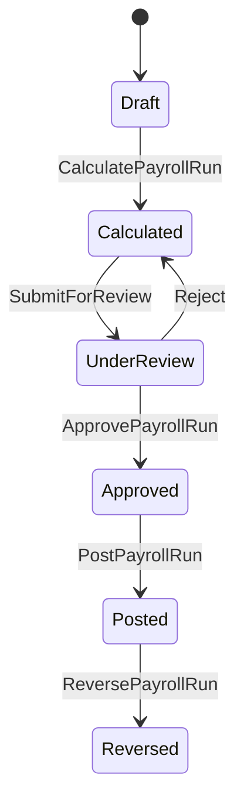

# Payroll Rules — Technical Reference

**Version:** 1.0  
**Scope:** Configurable payroll engine (placeholders until legal confirmation).

## Current vs Target

| Area | Before | Target (implemented) |
|------|--------|----------------------|
| Architecture | MVC → DbContext directly | Domain → Application (MediatR) → Infrastructure → Web |
| Engine | Static `PayrollCalculation` / `PayrollEngine` | `IPayrollEngine` pipeline with ordered `IPayrollRule` plugins |
| Run lifecycle | Pending → Processed → Posted | Draft → Calculated → UnderReview → Approved → Posted → Reversed |
| Proration | `PayrollPeriodRules` unused in runs | `BaseSalaryRule` + `AbsenceRule` use working days |
| Tax | Hardcoded brackets | `PayrollConfiguration` + `TaxBracket` entities |
| Pay profile | DB only, broken dashboard link | CRUD UI + `EmployeePayProfileHistory` |
| Events | Marker idempotency | `IntegrationMessageReceipts` + MediatR handlers |
| Corrections | None | `PayrollRunType.Correction` with delta lines |
| Payslips | EmployeeId only PDF | Name lookup + bulk ZIP export |

## Run Lifecycle

## Rule Pipeline (deterministic order)

1. **BaseSalaryRule** — profile or PayGrade base; prorate by `EffectiveFrom`/`EffectiveTo` vs period working days  
2. **AllowanceRule** — effective allowances  
3. **AbsenceRule** — unpaid leave / absence deductions in period  
4. **StatutoryDeductionRule** — `DeductionType.IsStatutory`  
5. **AdHocDeductionRule** — pending `DeductionRecord`  
6. **AdjustmentRule** — unassigned `PayrollAdjustment`  
7. **TaxRule** — progressive brackets from configuration  
8. **RoundingRule** — line totals `MidpointRounding.AwayFromZero`, 2 decimals  

Same inputs → same outputs. Rules do not access the database.

## Configuration

Default seed in `PayrollConfiguration` (see migration). Override via DB admin UI or seed.

| Setting | Default | Notes |
|---------|---------|-------|
| `ProrationDaysBasis` | WorkingDays | GOV-002: LD-PRORATION-BASIS |
| `DailyRateDivisor` | 30 | GOV-002: LD-DAILY-DIVISOR |
| `MissionAllowanceAmount` | 0 | GOV-002: LD-MISSION-ALLOWANCE |
| `SecondmentAllowancePercent` | 0 | GOV-002: LD-SECONDMENT-PERCENT |
| `EnableTrainingPremiums` | false | GOV-002: LD-TRAINING-PREMIUM |
| `TrainingPremiumAmount` | 0 | GOV-002: LD-TRAINING-PREMIUM |

## Rounding

- Component amounts: rounded per rule application where applicable  
- Line `GrossPay`, `TotalDeductions`, `NetPay`: single final pass in `RoundingRule`  
- Policy: `MidpointRounding.AwayFromZero`, scale 2 — **LD-ROUNDING**

## Event Integration

| Event | Payroll action |
|-------|----------------|
| `IContractActivated` | Close prior profile; upsert profile + history |
| `ISeparationCompleted` | Deactivate profile; EOS settlement; final deductions |
| `ITransferExecuted` | Update profile salary; single adjustment if salary change |
| `ILeaveApproved` | Unpaid leave deduction (configurable daily rate) |
| `IAdvanceApproved` | Installment `DeductionRecord` rows |
| `ISecondmentExecuted` / `IMissionApproved` | Configurable allowance adjustment |
| `IDisciplinaryActionTaken` | Penalty day deduction |
| `ITrainingCompleted` | Optional premium allowance (feature flag) |
| `IEmployeeCreated` | Draft pay profile |

## Legal decisions (GOV-002)

Former confirmation items are bound in [GOV_002_LEGAL_DECISION_REGISTER.md](./GOV_002_LEGAL_DECISION_REGISTER.md) / `docs/legal-decisions/register.json`. Law50 rows are **ApprovedInterim**; CIVIL_SERVICE_2026 remains **PendingEnactment**.

| # | Item | decisionId |
|---|------|------------|
| 1 | Income tax brackets and exemption | LD-TAX-BRACKETS, LD-TAX-EXEMPTION |
| 2 | Taxable base | LD-TAXABLE-BASE |
| 3 | EOS gratuity formula | LD-EOS-FORMULA |
| 4 | Daily rate / proration basis | LD-DAILY-DIVISOR, LD-PRORATION-BASIS |
| 5 | Weekend non-working days | LD-NON-WORKING-DAYS |
| 6 | Official holidays | LD-OFFICIAL-HOLIDAYS |
| 7 | Mission/secondment allowances | LD-MISSION-ALLOWANCE, LD-SECONDMENT-PERCENT |
| 8 | Training premium | LD-TRAINING-PREMIUM |
| 9–10 | Advances | HR.Contracts (out of payroll config register) |
| 11 | Retro correction limit | LD-RETRO-MONTHS (enforced) |
| 12 | Approval levels | IAM/PayrollApprove policy (ops; not LEGAL path) |

*Update the register when legal owners change ApprovedInterim → gazette-backed status (SYR/NAT).*
