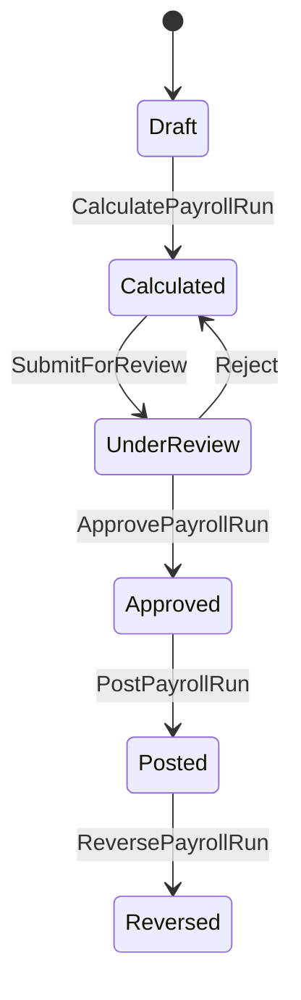

# Payroll Rules — Technical Reference

**Version:** 1.0  
**Scope:** Configurable payroll engine (placeholders until legal confirmation).

## Current vs Target

| Area | Before | Target (implemented) |
|------|--------|----------------------|
| Architecture | MVC → DbContext directly | Domain → Application (MediatR) → Infrastructure → Web |
| Engine | Static `PayrollCalculation` / `PayrollEngine` | `IPayrollEngine` pipeline with ordered `IPayrollRule` plugins |
| Run lifecycle | Pending → Processed → Posted | Draft → Calculated → UnderReview → Approved → Posted → Reversed |
| Proration | `PayrollPeriodRules` unused in runs | `BaseSalaryRule` + `AbsenceRule` use working days |
| Tax | Hardcoded brackets | `PayrollConfiguration` + `TaxBracket` entities |
| Pay profile | DB only, broken dashboard link | CRUD UI + `EmployeePayProfileHistory` |
| Events | Marker idempotency | `IntegrationMessageReceipts` + MediatR handlers |
| Corrections | None | `PayrollRunType.Correction` with delta lines |
| Payslips | EmployeeId only PDF | Name lookup + bulk ZIP export |

## Run Lifecycle

## Rule Pipeline (deterministic order)

1. **BaseSalaryRule** — profile or PayGrade base; prorate by `EffectiveFrom`/`EffectiveTo` vs period working days  
2. **AllowanceRule** — effective allowances  
3. **AbsenceRule** — unpaid leave / absence deductions in period  
4. **StatutoryDeductionEngineRule** — for a run pinned to a **v2** framework version (PLAN-54): the version's own `StatutoryDeductionRule` rows and nothing else, each `min(base, ceiling) × EmployeePercent / 100 + FixedAmount`, the base being gross pay or the base salary paid this period. For a **v1** version (older than PLAN-54): `DeductionType.IsStatutory` from the general table, on gross pay, exactly as before  
5. **AdHocDeductionRule** — pending `DeductionRecord`  
6. **AdjustmentRule** — unassigned `PayrollAdjustment`  
7. **TaxRule** — progressive brackets from configuration  
8. **RoundingRule** — line totals `MidpointRounding.AwayFromZero`, 2 decimals  

Same inputs → same outputs. Rules do not access the database.

### What a run reads (PLAN-54)

| | v2 version (created, imported or cloned since PLAN-54) | v1 version (legacy) |
|---|---|---|
| Tax brackets | the version's; none means the version is not published | the version's, else the built-in defaults |
| Statutory deductions | the version's `StatutoryDeductionRules` | `DeductionTypes` where `IsStatutory` (general table) |
| Holidays | the version's `OfficialHolidays` | the version's and the general ones |
| Disbursement priority rules | the version's (a funding decision that names another rule set is refused) | the decision's rule set, else the active general rules |
| Insurance export shares | the version's rules that name an `InsuranceBody` | 7% / 14% and the deductions named «تأمين» |
| Interim gate | every STR-002 exception the version cites must be active today (Damascus), at start, at resume and for a correction | none: a v1 version cites nothing |

A v1 version, its fingerprint and every result computed with it are unchanged. The general statutory flag of a deduction type
is read-only on its screens: a statutory deduction now belongs to a framework version.

Manual inputs (PLAN-54 §4): an allowance, a deduction or an adjustment a person enters is `PendingApproval` until a second
person approves it; the loader, corrections and the separation settlement read `Approved` rows only.

## The employee's bank account (PLAN-55)

The destination of an employee's pay is an `EmployeeBankAccount`, not a field of the pay profile (the three old profile columns are
`[Obsolete]`, unread, and stay only for a rollback).

| State | How it is reached |
|-------|-------------------|
| `PendingVerification` | a payroll processor (`Payroll.Process`) registers the account; migration `PAY055` moved any number an older build left on a profile here, with no registrar |
| `Active` | a payroll approver (`Payroll.Approve`) **who is not the registrar** verifies it with the reference of the bank's confirmation (mandatory); the account that was in force becomes `Retired` in the same save |
| `Rejected` | an approver rejects a pending account, with a reason |
| `Retired` | an approver retires the account in force, with a reason; or its replacement is verified |

- **The identifier (D-PAY-11).** An IBAN is always accepted after the ISO 13616 check: its form, 15 to 34 characters, check digits
  02 to 98, mod 97 = 1. No length per country is assumed (Syria is outside the IBAN registry). A local account number is accepted
  only for a bank defined in `Payroll:Bank:Banks` (`Code`, `NameAr`, `AccountRegex`, matched whole). The list is **empty** in
  Production, Staging and the prod-like stack until the bank file is adopted (SYD-014): there, only an IBAN is accepted. The service
  refuses to start on a list it cannot use (a pattern that does not compile, a code twice).
- **One in force, one waiting.** One `Active` and one `PendingVerification` account per employee and agency
  (`IX_EmployeeBankAccounts_OneActiveOnePending`). A change of account is a new registration; the account in force stays in force
  until its replacement is verified. An account with no known registrar is never verified: it is rejected and registered again.
- **The answers.** A broken input rule 400; the registrar verifying his own registration 400; a second waiting account, a wrong
  state, a concurrent decision 409; an employee or account outside the caller's branch scope or agency 404. Every refusal is an
  Arabic message and changes nothing. Every write of the API validates an antiforgery token (`GET api/payroll/bank-accounts/antiforgery`).
- **The number is never shown whole** except on the approver's verification page, to a person who can verify it (never cached).
  Lists, the API and every other page show its last four characters. It is redacted in the entity audit log and written to no log
  line, error message, hold reason or URL. Each act is also a `PayrollOverride` security audit event that names the account's id only.

### The account a run pins (D-PAY-15)

- A run takes each employee's `Active` account **at its snapshot** (`PayrollRunInputSnapshot.BankAccountId`); the salary line copies
  it (`SalaryLine.BankAccountId`). A correction run, which writes no snapshot rows, pins the account in force when it is computed.
  The account is not an input of the amount: it is in neither the input fingerprint nor the profile version.
- **Every reader takes the line's account**, never the profile and never «the current account»: payment orders
  (`BeneficiaryIban`; a local number goes there too), the treasury file, FR-04 (one account shared by several employees), the
  readiness report. An account that changes after the calculation applies from the next cycle — or from this run if it is
  calculated again before it is frozen.
- **The readiness report**: `GET api/payroll/runs/{id}/bank-readiness` and the card on the run's page: the lines with a pinned
  account, the employees with none (ids on the API, names on the page), the lines whose pinned account was retired since, and which
  of those are still held. A line without an account blocks neither the calculation nor the approval; the treasury file is refused
  while one exists, naming the employees (leaving them out of the batch and the file is PLAN-58's).
- **Retiring a pinned account.** A retirement, whatever caused it, places one `Manual` payment hold per run on the employee,
  `ACCOUNT-RETIRED:` at the start of its reason, for every run that pinned the account and has not disbursed his line: a line that
  carries it, or a snapshot that carries it while his line is not written yet. «Disbursed» = a payment order of the line left for
  the channel (`Submitted`, `Acknowledged`, `Settled`, `PartiallySettled`) in a batch the channel did not reject, return, fail or
  reverse. A reversed or cancelled run gets none.
- **While that hold is active nothing is paid to the retired account:** the disbursement gate refuses the batch and the treasury
  file is refused. Both also refuse a retired pinned account that has no hold at all. Releasing the hold (the existing four-eyes
  release) is a person's decision to pay the account the line pinned. An approver's action that re-pins a frozen line is PLAN-58's.

### Pay profile versions (PLAN-55)

`EmployeePayProfileVersioning.CreateNextVersion` is the only place a pay profile is made (the seed apart). It starts from the profile
in force, else from the employee's latest profile, and makes the first one when there is none. It carries the unit and the regime
always; the salary and the grade only from a version in force. It closes an open previous version the day before the new one
starts. The activation of a contract goes through `IPayProfileChangeApplier.ApplySystemChangeAsync` (see
[PAYROLL_SALARY_CHANGE.md](./PAYROLL_SALARY_CHANGE.md)). Old profiles are repaired by
`POST api/payroll/admin/backfill-profile-orgunit` (`scripts/pay055-backfill-profile-orgunit.ps1`, dry run first; policy
`Payroll.Repair`, central only; on Production it signs in with a session cookie or a token, as
[OPS_VPS_SINGLE_HOST.md](./OPS_VPS_SINGLE_HOST.md) shows). It copies from the employee's own history only and invents no value.

## Configuration

Demo and acceptance seeds write v1 versions. A production agency (`Seed:Profile=None`) has none: it imports a legal pack
(`docs/syr/payroll-framework-packs/`), and three people approve, attest and publish it — see
[PAYROLL_CONFIG_VERSIONING.md](./PAYROLL_CONFIG_VERSIONING.md). Each of the nineteen governed fields then carries its legal
reference and status inside the version.

| Setting | Default | Notes |
|---------|---------|-------|
| `ProrationDaysBasis` | WorkingDays | GOV-002: LD-PRORATION-BASIS |
| `DailyRateDivisor` | 30 | GOV-002: LD-DAILY-DIVISOR |
| `MissionAllowanceAmount` | 0 | GOV-002: LD-MISSION-ALLOWANCE |
| `SecondmentAllowancePercent` | 0 | GOV-002: LD-SECONDMENT-PERCENT |
| `EnableTrainingPremiums` | false | GOV-002: LD-TRAINING-PREMIUM |
| `TrainingPremiumAmount` | 0 | GOV-002: LD-TRAINING-PREMIUM |

## Rounding

- Component amounts: rounded per rule application where applicable  
- Line `GrossPay`, `TotalDeductions`, `NetPay`: single final pass in `RoundingRule`  
- Policy: `MidpointRounding.AwayFromZero`, scale 2 — **LD-ROUNDING**

## Event Integration

| Event | Payroll action |
|-------|----------------|
| `IContractActivated` | An `Applied` salary change request of source `ContractActivated` (the contract's id in `SourceReference`) and a new profile version through `CreateNextVersion`: the prior version closed the day before, unit and regime kept; PAY-029's holds as before |
| `ISeparationCompleted` | Deactivate profile; EOS settlement; final deductions |
| `ITransferExecuted` | Update profile salary; single adjustment if salary change |
| `ILeaveApproved` | Unpaid leave deduction (configurable daily rate) |
| `IAdvanceApproved` | Installment `DeductionRecord` rows |
| `ISecondmentExecuted` / `IMissionApproved` | Configurable allowance adjustment |
| `IDisciplinaryActionTaken` | Penalty day deduction |
| `ITrainingCompleted` | Optional premium allowance (feature flag) |
| `IEmployeeCreated` | The first, inactive, unpriced profile (unit and regime), dated today in the payroll calendar; arriving late, it fills the empty unit and regime of the employee's current profile and overwrites nothing |

## Legal decisions (GOV-002)

Former confirmation items are bound in [GOV_002_LEGAL_DECISION_REGISTER.md](./GOV_002_LEGAL_DECISION_REGISTER.md) / `docs/legal-decisions/register.json`. Law50 rows are **ApprovedInterim**; CIVIL_SERVICE_2026 remains **PendingEnactment**.

| # | Item | decisionId |
|---|------|------------|
| 1 | Income tax brackets and exemption | LD-TAX-BRACKETS, LD-TAX-EXEMPTION |
| 2 | Taxable base | LD-TAXABLE-BASE |
| 3 | EOS gratuity formula | LD-EOS-FORMULA |
| 4 | Daily rate / proration basis | LD-DAILY-DIVISOR, LD-PRORATION-BASIS |
| 5 | Weekend non-working days | LD-NON-WORKING-DAYS |
| 6 | Official holidays | LD-OFFICIAL-HOLIDAYS |
| 7 | Mission/secondment allowances | LD-MISSION-ALLOWANCE, LD-SECONDMENT-PERCENT |
| 8 | Training premium | LD-TRAINING-PREMIUM |
| 9–10 | Advances | HR.Contracts (out of payroll config register) |
| 11 | Retro correction limit | LD-RETRO-MONTHS (enforced) |
| 12 | Approval levels | IAM/PayrollApprove policy (ops; not LEGAL path) |

*Update the register when legal owners change ApprovedInterim → gazette-backed status (SYR/NAT).*
