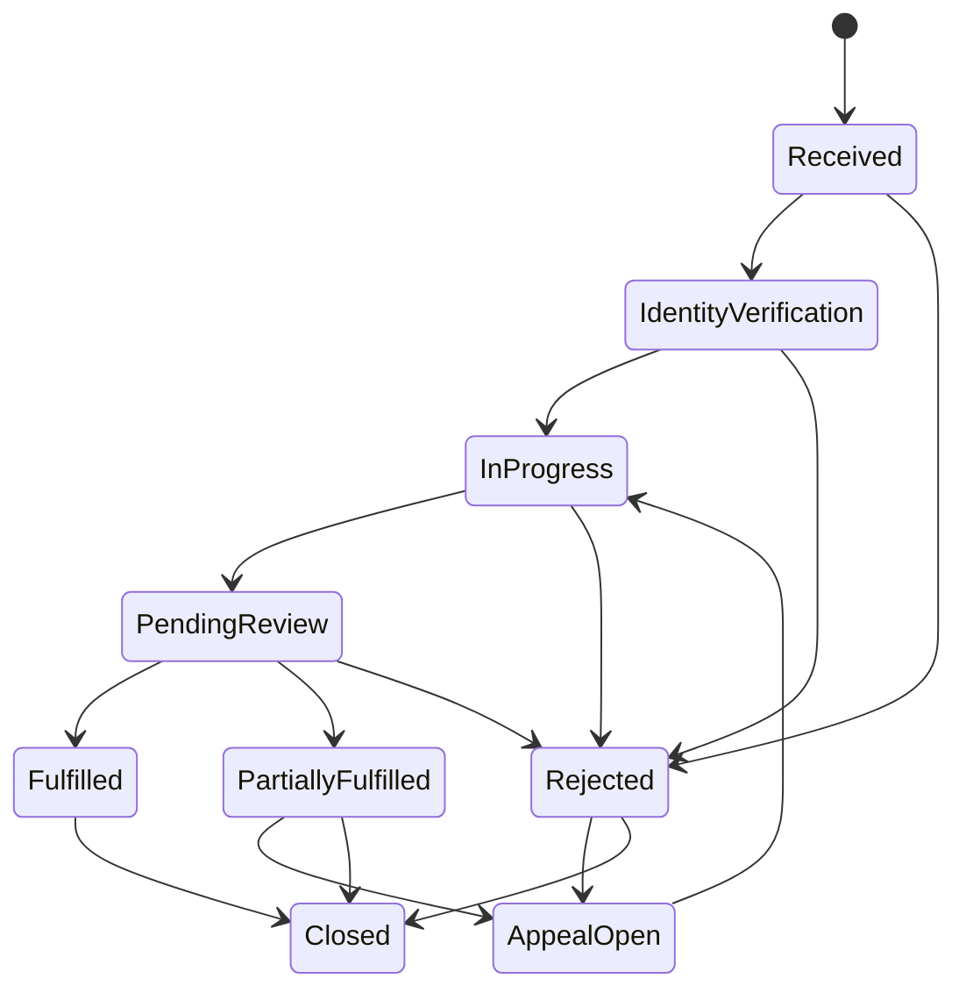

# PRV-002 — Individual rights / DSAR

**Card:** PRV-002 (P1-National)  
**Status:** Done  
**Scope:** Access, correction, restriction, deletion, objection, and appeal workflows with identity proof, cross-service discovery, SLA deadlines, exceptions, and independent appeal.

## Legal rights covered

| Right | RequestType | Default SLA |
|-------|-------------|-------------|
| Access (copy of data) | `Access` | 30 days |
| Correction (rectification) | `Correction` | 30 days |
| Restriction of processing | `Restriction` | 30 days |
| Erasure (where applicable) | `Deletion` | 45 days |
| Objection to processing | `Objection` | 30 days |
| Appeal of prior decision | `Appeal` | 30 days |

## Architecture

| Component | Location |
|-----------|----------|
| National entity contract | `HRManagement.SharedKernel/Privacy/DsarRequest.cs` |
| Workflow rules | `DsarWorkflowRules` (transitions + SLA) |
| Service contract | `HRManagement.ServiceDefaults/Privacy/IDsarService.cs` |
| Stub implementation | `DsarService` (in-memory; Compliance persists in production) |
| Workflow definition | [`prv/dsar-workflow.json`](./prv/dsar-workflow.json) |
| GOV-001 bridge | Compliance `DsarRequestsController` / `api/dsar` |

## Workflow summary



## Discovery scope

On `InProgress`, operators run discovery across ROPA-aligned services (see PRV-001). Stub returns 11 national services; production queries service registry + file/analytics indexes per [`DATA_CLASSIFICATION_INVENTORY.md`](./DATA_CLASSIFICATION_INVENTORY.md).

**No direct DB edits** — corrections propagate via domain services preserving provenance (MDM-002 / DATA-002).

## Exceptions

When third-party rights, legal hold (LEG-001), or statutory exemption applies:

- Set `ExceptionCode` + `ExceptionReason`
- Status → `PartiallyFulfilled` or `Rejected`
- Subject may open `Appeal` (`AppealOpen` → independent reviewer)

## Identity proof

- `SubjectId` when employee record known
- `SubjectNationalIdHash` (SHA-256) when identity pending linkage — never store raw national ID
- `IdentityProofMethod` documents verification channel

## SLA measurement

- `DeadlineUtc` computed at submit via `DsarWorkflowRules.ComputeDeadlineUtc`
- Configurable per tenant in production; defaults in workflow JSON
- Overdue requests flagged for Privacy Operations dashboard

## Dependencies

- **PRV-001** — ROPA defines discoverable processing activities
- **DATA-002** — correction provenance and lineage
- **ANA-001** — analytics subject access and restriction

## Validation

```powershell
./scripts/prv002-validate.ps1
dotnet test --filter Prv002DsarTests
```
