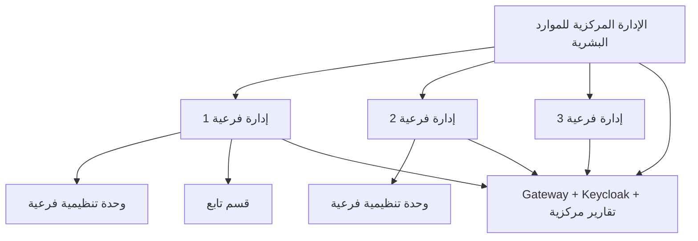

# أطروحة مشروع التخرج

---

## نموذج (1) - صفحة الغلاف العربية

<div align="center">

**الجمهورية العربية السورية**

**جامعة الشمال الخاصة**

**كلية الهندسة المعلوماتية**

**قسم هندسة البرمجيات ونظم المعلومات**

<br><br>

# نظام إدارة الموارد البشرية المتكامل
## HRManagement

<br>

**مشروع تخرج أُعد لنيل درجة الإجازة في الهندسة المعلوماتية**

**باختصاص هندسة البرمجيات ونظم المعلومات**

<br>

**إعداد الطلاب**

| | |
|---|---|
| عمر أحمد الخطاب | علي صالح أحمد الدحو |
| علي مصطفى السعيد | عبدالرحمن هيثم طحان |

<br>

**بإشراف**

**د. ماهر دبساوي**

<br>

**العام الدراسي 2025 - 2026**

</div>

---

## نموذج (2) - English Cover Page

<div align="center">

**Syrian Arab Republic**

**North Private University**

**Faculty of Informatics Engineering**

**Department of Software Engineering and Information Systems**

<br><br>

# Integrated Human Resources Management System
## HRManagement

<br>

**Graduation Project prepared to obtain bachelor's degree**

**of Informatics Engineering / Software Engineering and Information Systems**

<br>

**Prepared by**

| | |
|---|---|
| Omar Ahmad Al-Khattab | Ali Saleh Ahmad Al-Dahou |
| Ali Mustafa Al-Saeed | Abdulrahman Haitham Tahhan |

<br>

**Supervised by**

**Dr. Maher Dubsawi**

<br>

**Academic Year 2025 - 2026**

</div>

---

# كلمة الشكر

الحمد لله رب العالمين، والصلاة والسلام على سيدنا محمد وعلى آله وصحبه أجمعين.

نتقدم بجزيل الشكر والامتنان إلى الدكتور **ماهر دبساوي** على إشرافه وتوجيهه ومتابعته لهذا المشروع، وعلى ما قدمه من ملاحظات علمية ومنهجية أسهمت في توجيه العمل من فكرة عامة إلى منظومة برمجية قابلة للتنفيذ والاختبار.

كما نتقدم بالشكر إلى كلية الهندسة المعلوماتية وقسم هندسة البرمجيات ونظم المعلومات على ما وفراه من بيئة علمية ساعدتنا على بناء مشروع يجمع بين التحليل الإداري، التصميم المعماري، البرمجة، قواعد البيانات، أمن المعلومات، والنشر التشغيلي.

ونشكر كل من ساعدنا في مراجعة المتطلبات، اختبار الواجهات، أو مناقشة القرارات التقنية، فلولا تراكم هذه الملاحظات لما وصل المشروع إلى صورته الحالية.

---

# الإهداء

إلى أهلنا الذين منحونا الوقت والصبر والدعم.

إلى أساتذتنا الذين علمونا أن البرمجيات الجيدة ليست شيفرة فقط، بل فهم للمشكلة واحترام للمستخدم.

إلى كل زميل شاركنا سؤالاً أو تجربة أو مراجعة ساعدت في تحسين هذا العمل.

> وفق تعليمات بعض الجامعات، يمكن حذف صفحة الإهداء من النسخ المسلمة للتحكيم.

---

# الملخص

تعاني إدارات الموارد البشرية في المؤسسات الكبيرة من تشتت البيانات بين الإدارة المركزية والإدارات الفرعية، ومن صعوبة متابعة دورة حياة الموظف عبر ملفات شخصية، عقود، نقل، تدريب، صحة، رواتب، بطاقات تعريف، أرشيف، ولجان رقابية. وتزداد المشكلة عندما تكون المؤسسة متعددة الفروع؛ إذ يحتاج المركز إلى رؤية شاملة ومتكاملة، بينما تحتاج كل إدارة فرعية إلى العمل ضمن نطاقها التنظيمي دون الوصول إلى بيانات لا تخصها.

يهدف مشروع **HRManagement** إلى تصميم وتنفيذ نظام معلومات متكامل لإدارة الموارد البشرية في الإدارة المركزية للمؤسسة والإدارات الفرعية التابعة لها، بحيث يجمع بين مركزية القرار والرقابة، ولا مركزية التنفيذ اليومي داخل الفروع. يعتمد النظام على معمارية **Microservices** مقسمة إلى 14 خدمة مستقلة إضافة إلى بوابة مركزية **Gateway**، مع 15 قاعدة بيانات تطبيقية تشمل قواعد الخدمات وقاعدة تدقيق البوابة، وقاعدة بنية تحتية إضافية للهوية عبر Keycloak.

طُورت الخدمات باستخدام **.NET 10** و**ASP.NET Core MVC**، وتخزن البيانات في **PostgreSQL**، ويعتمد التكامل على **RabbitMQ/MassTransit**، وتدار الهوية عبر **Keycloak/OpenID Connect**، وتعمل البوابة عبر **YARP**، بينما يستخدم **Docker Compose** للتشغيل المحلي. بُنيت الخدمات وفق فصل مسؤوليات واضح بين طبقات Domain وInfrastructure وWeb، مع طبقات مشتركة لإدارة المصادقة، التفويض، فحوص الصحة، Correlation ID، الرسائل، التدقيق، والتعامل مع الملفات.

أهم قوة في النظام هي أنه لا يكتفي برقمنة إدارة مركزية واحدة، بل يدعم نموذجاً مؤسسياً متعدد المستويات: إدارة مركزية ترى الصورة الكاملة، ومديرو فروع يعملون ضمن نطاق وحداتهم التنظيمية وتفرعاتها، إضافة إلى فصل منطقي بين الكادر الإشرافي والموظفين التنفيذيين. وقد ظهر ذلك في تصميم الأدوار، سياسات الوصول، `OrgScopeService`، وحقول `OrgUnit` و`PrimaryOrgUnitId` ضمن النواة.

نتج عن المشروع إصدار أولي تشغيلي v1 يغطي ملفات الموظفين والعقود والخدمة والصحة والتنقلات والتدريب والرواتب التشغيلية والهويات والأرشيف واللوجستيات والتحليلات والامتثال وإدارة الملفات. كما يوفر النظام بوابة موحدة، وبوابة خدمة ذاتية للموظف، وبوابة توظيف عامة. يتكون الحل من 14 خدمة مستقلة و15 سياق بيانات تطبيقي و34 عقد حدث تكامل، وقد خضعت قواعد المجال والسياسات الأساسية إلى اختبارات وحدة وتكامل موثقة.

**الكلمات المفتاحية:** إدارة الموارد البشرية، الإدارة المركزية، الإدارات الفرعية، الخدمات المصغرة، Domain-Driven Design، RabbitMQ، Keycloak، PostgreSQL، .NET، YARP.

---

# Abstract

Large institutions often suffer from fragmented HR data across central and branch administrations. Employee information, contracts, transfers, training, health records, payroll, cards, archive, and compliance processes are frequently handled by separated units with weak traceability. The challenge becomes more significant when the institution operates through branches: the central HR administration needs a complete institutional view, while branch managers must operate only within their organizational scope.

This project presents **HRManagement**, an integrated Human Resources Management System designed for both the central HR administration and the institution's branch administrations. The system combines centralized governance with distributed operational execution. It is implemented as a microservices-based platform consisting of 14 independent services and a central Gateway, with 15 application databases and one additional infrastructure database for Keycloak.

The implementation uses **.NET 10**, **ASP.NET Core MVC**, **Entity Framework Core**, **PostgreSQL**, **RabbitMQ/MassTransit**, **YARP**, **Keycloak/OpenID Connect**, and **Docker Compose**. Services are organized into Domain, Infrastructure, and Web layers, supported by shared components for authentication, authorization, health checks, correlation IDs, messaging, sensitive data auditing, and file management.

The main strength of the project is its support for a multi-level institutional model: the central administration can observe and manage the full HR landscape, while branch managers work inside their assigned organizational units and sub-units. This model is reflected in roles, authorization policies, `OrgScopeService`, and organizational fields such as `OrgUnit` and `PrimaryOrgUnitId`.

The result is an operational v1 platform covering employee master data, contracts and service, occupational health, movements, training, operational payroll, ID cards, records archive, logistics, IT infrastructure, analytics, compliance, authentication directory, and file storage. The solution comprises 14 bounded services, 15 application data contexts, and 34 integration-event contracts, with documented unit and integration verification for its principal domain rules and access policies.

**Keywords:** Human Resources Management, Central Administration, Branch Administration, Microservices, Domain-Driven Design, RabbitMQ, Keycloak, PostgreSQL, .NET, YARP.

---

# فهرس المحتويات

| الرقم | العنوان |
|---|---|
| 1 | الفصل الأول: المقدمة |
| 1.1 | تمهيد |
| 1.2 | مشكلة المشروع |
| 1.3 | فكرة المشروع |
| 1.4 | أهداف المشروع |
| 1.5 | أهمية المشروع |
| 1.6 | الجهة المستفيدة ونموذج المركز والفروع |
| 1.7 | حدود المشروع |
| 1.8 | منهجية التنفيذ |
| 1.9 | المتطلبات الوظيفية وغير الوظيفية |
| 1.10 | دراسة الجدوى |
| 2 | الفصل الثاني: الدراسة النظرية |
| 2.1 | نظم إدارة الموارد البشرية |
| 2.2 | معمارية الخدمات المصغرة |
| 2.3 | Domain-Driven Design |
| 2.4 | Event-Driven Architecture |
| 2.5 | قاعدة بيانات لكل خدمة |
| 2.6 | البوابة المركزية API Gateway |
| 2.7 | المصادقة والتفويض |
| 2.8 | قواعد البيانات وORM |
| 2.9 | النشر والتشغيل |
| 2.10 | الاختبارات والجودة |
| 3 | الفصل الثالث: التطبيق العملي |
| 3.1 | بيئة العمل |
| 3.2 | بنية الحل |
| 3.3 | تحليل النظام |
| 3.4 | تصميم الخدمات |
| 3.5 | تصميم قواعد البيانات |
| 3.6 | نموذج المركز والفروع |
| 3.7 | سير العمل |
| 3.8 | واجهات المستخدم |
| 3.9 | التكامل بين الخدمات |
| 3.10 | الأمن والامتثال |
| 3.11 | النشر والتشغيل |
| 3.12 | الاختبارات والتحقق |
| 3.13 | النتائج |
| 3.14 | التحديات |
| 3.15 | التوصيات |
| 3.16 | شرح تفصيلي للخدمات |
| 3.17 | تحليل المخاطر والضوابط |
|  | الخاتمة |
|  | الاختصارات |
|  | المراجع |
|  | الملاحق |

---

# قائمة الأشكال

| الرقم | عنوان الشكل |
|---|---|
| الشكل (1-1) | نموذج العمل المركزي والفرعي في المؤسسة |
| الشكل (2-1) | البنية العامة لمعمارية الخدمات المصغرة |
| الشكل (2-2) | طبقات Domain وInfrastructure وWeb |
| الشكل (2-3) | التكامل القائم على الأحداث عبر RabbitMQ |
| الشكل (3-1) | بنية الحل البرمجي HRManagement |
| الشكل (3-2) | مسارات Gateway بين المستخدم والخدمات |
| الشكل (3-3) | نموذج قواعد البيانات المنفصلة لكل خدمة |
| الشكل (3-4) | مسار التعيين من الاستقطاب إلى الأرشفة |
| الشكل (3-5) | مسار الفصل وتأثيره على الخدمات |
| الشكل (3-6) | نموذج نطاق الفرع Org Scope |

---

# قائمة الجداول

| الرقم | عنوان الجدول |
|---|---|
| الجدول (1-1) | المتطلبات الوظيفية الأساسية |
| الجدول (1-2) | المتطلبات غير الوظيفية |
| الجدول (2-1) | مقارنة Monolith وMicroservices |
| الجدول (3-1) | الخدمات والمنافذ وقواعد البيانات |
| الجدول (3-2) | مؤشرات بنية النظام المنفذ |
| الجدول (3-3) | الخدمات وعدد المتحكمات والواجهات وDbSets |
| الجدول (3-4) | الأدوار وسياسات الوصول |
| الجدول (3-5) | أحداث التكامل الأساسية |
| الجدول (3-6) | حدود الإصدار v1 وما يؤجل للإصدارات اللاحقة |

---

# الفصل الأول: المقدمة

## 1.1 تمهيد

تُعد إدارة الموارد البشرية من أكثر الإدارات حساسية في المؤسسات الكبيرة، لأنها تتعامل مع دورة حياة الموظف منذ الاستقطاب والتعيين، مروراً بالعقود، الخدمة، النقل، التدريب، الصحة، الرواتب، والامتثال، وصولاً إلى الفصل والأرشفة. وفي المؤسسات ذات الإدارات الفرعية، لا تقتصر المشكلة على وجود بيانات كثيرة، بل تمتد إلى ضرورة التحكم بمن يرى ماذا، ومن يملك صلاحية تنفيذ أي إجراء، وكيف يمكن للمركز متابعة الفروع دون تعطيل عملها اليومي.

تتعامل الإدارة المركزية للموارد البشرية عادةً مع التخطيط العام، اعتماد القرارات، مراقبة الالتزام، وإنتاج التقارير الشاملة، بينما تتولى الإدارات الفرعية تنفيذ جزء كبير من الإجراءات اليومية المتعلقة بموظفيها. لذلك فإن بناء نظام موارد بشرية ناجح في هذا السياق يتطلب أكثر من واجهات CRUD؛ إنه يحتاج إلى نموذج تنظيمي وبرمجي يسمح بالمركزية واللامركزية في الوقت نفسه.

من هنا جاء مشروع **HRManagement** كنظام معلومات متكامل يترجم الهيكل التنظيمي لإدارة الموارد البشرية إلى خدمات برمجية مستقلة متعاونة، ويعالج العلاقة بين المركز والفروع عبر الأدوار، الوحدات التنظيمية، نطاقات الوصول، وتدفقات العمل العابرة للخدمات.

## 1.2 مشكلة المشروع

يمكن تلخيص المشكلة في النقاط الآتية:

1. تشتت بيانات الموظف بين ملفات شخصية، عقود، رواتب، بطاقات، أرشيف، صحة، وتدريب.
2. ضعف الربط بين الإدارة المركزية والإدارات الفرعية، مما يؤدي إلى تكرار البيانات أو غياب الرؤية الشاملة.
3. صعوبة ضبط صلاحيات الوصول، خصوصاً عند وجود مدير فرع يجب أن يرى فرعه وتفرعاته فقط.
4. بطء الإجراءات الإدارية متعددة المراحل مثل التعيين، الفصل، النقل، الإجازات، والسلف.
5. غياب سجل تدقيق موحد يساعد في تتبع الإجراءات الحساسة.
6. صعوبة دمج الخدمات الخارجية مثل الهوية، الحضور، الدفع، الأرشفة، وتخزين الملفات.

## 1.3 فكرة المشروع

يقترح المشروع بناء منظومة موارد بشرية مؤسسية مكونة من خدمات مستقلة، لكل خدمة مجال وظيفي محدد وقاعدة بيانات خاصة بها، وتتكامل الخدمات فيما بينها عبر بوابة مركزية ورسائل أحداث. بدلاً من إنشاء قاعدة بيانات ضخمة تحتوي كل شيء، قُسم النظام إلى سياقات محدودة Bounded Contexts مثل HR.Core، HR.Contracts، Payroll، HR.Health، HR.Movements، HR.Training، وغيرها.

الفكرة الجوهرية ليست فقط أتمتة إدارة الموارد البشرية، بل تصميم نظام قادر على خدمة:

1. **الإدارة المركزية:** رؤية كاملة، اعتماد قرارات، تقارير شاملة، إدارة أدوار.
2. **الإدارات الفرعية:** تنفيذ إجراءات ضمن نطاق تنظيمي محدد.
3. **الموظفين:** خدمة ذاتية مثل التعلم الإلكتروني، سوق المواهب، ومعلومات الرواتب.
4. **المواطنين:** بوابة توظيف عامة دون الحاجة إلى حساب داخلي.

## 1.4 أهداف المشروع

يهدف المشروع إلى:

1. بناء نظام متكامل لإدارة الموارد البشرية يخدم المركز والفروع.
2. تحويل المتطلبات التنظيمية إلى خدمات برمجية مستقلة قابلة للتطوير.
3. توفير ملف موظف مرجعي في HR.Core دون نسخ كل البيانات في بقية الخدمات.
4. دعم سير عمل التعيين والفصل والإجازات والسلف والنقل والرواتب.
5. توفير مصادقة موحدة عبر Keycloak وسياسات تفويض دقيقة.
6. تمكين مدير الفرع من الوصول إلى نطاقه التنظيمي فقط.
7. توفير بوابة مركزية عبر YARP Gateway.
8. دعم التكامل غير المتزامن عبر RabbitMQ/MassTransit.
9. تطبيق فحوص صحة وتشغيل عبر Docker Compose.
10. تقويم الحل من خلال مصفوفة تتبع تربط المتطلبات بالنماذج التصميمية والتنفيذ ومعايير القبول.

## 1.5 أهمية المشروع

تظهر أهمية المشروع في ثلاثة مستويات:

**إدارياً:** يساعد المؤسسة على ربط المركز بالفروع، وتوحيد الملف الوظيفي، وتقليل تضارب البيانات، وتسريع الإجراءات.

**تقنياً:** يطبق مفاهيم حديثة مثل Microservices، DDD، Event-Driven Architecture، Database-per-Service، API Gateway، RBAC، Observability، وContainerized Deployment.

**أكاديمياً:** يقدم نموذجاً تطبيقياً واسعاً لتحويل متطلبات مؤسسية طويلة ومعقدة إلى نظام قابل للتشغيل، مع توثيق واضح للقرارات والحدود.

## 1.6 الجهة المستفيدة ونموذج المركز والفروع

الجهة المستفيدة الأساسية هي إدارة الموارد البشرية المركزية في مؤسسة مدنية كبيرة، إضافة إلى الإدارات الفرعية التابعة لها. ويُعد هذا النموذج نقطة القوة الأساسية في المشروع؛ لأن النظام لا يُبنى على فرضية مستخدم مركزي واحد، بل على هيكل متعدد المستويات.

يمثل الشكل (1-1) العلاقة بين المركز والفروع:



يحقق النظام ذلك عبر:

1. كيان `OrgUnit` لبناء الشجرة التنظيمية.
2. `PrimaryOrgUnitId` لربط الموظف بوحدته.
3. دور `branch-manager`.
4. claim باسم `scope_org_unit_id`.
5. خدمة `OrgScopeService` التي توسع صلاحية الفرع إلى جميع تفرعاته.
6. اختبارات `OrgScopeServiceTests` و`HrOrgScopeVisibilityTests`.

## 1.7 حدود المشروع

يغطي الإصدار v1:

1. إدارة بيانات الموظفين والوحدات التنظيمية.
2. إدارة العقود والخدمة والإجازات والسلف والفصل.
3. إدارة الصحة، التدريب، التنقلات، الهويات، الأرشيف، الرواتب التشغيلية.
4. بوابة التوظيف العامة.
5. بوابة خدمة ذاتية للموظف.
6. إدارة ملفات مركزية عبر File.Storage وMinIO.
7. مصادقة وتفويض موحدان.
8. نشر محلي وتجريبي عبر Docker Compose.

ولا يغطي الإصدار v1 بشكل كامل:

1. محرك رواتب قانوني نهائي شامل لكل الضرائب والتأمينات.
2. تكامل حكومي حي مع أنظمة خارجية.
3. تطبيقات جوال.
4. مزامنة دون اتصال Offline.
5. تعدد مستأجرين Multi-tenancy كامل.
6. اختبارات أداء موثقة رقمياً.

## 1.8 منهجية التنفيذ

اعتمد المشروع منهجية هندسية تكرارية وتزايدية تجمع بين تحليل المتطلبات والتصميم الموجه بالمجال والتحقق المستمر. بدأت المنهجية بتحديد أصحاب المصلحة والعمليات المؤسسية وحدود المركز والفروع، ثم صيغت المتطلبات الوظيفية وغير الوظيفية وحالات الاستخدام ومخططات تدفق البيانات. بعد ذلك حُددت السياقات المحدودة وملكية البيانات وعقود التكامل، وصُممت مكونات النظام وقواعد بياناته وتدفقات العمل قبل تنفيذها على مراحل قابلة للمراجعة.

نُفذت المنهجية عبر المراحل الآتية:

1. دراسة المشكلة المؤسسية وتحديد أصحاب المصلحة وصلاحياتهم ونطاقاتهم التنظيمية.
2. تحليل العمليات وصياغة المتطلبات ومعايير القبول والقيود غير الوظيفية.
3. إعداد نماذج حالات الاستخدام وDFD ونموذج المجال ومصفوفة التتبع.
4. تقسيم المجال إلى سياقات محدودة وتحديد مسؤولية كل خدمة وملكيتها للبيانات.
5. تصميم قواعد البيانات وعقود الأحداث وسياسات الهوية والتفويض.
6. تنفيذ الخدمات والبوابة والواجهات وفق التصميم المعتمد وبصورة تزايدية.
7. التحقق من قواعد المجال والعزل التنظيمي والتكامل من خلال اختبارات آلية قابلة للإعادة.
8. تحليل النتائج والقيود والمخاطر، والتمييز بين ما تحقق في v1 وما يتطلب تقويماً ميدانياً أو بيئة إنتاجية.

اعتمدت الدراسة على تحليل هندسي موثق واختبارات آلية، ولم تفترض وجود مقابلات أو استبيانات لم تُنفذ. لذلك تفسر النتائج ضمن حدود بيئة التحقق، ولا تُعمم بوصفها قبولاً ميدانياً أو قياساً لأداء الإنتاج.

## 1.9 المتطلبات الوظيفية وغير الوظيفية

مُثلت تدفقات البيانات بحزمة DFD رسمية تتكون من مخطط سياق للمستوى صفر، ومخطط رئيسي للمستوى الأول، وسبعة مخططات تفصيلية للمستوى الثاني، وقاموس بيانات. وتوضح هذه النماذج حدود النظام والجهات الخارجية والعمليات ومخازن البيانات وتدفق المعلومات بينها.

كما مُثلت تفاعلات المستخدمين في 21 مخطط حالات استخدام قطاعياً تضم 247 حالة موزعة على أربع إدارات عليا. توضح الحالات الممثل والمدخلات والمخرجات والسيناريو الوظيفي وعلاقات Include وExtend. ويعبر هذا العدد عن اتساع نطاق التحليل المؤسسي، بينما تحدد مصفوفة التتبع حالة كل متطلب وعلاقته بالتصميم والتنفيذ والتحقق.

الجدول (1-1) يبين أهم المتطلبات الوظيفية.

| الرمز | المتطلب |
|---|---|
| FR-01 | إدارة الملف المرجعي للموظف |
| FR-02 | إدارة الوحدات التنظيمية المركزية والفرعية |
| FR-03 | دعم نطاق مدير الفرع وتفرعاته |
| FR-04 | إدارة العقود والتثبيت والمباشرة |
| FR-05 | معالجة الإجازات والسلف |
| FR-06 | إدارة الفصل ونشر آثاره على الخدمات |
| FR-07 | إدارة التنقلات والانتداب |
| FR-08 | إدارة التدريب والتعلم الإلكتروني |
| FR-09 | إدارة الرواتب التشغيلية |
| FR-10 | إدارة الهويات والبطاقات |
| FR-11 | إدارة الأرشيف والملفات |
| FR-12 | إدارة الشكاوى والامتثال |
| FR-13 | بوابة توظيف عامة |
| FR-14 | بوابة خدمة ذاتية للموظف |

الجدول (1-2) يبين أهم المتطلبات غير الوظيفية.

| المحور | المتطلب |
|---|---|
| الأمان | مصادقة موحدة وتفويض قائم على الأدوار |
| الخصوصية | عزل البيانات الصحية والمالية والتأديبية |
| القابلية للتوسع | خدمات مستقلة وقواعد بيانات منفصلة |
| القابلية للتشغيل | Docker Compose وفحوص صحة |
| التتبع | Correlation ID وتدقيق |
| الاعتمادية | Retry وInbox/Outbox في نقاط محددة |
| القابلية للصيانة | طبقات مشتركة وخدمات محددة المسؤولية |

## 1.10 دراسة الجدوى

**الجدوى التقنية:** التقنيات المستخدمة متاحة ومستقرة، وبيئة .NET 10 موجودة في المشروع، كما أن الخدمات قابلة للبناء والتشغيل محلياً.

**الجدوى الاقتصادية:** اعتماد أدوات مفتوحة المصدر أو واسعة الانتشار مثل PostgreSQL، RabbitMQ، Keycloak، وDocker يقلل الكلفة الأولية مقارنة بشراء نظام HRMS تجاري واسع.

**الجدوى التشغيلية:** النظام يحتاج فريق تشغيل قادر على إدارة خدمات متعددة، وهذا تحد حقيقي، لكنه يقابله فصل واضح للمسؤوليات وقابلية توسع أفضل على المدى الطويل.

---

# الفصل الثاني: الدراسة النظرية

## 2.1 نظم إدارة الموارد البشرية HRMS

نظام إدارة الموارد البشرية هو منظومة معلومات تساعد المؤسسة على إدارة بيانات العاملين، العقود، الرواتب، التدريب، الأداء، الحضور، الأرشفة، والامتثال. في المؤسسات الصغيرة قد يكفي تطبيق واحد، أما في المؤسسات الكبيرة متعددة الإدارات والفروع، فيصبح النظام بحاجة إلى نمذجة تنظيمية وصلاحيات دقيقة وتكامل بين المجالات.

يميز مشروع HRManagement بين **النواة المرجعية للموظف** وبين الخدمات المتخصصة. فـ HR.Core هو مصدر الحقيقة لبيانات الموظف والوحدة التنظيمية، بينما تحتفظ Payroll أو HR.Health أو IDCard بمعرف الموظف كمرجع منطقي.

## 2.2 معمارية الخدمات المصغرة

تقسم Microservices النظام إلى خدمات مستقلة، لكل خدمة مسؤولية واضحة، ويمكن نشرها أو تطويرها أو اختبارها بشكل مستقل نسبياً. يوضح الجدول (2-1) مقارنة مختصرة.

| المحور | Monolith | Microservices في المشروع |
|---|---|---|
| النشر | تطبيق واحد | 14 خدمة + Gateway |
| قاعدة البيانات | قاعدة موحدة | قاعدة لكل خدمة |
| العزل | محدود | عزل وظيفي وبياني |
| التعقيد التشغيلي | أقل | أعلى |
| ملاءمة الفروع | تحتاج تخصيصاً داخلياً | يمكن ضبطها عبر Gateway والأدوار |

اختيار الخدمات المصغرة في هذا المشروع مبرر بحجم المجالات الوظيفية وحساسية البيانات، لكنه ليس اختياراً بلا تكلفة؛ فهو يرفع متطلبات التشغيل والمراقبة والاختبار.

## 2.3 Domain-Driven Design

يعتمد DDD على تقسيم النظام إلى سياقات محدودة، حيث يكون لكل سياق لغته ونموذجه. في HRManagement:

1. `Employee` في HR.Core يعني الملف المرجعي الكامل.
2. `EmployeePayProfile` في Payroll يعني الملف المالي.
3. `IssuedCard` في IDCard يعني البطاقة المصدرة.
4. `DirectoryEntry` في Auth.Directory يعني تمثيل الموظف داخل الدليل والمصادقة.

هذا الفصل يمنع تضخم كيان واحد باسم Employee في كل مكان، ويجعل كل خدمة مسؤولة عن نموذجها الداخلي.

## 2.4 Event-Driven Architecture

التكامل القائم على الأحداث يسمح لخدمة أن تنشر حدثاً عند تغير حالتها، وتترك الخدمات الأخرى تتفاعل معه. مثال ذلك:

1. HR.Core ينشر `IEmployeeCreated`.
2. HR.Contracts ينشئ عقداً أو قائمة تحقق.
3. IDCard يجهز طلب بطاقة.
4. Auth.Directory ينشئ مستخدماً.
5. Dev.Analytics يسجل حدثاً تحليلياً.

تستعمل المنظومة RabbitMQ كوسيط رسائل، وMassTransit كطبقة .NET لتسهيل النشر والاستهلاك وإعادة المحاولة.

## 2.5 قاعدة بيانات لكل خدمة

يعني نمط Database-per-Service أن كل خدمة تملك قاعدة بياناتها ولا تصل مباشرة إلى قواعد الخدمات الأخرى. الفائدة هي تقليل الاقتران، أما الكلفة فهي الحاجة إلى اتساق نهائي ورسائل أحداث.

يوظف التصميم هذا النمط عبر قاعدة مستقلة لكل خدمة، وقاعدة `gateway_audit_db` لتدقيق البوابة، إضافة إلى `keycloak_db` كبنية تحتية خاصة بالهوية. وبذلك يدير النظام 15 قاعدة تطبيقية، بينما تبقى قاعدة الهوية منفصلة ضمن مكونات البنية التحتية.

## 2.6 البوابة المركزية API Gateway

تعمل YARP Gateway كواجهة موحدة للمستخدم والخدمات. فهي توجه المسارات:

1. `/ui/hr-core` إلى HR.Core.
2. `/ui/hr-contracts` إلى HR.Contracts.
3. `/api/payroll` إلى Payroll.
4. `/careers` إلى بوابة التوظيف العامة.
5. `/health/upstreams/...` إلى فحوص الخدمات.

وتفرض البوابة سياسات وصول قبل تمرير الطلب إلى الخدمة، مما يجعلها نقطة مركزية مهمة في نموذج المركز والفروع.

## 2.7 المصادقة والتفويض

يعتمد النظام على Keycloak وOpenID Connect. الأدوار الأساسية تشمل:

| الدور | الوظيفة |
|---|---|
| `hr-admin` | إدارة كاملة |
| `hr-core` | إدارة النواة |
| `hr-core-supervisory` | رؤية الكادر الإشرافي |
| `hr-core-executive` | رؤية الموظفين التنفيذيين |
| `branch-manager` | رؤية نطاق فرع محدد |
| `hr-contracts` | العقود والخدمة |
| `payroll` | الرواتب |
| `hr-employee` | بوابة الموظف |

يعتمد التفويض على سياسات مثل `Module.HrCore` و`HrCore.ReadOnly` و`HrCore.Write` و`Payroll.Process`. ويدعم النظام claim باسم `scope_org_unit_id` لتحديد نطاق مدير الفرع.

## 2.8 قواعد البيانات وORM

يستخدم المشروع PostgreSQL وEntity Framework Core بأسلوب Code First. لكل خدمة DbContext خاص وترحيلات Migrations مستقلة. يساعد ذلك في عزل تغييرات الجداول، بحيث لا يؤدي تعديل جداول Payroll إلى كسر HR.Core مباشرة.

## 2.9 النشر والتشغيل

يعتمد المشروع على Docker Compose لتشغيل البنية التحتية والخدمات. يتضمن التشغيل:

1. PostgreSQL.
2. RabbitMQ.
3. MinIO لتخزين الملفات.
4. Keycloak للهوية.
5. Gateway.
6. الخدمات الأربع عشرة.

كما يوجد ملف إنتاج يوقف الترحيل التلقائي عند الإقلاع، ويضيف Health checks وحدود موارد وخيارات Observability.

## 2.10 الاختبارات والجودة

تُقوَّم جودة البرمجيات عبر خصائص متعددة تشمل الملاءمة الوظيفية والأمن والاعتمادية والأداء وقابلية الصيانة وفق نموذج ISO/IEC 25010. ولا يكفي نجاح نوع واحد من الاختبارات لإثبات جميع هذه الخصائص؛ إذ تختبر الوحدة قواعد المجال بصورة معزولة، وتتحقق اختبارات التكامل من تعاون المكونات، بينما تقيس اختبارات النهاية إلى النهاية المسارات الكاملة من منظور المستخدم.

اعتمدت استراتيجية التحقق في المشروع هذا التدرج، مع فصل نتائج كل مستوى وحدوده. وتعرض النتائج العددية وبيئة التشغيل في الفصل الثالث، حتى يبقى هذا الفصل مخصصاً للأساس النظري ولا تختلط مبادئ الجودة بنتائج التنفيذ.

---

# الفصل الثالث: التطبيق العملي

## 3.1 بيئة العمل

استُخدمت البيئة التالية:

| البند | القيمة |
|---|---|
| منصة التطوير | .NET 10 |
| واجهات الويب | ASP.NET Core MVC + Razor |
| ORM | Entity Framework Core |
| قاعدة البيانات | PostgreSQL 16 |
| وسيط الرسائل | RabbitMQ 3.13 |
| التكامل | MassTransit 8 |
| المصادقة | Keycloak 24 + OIDC |
| البوابة | YARP Reverse Proxy |
| الحاويات | Docker Compose |
| الملفات | File.Storage + MinIO |
| الاختبارات | xUnit, Moq, Testcontainers, Playwright |

## 3.2 بنية الحل

يتكون الحل البرمجي المنفذ من العناصر الآتية:

| المؤشر | القيمة |
|---|---|
| مشاريع `.csproj` | 55 |
| خدمات مستقلة | 14 |
| مشاريع مشتركة | 7 |
| مشاريع اختبار | 3 |
| ملفات C# فعلية | 914 |
| متحكمات | 102 |
| واجهات Razor | 544 |
| DbContexts | 15 |
| DbSets داخل الخدمات | 174 |
| عقود أحداث | 34 |
| مستهلكو أحداث | 33 |

تتوزع البنية إلى:

1. `src/Gateway`: البوابة المركزية.
2. `src/Services`: الخدمات المستقلة.
3. `src/Shared`: المشاريع المشتركة.
4. `src/Tests`: اختبارات الوحدة والتكامل وE2E.

## 3.3 تحليل النظام

يعتمد النظام على تقسيم المجال إلى خدمات تمثل مجالات إدارية. يبين الجدول (3-3) الخدمات والمنافذ وقواعد البيانات.

| الخدمة | المنفذ | قاعدة البيانات | المسؤولية |
|---|---:|---|---|
| HR.Core | 5010 | `hr_core_db` | الموظفون والوحدات والتنظيم |
| HR.Contracts | 5020 | `hr_contracts_db` | العقود والخدمة والإجازات والسلف |
| HR.Health | 5030 | `hr_health_db` | الصحة واللجان الطبية |
| HR.Movements | 5040 | `hr_movements_db` | النقل والتوزيع والانتداب |
| HR.Training | 5050 | `hr_training_db` | التدريب والتعلم الإلكتروني |
| Payroll | 5060 | `payroll_db` | الرواتب التشغيلية |
| IDCard | 5070 | `idcard_db` | البطاقات والهويات |
| Records.Archive | 5080 | `archive_db` | الأرشيف والوثائق |
| Admin.Logistics | 5090 | `admin_db` | الأصول واللوجستيات |
| IT.Infra | 5100 | `it_infra_db` | الأجهزة والدعم والنسخ |
| Dev.Analytics | 5110 | `analytics_db` | التقارير والتحليلات |
| Compliance | 5120 | `compliance_db` | الشكاوى والامتثال |
| Auth.Directory | 5130 | `auth_directory_db` | الدليل والمستخدمون |
| File.Storage | 5140 | `file_storage_db` | الملفات والمرفقات |
| Gateway | 5000/5200 | `gateway_audit_db` | البوابة والتدقيق |

## 3.4 تصميم الخدمات

يعرض الجدول (3-4) مؤشرات تنفيذ كل خدمة.

| الخدمة | ملفات Domain | متحكمات | واجهات | DbSets | ملفات Migration |
|---|---:|---:|---:|---:|---:|
| Admin.Logistics | 11 | 3 | 33 | 9 | 7 |
| Auth.Directory | 8 | 4 | 16 | 9 | 7 |
| Compliance | 14 | 4 | 29 | 8 | 7 |
| Dev.Analytics | 10 | 5 | 29 | 8 | 5 |
| File.Storage | 5 | 1 | 0 | 4 | 7 |
| HR.Contracts | 33 | 17 | 49 | 18 | 21 |
| HR.Core | 45 | 28 | 101 | 32 | 31 |
| HR.Health | 15 | 6 | 43 | 13 | 9 |
| HR.Movements | 13 | 3 | 30 | 10 | 9 |
| HR.Training | 18 | 5 | 43 | 14 | 9 |
| IDCard | 11 | 4 | 29 | 8 | 9 |
| IT.Infrastructure | 14 | 5 | 33 | 9 | 7 |
| Payroll | 40 | 13 | 45 | 24 | 17 |
| Records.Archive | 10 | 2 | 29 | 8 | 9 |

## 3.5 تصميم قواعد البيانات

يعتمد المشروع منهجية قاعدة بيانات مملوكة لكل خدمة (Database per Service) ضمن سياقات محدودة (Bounded Contexts). اختيرت هذه المنهجية لأن بيانات الموظفين والهيكل التنظيمي والعقود والرواتب والصحة المهنية تختلف في دورة حياتها ودرجة حساسيتها، ولأن امتلاك كل خدمة لنموذجها وترحيلاتها يقلل أثر التغييرات ويدعم مبدأ أقل صلاحية. ولا يعني الفصل قطع التواصل؛ فالخدمات تتبادل المعرفات والأحداث عبر RabbitMQ وMassTransit، من دون مفاتيح أجنبية أو استعلامات مباشرة بين قواعدها. وتعرض مخططات ERD النموذج المنطقي لكل سياق، في حين توضح مخططات التكامل آلية Outbox/Inbox والاتساق النهائي بين الخدمات.

لكل خدمة DbContext مستقل. أهم الجداول في النواة:

1. `Employee`: السجل المرجعي للموظف.
2. `OrgUnit`: الشجرة التنظيمية للمركز والفروع.
3. `EmploymentRecord`: السجل الوظيفي.
4. `EmployeeProfile`: الملف الشخصي.
5. `Qualification`: المؤهلات.
6. `PerformanceEvaluation`: التقييمات.
7. `PublicJobPosting`: إعلان وظيفة عامة.
8. `CitizenApplication`: طلب مواطن.
9. `Shift`, `ShiftRoster`, `ShiftAssignment`: الورديات والمناوبات.
10. `CareerPath`, `SuccessionPlan`, `InternalVacancy`: المسارات والتعاقب وسوق المواهب.

أما HR.Contracts فيضم العقود، الإجازات، السلف، مباشرة الخدمة، الفصل، وقوائم التحقق. وتضم Payroll دورة الرواتب، ملفات الأجور، البنود، البدلات، الاستقطاعات، وسجل التدقيق المالي.

ولعدم اختزال قواعد البيانات الثلاث الجوهرية أو إغفال قواعد الخدمات المساندة، يتضمن ملحق (و) مخطط ERD كاملاً لكل سياق من السياقات الخمسة عشر. تعكس المخططات نموذج البيانات النهائي، وتعرض الجداول والمفاتيح الأساسية وحقول المفاتيح الأجنبية والعلاقات الداخلية، مع التنبيه إلى أن المعرفات التي تشير إلى خدمة أخرى هي معرفات تكاملية وليست علاقات FK عابرة لقواعد البيانات.

## 3.6 نموذج المركز والفروع في التطبيق

تظهر قوة المشروع في هذا القسم تحديداً. فالنظام مصمم ليعمل على مستويين:

**المستوى المركزي:** يرى جميع الوحدات والموظفين، يعتمد القرارات، ويستخرج التقارير.

**مستوى الفرع:** يرى مدير الفرع وحدته التنظيمية وتفرعاتها فقط، ويستطيع متابعة بيانات موظفيه ضمن صلاحيات محددة.

يتحقق ذلك عملياً عبر:

1. كيان `OrgUnit` مع علاقة أب/ابن.
2. `MaterializedPath` لتسهيل تمثيل الشجرة.
3. `OrgScopeService` الذي يرجع الوحدات المسموحة.
4. `HrOrgScopeVisibility` الذي يقرأ claim الخاص بالنطاق.
5. اختبارات تؤكد أن مدير الفرع يرى الفرع والتفرعات.
6. تقارير HR.Core التي تطبق الفلترة حسب النطاق.
7. أدوار تفصل الكادر الإشرافي عن التنفيذي.

هذا التصميم يجعل النظام مناسباً لمؤسسة مركزية ذات إدارات فرعية، وليس مجرد تطبيق HR داخلي محدود.

## 3.7 سير العمل

### 3.7.1 مسار التعيين

يبدأ المسار من إعلان وظيفة أو طلب مرشح، ثم قبول المرشح، ثم إنشاء الموظف في HR.Core، ثم نشر `IEmployeeCreated`. بعد ذلك تتفاعل الخدمات:

1. HR.Contracts يجهز العقد وقائمة التحقق.
2. Auth.Directory يجهز حساب المستخدم.
3. IDCard يجهز البطاقة.
4. Payroll يجهز ملف الأجر.
5. Dev.Analytics يسجل الحدث.
6. Records.Archive يؤرشف المعاملة عند اكتمالها.

### 3.7.2 مسار الفصل

ينشئ HR.Contracts سجل فصل وقائمة تحقق، ثم ينشر `ISeparationCompleted`. تستجيب الخدمات:

1. Payroll لمعالجة أثر الفصل.
2. IDCard لإبطال البطاقات النشطة.
3. Auth.Directory لتعطيل أو تحديث الحساب.
4. IT.Infra لإغلاق تذاكر أو موارد تقنية.
5. Admin.Logistics لاسترداد العهد.
6. Records.Archive لأرشفة المعاملة.

### 3.7.3 الإجازات والسلف

يدعم النظام طلبات الإجازة والسلفة واعتمادها، مع نشر أحداث `ILeaveApproved` و`IAdvanceApproved` لإبلاغ Payroll وHR.Core وRecords.Archive عند الحاجة.

### 3.7.4 النقل والانتداب

تدير HR.Movements طلبات النقل والانتداب، وتنشر `ITransferExecuted` و`ISecondmentExecuted`. ينعكس ذلك على Payroll وAuth.Directory وAdmin.Logistics وHR.Core حسب المستهلكين المسجلين.

### 3.7.5 دورة الرواتب

توفر Payroll دورة تشغيلية:

1. Draft.
2. Calculate.
3. Review.
4. Approve.
5. Post.

الإصدار v1 ليس محرك رواتب قانونياً كاملاً، لكنه يضع الأساس التشغيلي لدورة الرواتب والتعديلات الواردة من الأحداث.

### 3.7.6 بوابة المواطن للتوظيف

تسمح بوابة `/careers` للمواطن باستعراض الوظائف العامة والتقديم دون حساب داخلي، مع رقم تتبع مرجعي. وتُعد هذه البوابة امتداداً خارجياً للنظام دون فتح خدمات الإدارة الداخلية للمستخدم العام.

### 3.7.7 بوابة الخدمة الذاتية

تدعم بوابة ESS الموظف في الوصول إلى وظائف مثل التعلم الإلكتروني وسوق المواهب ومعلومات الرواتب حسب الصلاحيات.

## 3.8 واجهات المستخدم

اعتمد النظام Razor Views وواجهات عربية RTL. بلغ عدد الواجهات 544 ملفاً. تميزت الواجهات بالآتي:

1. لوحات Dashboard لكل خدمة أو خدمة مركزية.
2. قوائم CRUD للكيانات الأساسية.
3. معالجات متعددة الخطوات مثل HireWizard وSeparationWizard.
4. بوابة مركزية تعرض الخدمات وحالتها.
5. بوابة توظيف عامة.
6. بوابة ESS.

## 3.9 التكامل بين الخدمات

توجد 34 واجهة حدث داخل MessageContracts. يبين الجدول (3-7) عينة من أهم الأحداث.

| الحدث | الناشر | مستهلكون أمثلة |
|---|---|---|
| `IEmployeeCreated` | HR.Core | Contracts, Health, IDCard, Auth, Payroll |
| `IContractActivated` | HR.Contracts | Payroll |
| `ISeparationCompleted` | HR.Contracts | Payroll, Archive, IDCard, Admin, Auth |
| `ILeaveApproved` | HR.Contracts | Payroll, HR.Core, Archive |
| `ITransferExecuted` | HR.Movements | Payroll, HR.Core, Auth, Admin |
| `ITrainingCompleted` | HR.Training | HR.Core, Payroll |
| `IPayrollProcessed` | Payroll | Dev.Analytics |
| `IComplaintResolved` | Compliance | Analytics, Archive |
| `IHireCaseCompleted` | HR.Contracts | Archive, HR.Core |

يعتمد النظام على Retry عام في MassTransit، وعلى Outbox في HR.Core وHR.Contracts وPayroll، وعلى Inbox/markers في عدد من المستهلكين لتجنب التكرار.

## 3.10 الأمن والامتثال

يعتمد النظام على:

1. Keycloak للمصادقة.
2. OIDC وJWT.
3. أدوار Realm Roles.
4. سياسات Module-based Authorization.
5. سياسات دقيقة لـ HR.Core وPayroll وHR.Contracts.
6. تدقيق بيانات حساسة في الصحة والامتثال.
7. Correlation ID في HTTP والرسائل.
8. منع وصول مدير الفرع إلى خارج نطاقه.

## 3.11 النشر والتشغيل

توفر ملفات Docker:

1. تشغيل PostgreSQL على 5433 محلياً.
2. تشغيل RabbitMQ على 5673 وواجهة الإدارة 15673.
3. تشغيل Keycloak على 8088 في التطوير.
4. تشغيل MinIO للملفات.
5. تشغيل Gateway والخدمات.
6. Override لتشغيل كل الخدمات.
7. إعداد إنتاج مع Health checks وتعطيل migrations التلقائية.

## 3.12 الاختبارات والتحقق

يضم المشروع 85 ملف اختبار فعلياً ضمن مشاريع الاختبار. تشمل الاختبارات:

1. سياسات التفويض الدقيقة.
2. نطاق الفروع.
3. فصل الكادر الإشرافي والتنفيذي.
4. قواعد العقود.
5. قواعد الإجازات والسلف.
6. قواعد الرواتب.
7. المستهلكين والأحداث.
8. Gateway routing.
9. Correlation ID.
10. تكاملات ملفات.

عند تشغيل اختبارات الوحدة محلياً باستخدام:

```bash
dotnet test src/Tests/HRManagement.UnitTests/HRManagement.UnitTests.csproj --no-restore --configuration Release
```

أُجري هذا التشغيل بعد إصلاح الاختبارين عبر `HttpMessageInvoker`، وكانت النتيجة `491/491` اختبار وحدة ناجحاً من دون فشل أو تخطٍ، و`50/50` لاختبارات التكامل التي لا تتطلب Docker. بلغت تغطية السطور المجمعة على مستوى الحل `4.09%`، وهي نتيجة منخفضة تسجل بصدق وتؤكد الحاجة إلى توسيع الاختبارات. كما ظهرت تحذيرات أمنية لحزم OpenTelemetry وSQLitePCLRaw؛ وهي لا تنفي نجاح الاختبارات، لكنها دين تقني يجب تحديثه أو تبرير إبقائه قبل النشر الإنتاجي.

## 3.13 النتائج

حقق المشروع النتائج الآتية:

1. بناء منظومة موارد بشرية متعددة الخدمات.
2. دعم نموذج الإدارة المركزية والإدارات الفرعية.
3. إنشاء نواة موظف مرجعية.
4. بناء بوابة مركزية موحدة.
5. تنفيذ 14 خدمة مستقلة.
6. بناء 15 DbContext تطبيقياً.
7. إنشاء 102 متحكم و544 واجهة Razor.
8. تعريف 34 عقد حدث للتكامل.
9. دعم التوظيف العام وESS.
10. توثيق حدود v1 بوضوح.

## 3.14 التحديات

واجه المشروع تحديات متعددة:

1. تعقيد تشغيل 14 خدمة مع Gateway وRabbitMQ وKeycloak.
2. ضبط الاتساق النهائي بين الخدمات.
3. منع التكرار في مستهلكي الأحداث.
4. تصميم صلاحيات دقيقة للمركز والفروع.
5. توحيد واجهات عربية كثيرة.
6. الموازنة بين العمق الوظيفي وحجم مشروع التخرج.
7. ضبط اختبارات الوحدة والتكامل.

## 3.15 التوصيات

يوصي الفريق بما يلي:

1. تحديث الحزم ذات التحذيرات الأمنية وإعادة تشغيل الاختبارات بعد كل تحديث.
2. تشغيل اختبارات التكامل في CI باستخدام Testcontainers.
3. إضافة اختبارات أداء لسيناريوهات التعيين والفصل والرواتب.
4. إكمال محرك الرواتب القانوني في v2.
5. توسيع التكامل مع أنظمة الحضور والهوية الحكومية عند توفر مواصفاتها.
6. إضافة لوحة مركزية أعمق لإحصاءات الفروع.
7. إجراء دراسة قابلية استخدام وقبول ميداني بمشاركة مستخدمين من المركز والفروع.

## 3.16 شرح تفصيلي للخدمات

يقدم هذا القسم توصيفاً أعمق لكل خدمة، حتى لا تبقى الأطروحة عند مستوى تعداد أسماء الخدمات فقط. يوضح الشرح مسؤولية الخدمة، أهم الكيانات، الواجهات، التكامل، ودورها في نموذج المركز والفروع.

### 3.16.1 خدمة HR.Core

تمثل HR.Core النواة المرجعية للنظام. وهي الخدمة التي تجيب عن الأسئلة الأساسية: من هو الموظف؟ ما رقمه الوطني؟ إلى أي وحدة تنظيمية يتبع؟ ما حالته الوظيفية؟ هل هو من الكادر الإشرافي أم من الموظفين التنفيذيين؟

أهم مسؤوليات الخدمة:

1. إدارة بيانات الموظف الأساسية.
2. إدارة الوحدات التنظيمية والشجرة الهرمية.
3. إدارة المؤهلات والاتصالات والوثائق والتقييمات.
4. إدارة السجل الوظيفي وحالات الموظف.
5. إدارة بوابة التوظيف العامة.
6. إدارة بوابة الخدمة الذاتية المرتبطة بسوق المواهب.
7. دعم الورديات والمناوبات.
8. دعم المسارات الوظيفية والتعاقب.

أهم الكيانات:

| الكيان | الغرض |
|---|---|
| `Employee` | السجل المرجعي للموظف |
| `OrgUnit` | تمثيل الإدارة المركزية والفروع والأقسام |
| `EmploymentRecord` | السجل الوظيفي |
| `EmploymentStatusHistory` | تاريخ حالات الموظف |
| `EmployeeProfile` | البيانات الشخصية المكملة |
| `Qualification` | المؤهلات والشهادات |
| `PerformanceEvaluation` | تقييمات الأداء |
| `PublicJobPosting` | إعلان وظيفة عامة |
| `CitizenApplication` | طلب توظيف من مواطن |
| `InternalVacancy` | شاغر داخلي |
| `ShiftRoster` | جدول مناوبة مرتبط بوحدة تنظيمية |

تُعد هذه الخدمة الأساس في نموذج المركز والفروع، لأنها تحتوي `OrgUnit` و`PrimaryOrgUnitId` وحقول الكادر. ومن خلالها يتمكن النظام من تقييد الرؤية حسب الفرع أو نوع الكادر.

### 3.16.2 خدمة HR.Contracts

تدير HR.Contracts الجانب الخدمي والقانوني الداخلي لدورة حياة الموظف. لا تكرر بيانات الموظف، بل تحتفظ بمعرفه وتربط العقود والمعاملات به.

أهم مسؤوليات الخدمة:

1. إدارة أنواع العقود والعقود.
2. إدارة أوامر المباشرة والتثبيت.
3. إدارة الإجازات والسلف.
4. إدارة الفصل والاستقالة وإنهاء الخدمة.
5. إدارة قوائم تحقق التعيين والفصل.
6. نشر أحداث مثل `IContractActivated` و`ISeparationCompleted`.

أهم الكيانات:

| الكيان | الغرض |
|---|---|
| `Contract` | عقد الموظف |
| `ContractType` | تصنيف العقد |
| `LeaveRequest` | طلب إجازة |
| `AdvanceRequest` | طلب سلفة |
| `SeparationRecord` | سجل فصل أو إنهاء خدمة |
| `ServiceTransaction` | معاملة خدمة موحدة |
| `HireChecklist` | قائمة تحقق التعيين |
| `SeparationChecklist` | قائمة تحقق الفصل |

تمثل هذه الخدمة القلب العملي لسير الإجراءات، لأنها تستقبل أثر التعيين من HR.Core وتنسق مع Payroll وArchive وIDCard وAuth.Directory عند اكتمال أحداث معينة.

### 3.16.3 خدمة Payroll

تدير Payroll الرواتب والتعويضات بصورة تشغيلية في الإصدار v1. صُممت الخدمة لعزل البيانات المالية عن بقية النظام، وهو قرار مهم لأن بيانات الرواتب حساسة ويجب ألا تختلط بالبيانات الصحية أو الشخصية أو التأديبية.

أهم مسؤوليات الخدمة:

1. إدارة ملفات الأجر للموظفين.
2. إدارة سلم الرواتب والدرجات.
3. إدارة دورات الرواتب.
4. حساب بنود الراتب.
5. استقبال تعديلات ناتجة عن إجازة أو نقل أو فصل أو تأديب.
6. نشر `IPayrollProcessed` بعد ترحيل دورة الرواتب.

أهم الكيانات:

| الكيان | الغرض |
|---|---|
| `PayrollRun` | دورة رواتب |
| `SalaryLine` | سطر راتب للموظف |
| `EmployeePayProfile` | ملف الأجر |
| `PayrollAdjustment` | تعديل على الراتب |
| `AllowanceRecord` | بدل |
| `DeductionRecord` | اقتطاع |
| `PayGrade` | درجة الأجر |
| `SalaryScale` | سلم الرواتب |
| `EndOfServiceSettlement` | تسوية نهاية الخدمة |

تقدم Payroll في الإصدار v1 وظائف تشغيلية قابلة للتهيئة، ولا تمثل محرك رواتب قانونياً مصدقاً يغطي جميع الضرائب والتأمينات. ويتطلب الانتقال إلى الاستخدام الإنتاجي اعتماد قواعد الجهة المستفيدة والتحقق القانوني والمالي منها.

### 3.16.4 خدمة HR.Health

تدير HR.Health البيانات الصحية واللجان الطبية والسلامة المهنية. عزل هذه الخدمة عن HR.Core وPayroll يحمي البيانات الصحية ويمنع كشفها لمن لا يحتاج إليها.

أهم مسؤوليات الخدمة:

1. إدارة الملف الطبي.
2. إدارة الفحوص الدورية.
3. إدارة توصيات اللجان الطبية.
4. إدارة بطاقات التأمين الصحي.
5. إدارة السلامة المهنية وحوادث العمل.
6. نشر توصيات طبية يمكن أن تؤثر على الخدمة أو الامتثال أو الرواتب.

أهم الكيانات:

| الكيان | الغرض |
|---|---|
| `MedicalRecord` | ملف طبي |
| `MedicalRecommendation` | توصية طبية |
| `MedicalCommitteeReport` | تقرير لجنة طبية |
| `PeriodicMedicalCheck` | فحص دوري |
| `WorkplaceAccident` | حادث عمل |
| `SafetyInspection` | تفتيش سلامة |
| `InsuranceCard` | بطاقة تأمين صحي |

### 3.16.5 خدمة HR.Movements

تدير HR.Movements النقل والتوزيع والانتداب والإعارة. هذه الخدمة مهمة في نموذج الفروع، لأنها تتعامل مع انتقال الموظف بين وحدات تنظيمية أو بين إدارات.

أهم مسؤوليات الخدمة:

1. إنشاء طلب نقل.
2. تنفيذ النقل.
3. إدارة نشرات التنقلات.
4. إدارة الانتداب والإلحاق.
5. حساب أثر النقل على الخدمات الأخرى.
6. نشر `ITransferExecuted` و`ISecondmentExecuted`.

أهم الكيانات:

| الكيان | الغرض |
|---|---|
| `TransferRequest` | طلب نقل |
| `TransferApproval` | موافقة نقل |
| `MovementNotice` | نشرة تنقلات |
| `MovementExecutionRecord` | سجل تنفيذ |
| `SecondmentRequest` | طلب انتداب |
| `DistributionPlan` | خطة توزيع |

### 3.16.6 خدمة HR.Training

تدير HR.Training التدريب والتأهيل والتعلم الإلكتروني. وهي تربط بين احتياجات المؤسسة، المؤهلات المطلوبة، ودورات الموظفين.

أهم مسؤوليات الخدمة:

1. إدارة الدورات التدريبية.
2. إدارة التسجيل في الدورات.
3. إدارة خطط التدريب.
4. إدارة التعلم الإلكتروني.
5. إصدار شهادات تعلم.
6. نشر `ITrainingCompleted` عند إكمال تدريب مؤثر.

أهم الكيانات:

| الكيان | الغرض |
|---|---|
| `TrainingCourse` | دورة تدريبية |
| `TrainingEnrollment` | تسجيل دورة |
| `TrainingPlan` | خطة تدريب |
| `QualificationCode` | رمز تأهيل |
| `ELearningCourse` | دورة تعلم إلكتروني |
| `LearningEnrollment` | التحاق إلكتروني |
| `LearningCertificate` | شهادة تعلم |

### 3.16.7 خدمة IDCard

تدير IDCard البطاقات والهويات. ترتبط هذه الخدمة بالتعيين والفصل؛ فعند إنشاء موظف يمكن تجهيز بطاقة، وعند الفصل يجب إبطال البطاقات النشطة.

أهم الكيانات:

| الكيان | الغرض |
|---|---|
| `CardDesign` | تصميم بطاقة |
| `CardRequest` | طلب بطاقة |
| `IssuedCard` | بطاقة مصدرة |
| `CardDeliveryRecord` | تسليم بطاقة |
| `AccessPermission` | صلاحية دخول |
| `OfficialSealRecord` | ختم رسمي |

### 3.16.8 خدمة Records.Archive

تمثل Records.Archive الذاكرة الرسمية للمعاملات والوثائق. وهي ضرورية في بيئة مؤسسية تحتاج إلى تتبع القرارات والمستندات الورقية والرقمية.

أهم مسؤوليات الخدمة:

1. إنشاء عنصر أرشيف.
2. حفظ ملف رقمي أو ورقي.
3. إدارة التصنيفات.
4. إدارة الإعارة والاسترجاع.
5. إدارة الإتلاف وفترات الاحتفاظ.
6. أرشفة معاملات التعيين والفصل والشكاوى.

### 3.16.9 خدمة Admin.Logistics

تدير Admin.Logistics العهد والأصول والمخزون. تظهر أهمية هذه الخدمة عند نقل الموظف أو فصله، إذ يجب معرفة ما في عهدته وما يجب استرداده.

أهم الكيانات:

| الكيان | الغرض |
|---|---|
| `Asset` | أصل أو عهدة |
| `AssetAssignment` | تسليم عهدة |
| `InventoryItem` | عنصر مخزون |
| `SupplyOrder` | طلب توريد |
| `MaintenanceRecord` | سجل صيانة |
| `Vendor` | مورد |

### 3.16.10 خدمة IT.Infra

تدير IT.Infra الموارد التقنية المرتبطة بالموظفين والخدمات، مثل الأجهزة والتذاكر والحوادث والنسخ الاحتياطي.

أهم الكيانات:

| الكيان | الغرض |
|---|---|
| `UserDevice` | جهاز مستخدم |
| `ServerDevice` | خادم |
| `ITSupportTicket` | تذكرة دعم |
| `SecurityIncident` | حادث أمني |
| `BackupJob` | مهمة نسخ احتياطي |
| `EnvironmentConfiguration` | توصيف بيئة |

تظهر أهمية هذه الخدمة في الفصل والتعيين، حيث قد تحتاج المؤسسة إلى إنشاء أو إغلاق حسابات وأجهزة وتذاكر.

### 3.16.11 خدمة Dev.Analytics

تجمع Dev.Analytics الأحداث والمؤشرات والتقارير. وهي تخدم الإدارة المركزية بشكل مباشر، لأنها تساعدها على رؤية مؤشرات القوى العاملة عبر الفروع.

أهم الكيانات:

| الكيان | الغرض |
|---|---|
| `AnalyticsEvent` | حدث تحليلي |
| `Dashboard` | لوحة مؤشرات |
| `Report` | تقرير |
| `KPI` | مؤشر أداء |
| `ETLJob` | مهمة تجهيز بيانات |
| `ReadModel` | نموذج قراءة |

### 3.16.12 خدمة Compliance

تدير Compliance الشكاوى والرقابة والانضباط. وهي خدمة حساسة لأنها تتعامل مع بيانات تأديبية وقانونية يجب ضبط الوصول إليها.

أهم الكيانات:

| الكيان | الغرض |
|---|---|
| `Complaint` | شكوى أو تظلم |
| `ComplaintFollowUp` | متابعة شكوى |
| `AuditFinding` | نتيجة تدقيق |
| `DisciplinaryAction` | إجراء تأديبي |
| `LegalCase` | حالة قانونية |
| `ComplianceRecommendation` | توصية رقابية |

### 3.16.13 خدمة Auth.Directory

تدير Auth.Directory تمثيل المستخدمين والدليل المحلي، وتتفاعل مع Keycloak عند تفعيل المزامنة. وهي الجسر بين بيانات الموظف وبين حسابات الدخول.

أهم الكيانات:

| الكيان | الغرض |
|---|---|
| `AuthUser` | مستخدم النظام |
| `DirectoryEntry` | مدخل دليل |
| `Role` | دور |
| `UserRole` | ربط مستخدم بدور |
| `AuthAuditLog` | سجل تدقيق |
| `DirectorySyncRecord` | سجل مزامنة |

### 3.16.14 خدمة File.Storage

تدير File.Storage الملفات مركزياً حتى لا تخزن كل خدمة الملفات الثنائية داخل قاعدتها. الخدمات الأخرى تحتفظ بـ `FileId` فقط، وهذا يقلل التكرار ويسهل التدقيق والإتلاف.

أهم الكيانات:

| الكيان | الغرض |
|---|---|
| `FileRecord` | ملف مخزن |
| `FileReferenceRecord` | مرجع من خدمة مالكة |
| `FileAccessAuditLog` | سجل وصول |

تعمل هذه الخدمة مع MinIO في Docker Compose، ويمكن لاحقاً استبدال المزود دون تغيير كبير في الخدمات المالكة.

## 3.17 تحليل المخاطر والضوابط

لا يكتمل تقييم مشروع بهذا الحجم دون توثيق المخاطر. يبين الجدول التالي أهم المخاطر والضوابط المقترحة.

| الخطر | الأثر | الضبط الحالي | التوصية |
|---|---|---|---|
| تعقيد Microservices | صعوبة التشغيل | Docker Compose وHealth checks | مراقبة مركزية وتنبيهات |
| تضارب البيانات بين الخدمات | قرارات غير متسقة | أحداث وCorrelation ID | Outbox أوسع وReplay آمن |
| وصول فرع إلى بيانات فرع آخر | خرق خصوصية | `OrgScopeService` و`branch-manager` | اختبارات أوسع على كل واجهات HR.Core |
| كشف بيانات صحية أو تأديبية | خرق امتثال | عزل HR.Health وCompliance | تدقيق وصول تفصيلي |
| فشل RabbitMQ | توقف التكامل غير المتزامن | Retry وError queues | DLQ dashboards وخطة إعادة معالجة |
| عدم اكتمال محرك الرواتب | نتائج مالية غير قانونية | توصيف v1 كتشغيلي | v2 قانوني أو تكامل مالي خارجي |
| تحذيرات حزم NuGet | مخاطر أمنية محتملة | توثيق التحذيرات مع نجاح الاختبارات الآلية | تحديث الحزم وإعادة الاختبار الأمني والوظيفي |

يبين هذا التحليل أن صلاحية النظام للاستخدام الإنتاجي لا تتوقف على اكتمال الوظائف وحده، بل تتطلب إدارة المخاطر الأمنية والتشغيلية، واختبارات أداء وتكامل وقبول ميداني وفق سياسات المؤسسة.

---

# الخاتمة

قدم هذا المشروع نظاماً متكاملاً لإدارة الموارد البشرية مبنياً على معمارية الخدمات المصغرة، وموجهاً لمؤسسة تمتلك إدارة موارد بشرية مركزية وإدارات فرعية. لم تكن المساهمة الأساسية في استخدام مكتبات حديثة فحسب، بل في ترجمة هيكل تنظيمي معقد إلى نموذج برمجي قابل للتوسع، حيث يتعايش القرار المركزي مع تنفيذ الفروع ضمن نطاقات صلاحية مضبوطة.

أثبت النظام أن تقسيم الموارد البشرية إلى خدمات مستقلة يمكن أن يساعد في عزل البيانات الحساسة، تبسيط تطوير الوحدات، وتمكين التكامل عبر الأحداث. وفي الوقت نفسه، بيّن المشروع أن Microservices ليست حلاً مجانياً؛ فهي تتطلب تشغيلًا ومراقبة واختبارات وانضباطاً في إدارة العقود بين الخدمات.

تُعد نقطة القوة الأبرز في HRManagement أنه لا يعالج الموارد البشرية كقسم واحد معزول، بل كنظام مؤسسي متعدد المستويات. فالإدارة المركزية تملك الرؤية الكاملة، والفروع تعمل ضمن نطاقها، والموظف والمواطن يحصلان على بوابات مناسبة. وهذا يجعل المشروع قابلاً للتطور نحو منتج مؤسسي حقيقي بعد استكمال فجوات v1.

---

# قائمة الاختصارات

| الاختصار | المعنى |
|---|---|
| API | Application Programming Interface |
| DDD | Domain-Driven Design |
| DB | Database |
| DTO | Data Transfer Object |
| EF Core | Entity Framework Core |
| ESS | Employee Self-Service |
| HR | Human Resources |
| HRMS | Human Resources Management System |
| HTTP | HyperText Transfer Protocol |
| JWT | JSON Web Token |
| MVC | Model View Controller |
| OIDC | OpenID Connect |
| RBAC | Role-Based Access Control |
| RTL | Right To Left |
| UI | User Interface |
| YARP | Yet Another Reverse Proxy |

---

# المراجع

1. Eric Evans. *Domain-Driven Design: Tackling Complexity in the Heart of Software*. Addison-Wesley, 2003.
2. Sam Newman. *Building Microservices*. O'Reilly Media.
3. Microsoft Learn. ASP.NET Core Documentation.
4. Microsoft Learn. Entity Framework Core Documentation.
5. Microsoft Learn. YARP Reverse Proxy Documentation.
6. RabbitMQ Documentation. AMQP and Messaging Concepts.
7. MassTransit Documentation. Messaging, Consumers, Retry, and Outbox.
8. Keycloak Documentation. OpenID Connect and Realm Roles.
9. PostgreSQL Documentation. PostgreSQL 16.
10. Docker Documentation. Docker Compose.
11. OpenTelemetry Documentation. Observability Concepts.
12. فريق مشروع HRManagement. وثيقة تحليل المتطلبات الوظيفية وغير الوظيفية، 2026.
13. فريق مشروع HRManagement. وثيقة التصميم المعماري وحدود الخدمات، 2026.
14. فريق مشروع HRManagement. مصفوفة عقود أحداث التكامل، 2026.
15. فريق مشروع HRManagement. وثيقة نطاق الإصدار الأول وحدوده، 2026.
16. فريق مشروع HRManagement. تقرير التنفيذ والتحقق البرمجي، 2026.
17. منهجية إعداد مشاريع التخرج، كلية الهندسة المعلوماتية، جامعة حمص.

---

# الملاحق

## ملحق (أ): مطابقة الأطروحة مع منهجية إعداد مشاريع التخرج

| بند المنهجية | موضعه في هذه الأطروحة |
|---|---|
| الغلاف العربي | بداية الوثيقة |
| الغلاف الإنجليزي | بداية الوثيقة |
| كلمة الشكر | بعد الغلافين |
| الإهداء | بعد الشكر |
| الملخص | الملخص العربي |
| Abstract | الملخص الإنجليزي |
| فهرس المحتويات | قسم مستقل |
| قائمة الأشكال | قسم مستقل |
| قائمة الجداول | قسم مستقل |
| الفصل الأول | المقدمة |
| الفصل الثاني | الدراسة النظرية |
| الفصل الثالث | التطبيق العملي |
| الاختصارات | بعد الخاتمة |
| المراجع | بعد الاختصارات |
| الملاحق | نهاية الوثيقة |

## ملحق (ب): مصفوفة الخدمات المختصرة

| الخدمة | أهم كيانات Domain |
|---|---|
| HR.Core | Employee, OrgUnit, EmploymentRecord, PublicJobPosting, CitizenApplication |
| HR.Contracts | Contract, LeaveRequest, AdvanceRequest, SeparationRecord, HireChecklist |
| Payroll | PayrollRun, SalaryLine, EmployeePayProfile, PayGrade, SalaryScale |
| HR.Health | MedicalRecord, MedicalRecommendation, PeriodicMedicalCheck, WorkplaceAccident |
| HR.Movements | TransferRequest, SecondmentRequest, MovementNotice |
| HR.Training | TrainingCourse, TrainingEnrollment, ELearningCourse, LearningCertificate |
| IDCard | CardDesign, CardRequest, IssuedCard |
| Records.Archive | ArchiveItem, DigitalFileRecord, PhysicalFileRecord |
| Admin.Logistics | Asset, AssetAssignment, InventoryItem |
| IT.Infra | UserDevice, ITSupportTicket, BackupJob, SecurityIncident |
| Dev.Analytics | Report, Dashboard, KPI, AnalyticsEvent |
| Compliance | Complaint, AuditFinding, DisciplinaryAction, LegalCase |
| Auth.Directory | AuthUser, DirectoryEntry, Role, AuthAuditLog |
| File.Storage | FileRecord, FileReferenceRecord, FileAccessAuditLog |

## ملحق (ج): حدود v1

| داخل النطاق | خارج النطاق |
|---|---|
| ملف موظف مرجعي | محرك رواتب قانوني كامل |
| عقود وخدمة وإجازات وسلف | تكامل حكومي حي |
| فصل ونقل وتدريب | تطبيقات جوال |
| رواتب تشغيلية | Offline sync |
| Gateway وKeycloak | Multi-tenancy كامل |
| بوابة توظيف عامة | تحليلات تنبؤية |
| ESS | اختبار أداء شامل |
