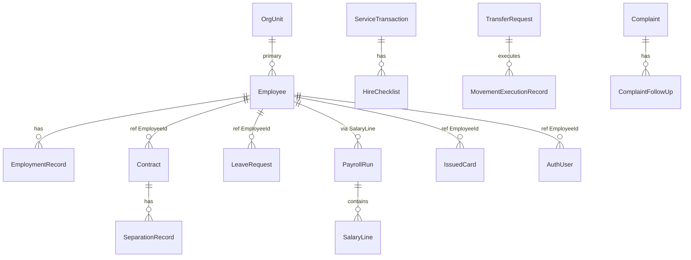

# وثيقة التحليل الشامل — نظام إدارة الموارد البشرية (HRManagement)

**الغرض:** مصدر معرفة موحّد لكتابة أطروحة مشروع التخرّج  
**المصدر:** تحليل الشيفرة المصدرية والوثائق التشغيلية في المستودع  
**تاريخ التحليل:** يوليو 2026  
**حالة المشروع:** إصدار v1 (Release Candidate — 2026-05-29)

---

## 1. الوصف العام

### 1.1 اسم المشروع
**نظام إدارة الموارد البشرية المتكامل — HRManagement**  
(شعبة التنظيم والموارد البشرية — مؤسسة مدنية)

### 1.2 وصف المشروع
منظومة معلومات مؤسسية مبنية على **معمارية الخدمات المصغّرة (Microservices)** تغطي دورة حياة الموظف من الاستقطاب والتعيين حتى الفصل والأرشفة، وتشمل: الملفات الشخصية، العقود والخدمة، الصحة المهنية، التنقلات، التدريب، الرواتب، الهويات، الأرشيف، اللوجستيات، البنية التقنية، التحليلات، الامتثال، ودليل المصادقة. يُعرَض النظام عبر **بوابة مركزية (API Gateway)** بواجهة عربية RTL.

### 1.3 المشكلة التي يحلها
- **تشتت البيانات:** إدارة الموارد البشرية في المؤسسات الكبيرة تتطلب تنسيقاً بين فروع متعددة (الخدمة، الشؤون الشخصية، التنقلات، التدريب، الرواتب...) دون قاعدة بيانات مركزية هشة.
- **بطء الإجراءات:** مسارات التعيين والفصل والإجازات والتنقلات تتطلب تنسيقاً يدوياً بين وحدات لا تتشارك بياناتها فورياً.
- **ضعف التتبع:** غياب Correlation ID وسجل تدقيق موحّد يعيق التحقيق في الأخطاء والامتثال.
- **تحديات الأمن:** بيانات حساسة (صحية، مالية، تأديبية) تتطلب عزلاً وصلاحيات دقيقة.

### 1.4 أهداف المشروع
1. أتمتة عمليات شعبة التنظيم والموارد البشرية وفق الهيكل التنظيمي المدني في `Requariments.md`.
2. بناء 14 خدمة مستقلة مع قاعدة بيانات لكل خدمة (Database-per-Service).
3. تحقيق التكامل عبر **RabbitMQ/MassTransit** دون FK عابرة للقواعد.
4. توفير مصادقة موحّدة عبر **Keycloak (OpenID Connect)** وRBAC.
5. دعم مسارات عمل متكاملة: تعيين، فصل، إجازات، رواتب، تنقلات، شكاوى.
6. توفير بوابة موظف (ESS) وبوابة توظيف عامة.

### 1.5 أهمية المشروع
- **إدارياً:** يربط 13 مجالاً وظيفياً في منظومة واحدة.
- **تقنياً:** يطبّق أنماطاً هندسية حديثة (Microservices, DDD, Event-Driven, Outbox).
- **أكاديمياً:** نموذج تطبيقي لتحويل متطلبات مؤسسية معقدة إلى نظام قابل للتشغيل.

### 1.6 الجهات المستفيدة
- شعبة التنظيم والموارد البشرية (الجهة المالكة).
- الإدارة العليا (تقارير وتحليلات).
- فروع الشعبة: الخدمة والعقود، الشؤون الشخصية، التنقلات، التدريب، السجلات، الامتثال.
- الموظفون (بوابة ESS).
- المواطنون (بوابة التوظيف العامة `/careers`).

### 1.7 المستخدمون المستهدفون
انظر القسم 5 (تحليل المستخدمين).

---

## 2. تحليل المعمارية

### 2.1 نوع المعمارية
**Microservices Architecture** + **Database-per-Service** + **Event-Driven Integration** + **API Gateway Pattern** + **Domain-Driven Design (Bounded Contexts)**

### 2.2 أسباب الاختيار
| السبب | التطبيق في المشروع |
|-------|-------------------|
| مواءمة الهيكل التنظيمي | 13 خدمة = 13 مجالاً إدارياً |
| عزل الأعطال | تعطل Payroll لا يوقف HR.Core |
| حساسية البيانات | عزل HR.Health و Compliance |
| نشر مستقل | كل خدمة منفذ وDbContext مستقل |
| اتساق نهائي مقبول | RabbitMQ بدلاً من معاملات موزعة |

### 2.3 مزايا المعمارية في هذا المشروع
- فصل المسؤوليات (Separation of Concerns).
- Loose Coupling عبر عقود رسائل `HRManagement.MessageContracts`.
- High Cohesion داخل كل Bounded Context.
- قابلية التوسع الأفقي لكل خدمة.
- Correlation ID وSerilog للملاحظة.

### 2.4 مكونات النظام

```
┌─────────────────────────────────────────────────────────────┐
│                    Browser (AdminLTE RTL)                    │
└───────────────────────────┬─────────────────────────────────┘
                            │
┌───────────────────────────▼─────────────────────────────────┐
│           HRManagement.Gateway (YARP :5000)                  │
│     OIDC/Keycloak + GatewayPathAuthorizationMiddleware       │
└───────┬───────────────────────────────────────────┬─────────┘
        │ HTTP /ui/* , /api/*                       │
┌───────▼───────────────────────────────────────────▼─────────┐
│  14 Microservices (5010-5140)                                │
│  Domain / Infrastructure / Web (MVC)                         │
└───────┬───────────────────────────────┬─────────────────────┘
        │                               │
┌───────▼────────┐              ┌───────▼────────┐
│ PostgreSQL 16  │              │ RabbitMQ 3.13  │
│ (15 DBs)       │              │ MassTransit    │
└────────────────┘              └────────────────┘
        │
┌───────▼────────┐
│ Keycloak 24    │
└────────────────┘
```

### 2.5 التواصل بين الأنظمة
| الآلية | الاستخدام |
|--------|-----------|
| HTTP Sync | Gateway → Services (YARP proxy + JWT Bearer) |
| RabbitMQ Async | أحداث Domain/Workflow بين الخدمات |
| Shared Contracts | `HRManagement.MessageContracts` (39 حدث) |
| File API | `/api/files` — File.Storage |
| Lookup API | `/api/hr-core/api/lookup/*` (anonymous) |

---

## 3. تحليل الأنظمة الفرعية (Modules/Services)

| # | الخدمة | المنفذ | DB | الهدف |
|---|--------|--------|-----|-------|
| 1 | HR.Core | 5010 | hr_core_db | النواة: موظفون، هيكل، حضور، تعيين |
| 2 | HR.Contracts | 5020 | hr_contracts_db | عقود، إجازات، سلف، فصل |
| 3 | HR.Health | 5030 | hr_health_db | صحة مهنية، لجان طبية |
| 4 | HR.Movements | 5040 | hr_movements_db | نقل، انتداب، إعارة |
| 5 | HR.Training | 5050 | hr_training_db | تدريب، LMS، بعثات |
| 6 | Payroll | 5060 | payroll_db | رواتب، تعويضات |
| 7 | IDCard | 5070 | idcard_db | بطاقات وهويات |
| 8 | Records.Archive | 5080 | archive_db | أرشفة وثائق |
| 9 | Admin.Logistics | 5090 | admin_db | أصول ومخزون |
| 10 | IT.Infra | 5100 | it_infra_db | أجهزة، نسخ، تذاكر |
| 11 | Dev.Analytics | 5110 | analytics_db | KPIs، ETL، تقارير |
| 12 | Compliance | 5120 | compliance_db | شكاوى، تأديب |
| 13 | Auth.Directory | 5130 | auth_directory_db | مستخدمون، دليل |
| 14 | File.Storage | 5140 | file_storage_db | ملفات مركزية |
| — | Gateway | 5000 | gateway_audit_db | بوابة + تدقيق |

*(تفاصيل كل خدمة: مسؤوليات، مدخلات، مخرجات، تبعيات — مذكورة في الفصل الثالث من الأطروحة)*

---

## 4. تحليل قواعد البيانات

### 4.1 الملخص الإحصائي
- **15 قاعدة PostgreSQL** مستقلة.
- **~180+ جدول** (بما فيها EntityAuditLog و IntegrationMessageReceipt).
- **لا FK عابرة للقواعد** — مراجع منطقية (EmployeeId, OrgUnitId).
- **PK موحّد:** Guid `Id` من `BaseEntity`.
- **UK شائعة:** NationalId, Code, ReferenceNumber, (MessageId, ConsumerType).

### 4.2 ER Diagram — منطقي (Cross-Service)



### 4.3 جداول رئيسية per service
*(انظر docs/database/01-13.md + DbContext files)*

**HR.Core (32 جدول):** Employee, OrgUnit, EmploymentRecord, Qualification, DailyAttendanceRecord, ApprovalRequest, Shift, CareerPath, InternalVacancy, PublicJobPosting, CitizenApplication...

**HR.Contracts (20):** Contract, LeaveRequest, AdvanceRequest, SeparationRecord, HireChecklist, LeaveBalance, LeavePolicy...

**Payroll (25):** PayrollRun, SalaryLine, EmployeePayProfile, SalaryScale, PayGrade, PayrollConfiguration, TaxBracket...

---

## 5. تحليل المستخدمين

| الدور Keycloak | السياسة | الصلاحيات | القيود |
|----------------|---------|-----------|--------|
| hr-admin | جميع Modules | كامل + Delete | — |
| hr-core | Module.HrCore | Write, Approve | — |
| hr-core-supervisory | HrCore.ReadOnly | قراءة | Cadre filter |
| hr-core-executive | HrCore.ReadOnly | قراءة | Cadre filter |
| branch-manager | Module.HrCore | قراءة | OrgUnit scope |
| hr-contracts | Module.HrContracts | Approve, HireExecute | — |
| hr-management-approver | HrManagement.Approve | موافقة تعيين | — |
| payroll | Payroll.* | Process, Approve, Post | — |
| hr-employee | Module.Ess | ESS فقط | employee_id claim |
| hr-health, hr-movements, hr-training, idcard, records-archive, admin-logistics, it-infra, dev-analytics, compliance, auth-directory | Module.* | CRUD الوحدة | — |

---

## 6. تحليل العمليات الرئيسية

### 6.1 تسجيل الدخول
Gateway → Keycloak OIDC → Cookie + JWT → GatewayPathAuthorizationMiddleware → YARP → Module JwtBearer

### 6.2 التعيين (Hire)
RecruitmentApplications → ICandidateAccepted → IEmployeeCreated → HireWizard (7 checklist) → Activate Contract → IContractActivated → ICardIssued → IHireCaseCompleted

### 6.3 الفصل (Separation)
SeparationWizard → Checklist → ISeparationCompleted → Payroll/Archive/IDCard/Auth/IT/Analytics

### 6.4 الإجازات
LeaveRequests/ESS → Approve → ILeaveApproved → Payroll adjustment + HR.Core OnLeave + Archive

### 6.5 الرواتب
Draft → Calculate → Review → Approve → Post → IPayrollProcessed

### 6.6 التنقلات
TransferRequests → Execute → ITransferExecuted → Payroll, Auth, HR.Core, Admin

### 6.7 الشكاوى
Complaints → Resolve → IComplaintResolved → Analytics + Archive

---

## 7. تحليل الواجهات البرمجية (APIs)

### 7.1 Gateway Routes
- `/ui/{module}/{Controller}/{Action}` — MVC
- `/api/{module}/...` — REST
- `/careers/**` — Public anonymous
- `/api/files/**` — File storage

### 7.2 REST APIs صريحة
| Service | Endpoints | Auth |
|---------|-----------|------|
| File.Storage | POST/GET/DELETE /api/files | Authenticated |
| HR.Core | /api/lookup/*, /api/stats/* | Anonymous |
| Payroll | /api/payroll/runs, payslips | Module.Payroll + fine-grained |
| Dev.Analytics | /api/analytics/events, workforce | Module.DevAnalytics |
| Auth.Directory | /api/stats/active-users | Anonymous |

---

## 8. تحليل التقنيات

| التقنية | الإصدار | السبب |
|---------|---------|-------|
| .NET | 10 | ASP.NET Core MVC |
| PostgreSQL | 16 | ACID، مفتوح المصدر |
| EF Core | — | ORM + Migrations |
| RabbitMQ | 3.13 | Messaging |
| MassTransit | — | Abstraction + Outbox |
| YARP | — | Reverse Proxy Gateway |
| Keycloak | 24 | OIDC/IAM |
| AdminLTE | 3 | RTL UI |
| Serilog | — | Logging |
| Docker Compose | — | Dev/Staging infra |
| MediatR | — | CQRS handlers |
| QuestPDF | — | Reports (Payroll) |
| SignalR | — | Notifications (HR.Core) |
| xUnit + Testcontainers | — | Testing |

**غير مستخدم:** Redis, Kafka, Kubernetes (في الكود الحالي), OAuth مباشر (Keycloak يوفّر OIDC).

---

## 9. تحليل الكود — Design Patterns

| Pattern | الموقع | الدليل |
|---------|--------|--------|
| Repository Pattern | ServiceDefaults | `IRepository<>`, `EfRepository<>` |
| Unit of Work | ServiceDefaults | `IUnitOfWork`, `EfUnitOfWork` |
| Mediator (CQRS) | HR.Contracts, Payroll | MediatR Handlers |
| Dependency Injection | جميع Program.cs | AddScoped/Transient |
| Outbox Pattern | Contracts, Core, Payroll | AddPostgresOutbox |
| Gateway Pattern | HRManagement.Gateway | YARP |
| Shared Kernel | HRManagement.SharedKernel | BaseEntity, Enums |
| Integration Events | MessageContracts | IEmployeeCreated, etc. |
| Idempotency | Consumers | IntegrationMessageReceipt |
| Middleware Pipeline | Gateway | CorrelationId, Auth |
| Factory (implicit) | DbContext registration | AddServiceDbContext |
| Strategy (implicit) | PayrollPeriodRules, HireWorkflowRules | Rule classes |

**غير مستخدم صراحة:** Observer (MassTransit بديل), Builder, Adapter (Http clients), Full CQRS read/write split.

### SOLID
- **S:** كل Service = Bounded Context واحد.
- **O:** Policies قابلة للتوسيع.
- **L:** IRepository abstraction.
- **I:** IEventPublisher, IFileReferenceClient.
- **D:** DI في جميع الخدمات.

---

## 10. معلومات المخططات (UML/DFD)

### Use Case Diagram — Actors
- مدير النظام (hr-admin)
- موظف HR (hr-core, hr-contracts...)
- موافق إداري (hr-management-approver)
- موظف (hr-employee / ESS)
- مواطن (anonymous / careers)
- Keycloak (external)

### Use Cases رئيسية
إدارة موظف، تعيين، فصل، إجازة، راتب، نقل، شكوى، أرشفة، إصدار بطاقة

### Component Diagram
Gateway → 14 Services → PostgreSQL + RabbitMQ + Keycloak

### Deployment Diagram
Docker Compose: postgresql, rabbitmq, keycloak, 15 .NET containers

### Sequence — Hire
Browser → Gateway → HR.Core (Create Employee) → RabbitMQ → HR.Contracts, Auth, Payroll... → HireWizard → IHireCaseCompleted

---

## 11. تحليل الواجهات (Screens)

**Gateway:** Dashboard, Journeys, HireJourney, SeparationJourney, Operations, Audit

**Per module:** Dashboard + CRUD controllers (~100 MVC controllers)

**ESS:** EssPortal (Leave, Advance, Attendance, Documents)

**Public:** PublicCareers (apply, track)

---

## 12. حدود v1 (من RELEASE_PRODUCT_SCOPE)

**داخل النطاق:** CRUD، مسارات تعيين/فصل/إجازة، دورة رواتب تشغيلية، MassTransit، Keycloak

**خارج النطاق:** محرك رواتب قانوني كامل، تكامل حضور كامل، ESS خارجي كامل، بعض Dead-end events

---

## 13. التحديات والتوصيات

### التحديات
1. تعقيد التشغيل (15 DB + 15 service).
2. Eventual Consistency — تأخير بين الخدمات.
3. عدم اكتمال محرك الرواتب القانوني.
4. Dead-end events بدون مستهلكين.

### التوصيات
1. Kubernetes للإنتاج.
2. إكمال محرك الرواتب v2.
3. Redis للتخزين المؤقت.
4. مستهلكون للأحداث الميتة.
5. OpenTelemetry للمراقبة.

---

*هذه الوثيقة هي الأساس المرجعي لـ `docs/THESIS_GRADUATION.md`*
