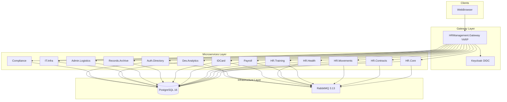
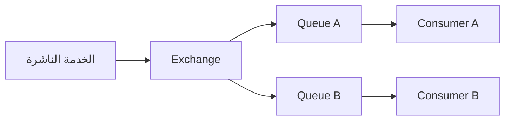

# التقنيات والأنماط المعمارية المستخدمة في نظام إدارة الموارد البشرية

**نظام HRManagement — شعبة التنظيم والموارد البشرية**

---

**الغرض من الوثيقة:** فصل أكاديمي يُستند إليه في أطروحة مشروع التخرّج، يصف التقنيات والأنماط المعمارية والمكتبات المستخدمة في بناء النظام، مع تبرير الاختيارات التقنية ومقارنتها بالبدائل، وربطها بالتطبيق الفعلي في المستودع البرمجي.

**الجمهور المستهدف:** لجنة المناقشة، المشرف الأكاديمي، والقارئ التقني الذي يريد فهم البنية التحتية للنظام دون الغوص في تفاصيل كل وحدة وظيفية.

**آخر مراجعة:** مايو 2026

---

## جدول المحتويات

1. [المقدمة وسياق المشروع](#1-المقدمة-وسياق-المشروع)
2. [الأنماط المعمارية الكلية](#2-الأنماط-المعمارية-الكلية)
3. [منصة التشغيل: .NET 10 و ASP.NET Core MVC](#3-منصة-التشغيل-net-10-و-aspnet-core-mvc)
4. [الوصول إلى البيانات: Entity Framework Core و PostgreSQL](#4-الوصول-إلى-البيانات-entity-framework-core-و-postgresql)
5. [المراسلة غير المتزامنة: RabbitMQ و MassTransit](#5-المراسلة-غير-المتزامنة-rabbitmq-و-masstransit)
6. [البوابة العكسية: YARP](#6-البوابة-العكسية-yarp)
7. [الهوية والمصادقة الموحدة: Keycloak و OpenID Connect](#7-الهوية-والمصادقة-الموحدة-keycloak-و-openid-connect)
8. [المراقبة وقابلية الملاحظة](#8-المراقبة-وقابلية-الملاحظة)
9. [الحاويات والنشر: Docker و Docker Compose](#9-الحاويات-والنشر-docker-و-docker-compose)
10. [ضمان الجودة والاختبار](#10-ضمان-الجودة-والاختبار)
11. [واجهة المستخدم والهوية البصرية](#11-واجهة-المستخدم-والهوية-البصرية)
12. [التقارير وواجهات برمجة التطبيقات](#12-التقارير-وواجهات-برمجة-التطبيقات)
13. [التكامل المستمر والأمن والامتثال](#13-التكامل-المستمر-والأمن-والامتثال)
- [ملحق أ: جدول الخدمات والمنافذ](#ملحق-أ-جدول-الخدمات-والمنافذ)
- [ملحق ب: مصفوفة الأحداث](#ملحق-ب-مصفوفة-الأحداث)
- [قائمة المراجع](#قائمة-المراجع)

---

## 1. المقدمة وسياق المشروع

### 1.1 وصف المشروع

يهدف نظام **HRManagement** إلى أتمتة عمليات **شعبة التنظيم والموارد البشرية** في مؤسسة مدنية، بما يشمل: إدارة الملفات الشخصية والسير الوظيفية، العقود والخدمة، الصحة المهنية، التنقلات والتوزيع، التدريب والتأهيل، الرواتب، الهويات والبطاقات، الأرشيف، اللوجستيات الإدارية، البنية التقنية، التحليلات، الامتثال، ودليل المصادقة. تفصيل المتطلبات الوظيفية والهيكل التنظيمي للشعبة موجود في [Requariments.md](./Requariments.md).

من منظور هندسي، يُبنى النظام كـ **منظومة خدمات مصغّرة (Microservices)** مستقلة، تتشارك في بنية تحتية موحّدة للمصادقة والمراسلة والمراقبة، وتُعرَض للمستخدم عبر **بوابة مركزية (API Gateway)** تدعم الواجهة العربية من اليمين إلى اليسار (RTL).

لا يقتصر المشروع على كونه مجموعة شاشات لإدخال البيانات، بل يمثل نموذجاً لنظام معلومات مؤسسي متكامل يعالج بيانات عالية الحساسية ترتبط بالموظفين، عقودهم، حالتهم الصحية، رواتبهم، حركاتهم الإدارية، وسجلاتهم الأرشيفية. لذلك فإن اختيار التقنيات لم يكن اختياراً شكلياً أو مبنياً على شهرة الأدوات فقط، بل جاء نتيجة طبيعة المجال نفسه: مجال الموارد البشرية يتطلب حفظ التاريخ، تتبع القرارات، ضبط الصلاحيات، قابلية التدقيق، وتكامل عدة وحدات إدارية دون السماح بتداخل غير مضبوط بين مسؤولياتها.

في الأنظمة الإدارية التقليدية، كثيراً ما تُبنى الحلول على قاعدة بيانات مركزية ضخمة وتطبيق واحد يحتوي كل الوظائف. هذا الأسلوب قد يكون مناسباً في المشاريع الصغيرة، لكنه يصبح عبئاً في الأنظمة المؤسسية ذات المجالات المتعددة، لأن أي تعديل في وحدة الرواتب أو الأرشيف قد ينعكس على وحدات أخرى غير مرتبطة بها مباشرة. لذلك اتجه هذا المشروع إلى تقسيم النظام إلى خدمات ذات حدود واضحة، بحيث تصبح كل خدمة مسؤولة عن مجال معرفي محدد، مع بقاء التكامل بينها محكوماً بعقود رسائل ومسارات بوابة مركزية.

من الناحية الأكاديمية، يمكن النظر إلى هذا النظام بوصفه تطبيقاً عملياً لمجموعة من المفاهيم المتقدمة في هندسة البرمجيات، منها: الفصل بين الاهتمامات (Separation of Concerns)، تقليل الاقتران (Loose Coupling)، زيادة التماسك الداخلي (High Cohesion)، الاتساق النهائي (Eventual Consistency)، التحكم المركزي بالهوية (Centralized Identity)، وقابلية الملاحظة (Observability). هذه المفاهيم لا تظهر كتعريفات نظرية فقط، بل تتجسد في ملفات المشروع مثل `Program.cs` في كل خدمة، مكتبة `ServiceDefaults`، عقود الرسائل، وإعدادات Docker Compose.

### 1.2 أهداف اختيار التقنيات

اعتُمدت التقنيات في هذا المشروع وفق **تحليل المفاضلات (Trade-off Analysis)** بين المحاور التالية:

| المحور | المعيار | انعكاسه في المشروع |
|--------|---------|-------------------|
| **النضج التقني** | استقرار الإطار، توفر الوثائق، دعم المجتمع | .NET 10، PostgreSQL 16، RabbitMQ 3.13 |
| **قابلية التوسع** | فصل الخدمات، التوسع الأفقي، فك الاقتران | 13 خدمة مستقلة + قواعد بيانات منفصلة |
| **الأمن** | مصادقة مركزية، RBAC، تدقيق البيانات الحساسة | Keycloak + OIDC + سياسات ASP.NET Core |
| **قابلية الصيانة** | طبقات واضحة، مكتبات مشتركة، CI | DDD layering + ServiceDefaults + GitHub Actions |
| **التكلفة** | حلول مفتوحة المصدر قابلة للاستضافة الذاتية | PostgreSQL، Keycloak، RabbitMQ، Docker |
| **الملاءمة الوظيفية** | دعم RTL، تقارير، سير عمل متعدد الوحدات | ASP.NET MVC + AdminLTE + QuestPDF |

### 1.3 منهجية المفاضلة التقنية

اعتمد المشروع منهجية مفاضلة متعددة المعايير (Multi-Criteria Decision Making) عند اختيار التقنيات. ويمكن تلخيصها في السؤال الآتي: **هل تخدم التقنية متطلبات النظام الوظيفية وغير الوظيفية على المدى الطويل، أم أنها تعالج حاجة فورية فقط؟** بناء على هذا السؤال، لم يكن معيار الأداء وحده كافياً، بل جرى النظر في جوانب أخرى مثل سهولة التشغيل، نضج المجتمع، وضوح الوثائق، قابلية تدريب الفريق، وإمكانية النشر داخل بيئة مؤسسية مغلقة.

في سياق مشروع تخرّج، من المهم التمييز بين **التقنية** و**النمط المعماري**. فـ PostgreSQL وRabbitMQ وKeycloak هي تقنيات أو منصات، أما Microservices وDDD وEvent-Driven Architecture فهي أنماط تنظيمية تحدد طريقة بناء النظام وتفاعل أجزائه. جودة المشروع لا تأتي فقط من استخدام أدوات متقدمة، بل من انسجام هذه الأدوات مع نمط معماري واضح. فعلى سبيل المثال، استخدام RabbitMQ يكون ذا قيمة حقيقية عندما توجد خدمات مستقلة تحتاج إلى تبادل أحداث دون اعتماد مباشر، بينما يصبح عبئاً زائداً إذا كان التطبيق أحادياً بسيطاً.

يمكن تمثيل عملية المفاضلة كما يلي:


وقد أثّرت طبيعة النظام في القرارات التقنية بالشكل الآتي:

| طبيعة المتطلب | أثره على التصميم | التقنية/النمط المختار |
|---------------|------------------|------------------------|
| تعدد الوحدات الإدارية | فصل كل مجال في خدمة مستقلة | Microservices |
| حساسية بيانات الموظفين | مصادقة وتفويض مركزي | Keycloak + RBAC |
| الحاجة لتتبع القرارات | سجلات مترابطة عبر الخدمات | Correlation ID + Serilog |
| عدم ضرورة المعاملة الفورية بين كل الوحدات | قبول الاتساق النهائي | RabbitMQ + MassTransit |
| الحاجة إلى تشغيل محلي للتجربة | بنية قابلة للتشغيل بالحاويات | Docker Compose |
| واجهة عربية إدارية | عرض Server-side مستقر | ASP.NET Core MVC + Razor |

### 1.4 نطاق هذه الوثيقة

تركز الوثيقة على **البنية التقنية والمعمارية**، وليس على تفاصيل كل حالة استخدام (Use Case). للاطلاع على ما تم تنفيذه فعلياً في الشيفرة، راجع [IMPLEMENTED_BASELINE.md](./IMPLEMENTED_BASELINE.md)؛ وللفجوات المتبقية نحو منتج تشغيلي كامل، راجع [REMAINING_IMPLEMENTATION.md](./REMAINING_IMPLEMENTATION.md).

لا تُقدّم هذه الوثيقة شرحاً تعليمياً مبسطاً لكل مكتبة من الصفر، بل تشرح التقنيات في علاقتها بالمشروع، أي: لماذا استُخدمت؟ أين تظهر في الشيفرة؟ ما القيمة التي تضيفها؟ وما حدودها أو مخاطرها؟ وهذا يجعلها أقرب إلى فصل "التقنيات المستخدمة" في الأطروحة، وليس إلى دليل تشغيل فقط.

---

## 2. الأنماط المعمارية الكلية

### 2.1 معمارية الخدمات المصغّرة (Microservices Architecture)

#### التعريف النظري

تُعرّف معمارية الخدمات المصغّرة (Newman & Lewis, 2015; Fowler, 2014) بأنها نمط يقسّم التطبيق إلى **مجموعة خدمات صغيرة مستقلة**، كل منها:

- تُنشر وتُوسَّع بشكل مستقل.
- تمتلك **قاعدة بيانات خاصة** (Database-per-Service).
- تتواصل مع الخدمات الأخرى عبر واجهات شبكية (HTTP أو رسائل).

#### التطبيق في المشروع

ينقسم النظام إلى **13 خدمة ويب** مستقلة، إضافة إلى **البوابة (Gateway)**:

| الخدمة | الوظيفة | المنفذ | قاعدة البيانات |
|--------|---------|--------|----------------|
| HR.Core | الملفات الشخصية والسير | 5010 | hr_core_db |
| HR.Contracts | العقود والخدمة | 5020 | hr_contracts_db |
| HR.Health | الصحة واللجان الطبية | 5030 | hr_health_db |
| HR.Movements | التنقلات والتوزيع | 5040 | hr_movements_db |
| HR.Training | التدريب والتأهيل | 5050 | hr_training_db |
| Payroll | الرواتب والتعويضات | 5060 | payroll_db |
| IDCard | الهويات والبطاقات | 5070 | idcard_db |
| Records.Archive | الأرشيف والملفات | 5080 | archive_db |
| Admin.Logistics | الإدارة واللوجستيات | 5090 | admin_db |
| IT.Infra | تقنية المعلومات | 5100 | it_infra_db |
| Dev.Analytics | التطوير والتحليل | 5110 | analytics_db |
| Compliance | الامتثال والرقابة | 5120 | compliance_db |
| Auth.Directory | المصادقة والدليل | 5130 | auth_directory_db |

> **المرجع:** [README.md](../README.md)

#### مبررات الاختيار

1. **مواءمة مع الهيكل التنظيمي:** كل فرع في الشعبة (الخدمة، الشؤون الشخصية، التنقلات، التدريب...) يمكن تطويره ونشره بشكل مستقل.
2. **عزل الأعطال:** تعطل خدمة الرواتب لا يوقف خدمة الملفات الشخصية.
3. **تنوع متطلبات البيانات:** البيانات الصحية والشكاوى تتطلب ضوابط خصوصية مختلفة عن بيانات التحليلات.

#### البدائل المقارنة

| البديل | المزايا | العيوب | سبب عدم الاختيار |
|--------|---------|--------|------------------|
| **Monolith** | بساطة التطوير الأولي | صعوبة التوسع، اقتران عالٍ | 13 مجالاً وظيفياً مستقلاً |
| **Modular Monolith** | حدود واضحة داخل عملية واحدة | لا يزال نقطة فشل واحدة | متطلبات نشر مستقل لكل وحدة |
| **Serverless (FaaS)** | توسع تلقائي | cold start، تعقيد محلي | بيئة مؤسسية ذاتية الاستضافة |

#### شرح تفصيلي لفلسفة التقسيم

لا يعني استخدام الخدمات المصغّرة أن كل جدول أو كل شاشة يجب أن تتحول إلى خدمة مستقلة. التقسيم الصحيح يعتمد على **حدود المجال الوظيفي** لا على عدد الملفات أو الجداول. في هذا النظام، تم اختيار الخدمات بناءً على وحدات ذات معنى إداري واضح:

- `HR.Core` يمثل النواة المرجعية للموظف: بياناته، حالاته، سيرته، مؤهلاته.
- `HR.Contracts` يمثل الجانب القانوني والإداري للخدمة: العقود، المباشرة، الإجازات، السلف، الفصل.
- `Payroll` يمثل المجال المالي: التعويضات، الدورات، المعالجة.
- `HR.Health` يمثل بيانات ذات حساسية خاصة تتطلب سياسات وصول أضيق.
- `Compliance` يمثل مجال الرقابة والشكاوى، وهو منفصل عن التشغيل اليومي لأنه يحمل طبيعة تدقيقية.

هذا التقسيم يحقق مبدأ **Single Responsibility at Service Level**: كل خدمة مسؤولة عن حقيقة معينة داخل المؤسسة. فحقيقة "من هو الموظف؟" توجد في HR.Core، وحقيقة "ما عقده الحالي؟" توجد في HR.Contracts، وحقيقة "ما أثر عقده على الراتب؟" توجد في Payroll. وعندما تحتاج خدمة إلى معرفة حدث وقع في خدمة أخرى، فهي لا تدخل إلى قاعدة بياناتها مباشرة، بل تستقبل حدثاً منشوراً عبر RabbitMQ.

#### أثر التقسيم على قواعد البيانات

نمط **Database-per-Service** يمنع استخدام قاعدة بيانات موحدة لكل الخدمات. هذا القرار له تكلفة وفائدة:

| الجانب | الفائدة | التكلفة |
|--------|---------|---------|
| استقلالية التطوير | يمكن تعديل مخطط Payroll دون تعطيل HR.Core | الحاجة إلى تكامل عبر أحداث |
| الأمان | يمكن عزل بيانات الصحة أو الشكاوى | إدارة صلاحيات قواعد أكثر |
| التوسع | يمكن توسيع خدمة دون أخرى | زيادة تعقيد التشغيل |
| الاختبار | اختبار كل خدمة بقاعدة مستقلة | إعداد بيانات تكامل أكثر تعقيداً |

في الأطروحة، يمكن وصف هذا القرار بأنه انتقال من **سلامة المعاملة المركزية (Central Transactional Consistency)** إلى **استقلالية الخدمات مع اتساق نهائي (Autonomous Services with Eventual Consistency)**. أي أن النظام يفضل تقليل الاقتران بين الخدمات على حساب وجود زمن قصير حتى تنتشر التغييرات بين الوحدات.

#### مثال تطبيقي: إنشاء موظف

عند إنشاء موظف جديد في HR.Core، لا تقوم هذه الخدمة بإدخال صفوف مباشرة في قواعد HR.Contracts أو IDCard أو Auth.Directory. بدلاً من ذلك، تنشر حدث `IEmployeeCreated`. بعد ذلك:

1. تستهلك HR.Contracts الحدث لإنشاء سياق أولي يتعلق بالعقود.
2. تستهلك HR.Health الحدث لتهيئة ملف صحي عند الحاجة.
3. تستهلك IDCard الحدث لإتاحة طلب بطاقة.
4. تستهلك Auth.Directory الحدث لإنشاء مستخدم مصادقة محلي وربما مزامنته مع Keycloak.

هذا التدفق يوضح قيمة الخدمات المصغّرة: كل خدمة تتفاعل مع الحدث وفق مسؤوليتها، دون أن تعرف HR.Core تفاصيل تنفيذ الخدمات الأخرى.

### 2.2 التصميم الموجّه بالنطاق (Domain-Driven Design — DDD)

#### التعريف النظري

يُقدّم DDD (Evans, 2003) مفهوم **Bounded Context** (سياق محدود): كل مجال له نموذجه الخاص، ولا تُشارك الكيانات مباشرة بين السياقات بل عبر **عقود تكامل** (Integration Contracts).

#### الطبقات في كل خدمة

```
{Service}.Domain/         ← الكيانات، التعدادات، قواعد النطاق
{Service}.Infrastructure/ ← DbContext، المستهلكون، الترحيلات
{Service}.Web/            ← Controllers، Views، Program.cs
```

**مثال:** خدمة HR.Core في [src/Services/HRCore](../src/Services/HRCore).

#### Shared Kernel

يحتوي [HRManagement.SharedKernel](../src/Shared/HRManagement.SharedKernel) على:

- **BaseEntity** و **AuditableEntity**: معرّفات موحّدة (`Guid Id`, `TenantId`, `CreatedAt`).
- **التعدادات المشتركة**: `EmploymentStatus`, `EmployeeCadre`, `Gender`...
- **واجهات Repository و UnitOfWork**: نمط Repository Pattern.

```csharp
// src/Shared/HRManagement.SharedKernel/Entities/BaseEntity.cs
public abstract class BaseEntity
{
    [Key]
    public Guid Id { get; set; } = Guid.NewGuid();
    public Guid? TenantId { get; set; }
    public DateTime CreatedAt { get; set; } = DateTime.UtcNow;
    public DateTime UpdatedAt { get; set; } = DateTime.UtcNow;
}
```

#### Anti-Corruption Layer (ACL)

عقود الرسائل في [HRManagement.MessageContracts](../src/Shared/HRManagement.MessageContracts) تعمل كـ **ACL**: كل خدمة تستهلك واجهات (`IEmployeeCreated`, `ITransferExecuted`...) دون الاعتماد على كيانات النطاق الداخلية للخدمة الناشرة.

#### شرح تفصيلي للـ Bounded Context

من أهم أفكار DDD أن المصطلح الواحد قد يحمل معنى مختلفاً حسب السياق. كلمة "موظف" في HR.Core تعني ملفاً شخصياً كاملاً يتضمن الاسم والرقم الوطني والحالة الاجتماعية والمؤهلات. أما في Payroll فقد تعني مرجعاً مالياً لحساب الراتب. وفي IDCard قد تعني صاحب بطاقة وتعريف بصري. لذلك من الخطأ إجبار كل الخدمات على استخدام نموذج كيان موحّد ضخم يسمى `Employee` يحتوي كل شيء.

بدلاً من ذلك، يمتلك كل سياق نموذجه الخاص:

| السياق | معنى الموظف داخله | البيانات المهمة |
|--------|-------------------|-----------------|
| HR.Core | ملف شخصي وسيرة وظيفية | الاسم، الرقم الوطني، المؤهلات، الحالة |
| HR.Contracts | طرف في عقد أو قرار خدمة | نوع العقد، تاريخ المباشرة، الإجازات |
| Payroll | مستحق مالي | الراتب، البدلات، الاستقطاعات |
| IDCard | حامل بطاقة | الصورة، رقم البطاقة، حالة الإصدار |
| Auth.Directory | مستخدم نظام | اسم الدخول، الأدوار، حالة التفعيل |

هذا الأسلوب يقلل **التضخم الكائني (Anemic or God Entity Problem)**، لأن كل خدمة تحتفظ فقط بالبيانات التي تحتاجها. كما يسمح بتطوير كل نموذج وفق قواعده الخاصة دون كسر بقية الخدمات.

#### الفرق بين Shared Kernel و Shared Database

وجود `SharedKernel` لا يعني أن الخدمات تشترك في قاعدة بيانات واحدة. الفرق جوهري:

| المفهوم | المقصود | هل هو مستخدم؟ |
|---------|---------|---------------|
| Shared Kernel | كود مشترك محدود مثل `BaseEntity` والتعدادات العامة | نعم |
| Shared Database | قاعدة واحدة تقرأ وتكتب فيها كل الخدمات | لا |

استخدام Shared Kernel يجب أن يبقى حذراً ومحدوداً، لأن الإفراط فيه يعيد الاقتران بين الخدمات. في هذا المشروع، العناصر المشتركة عامة ومستقرة نسبياً، مثل `Guid Id` و`TenantId` وبعض التعدادات العامة، أما قواعد الأعمال الخاصة فبقيت داخل الخدمات.

#### Repository و Unit of Work من منظور أكاديمي

نمط Repository يعزل منطق الوصول إلى البيانات عن منطق النطاق. فبدلاً من أن تتعامل Controllers أو Consumers مباشرة مع تفاصيل EF Core في كل مكان، يمكن توحيد عمليات القراءة والكتابة في طبقة Infrastructure. أما Unit of Work فيضمن تجميع عدة تغييرات ضمن معاملة واحدة داخل حدود الخدمة نفسها. لكن من المهم التأكيد أن Unit of Work لا تمتد بين الخدمات المختلفة، لأن ذلك سيعيد الاعتماد المركزي الذي جاءت Microservices لتجنبه.

### 2.3 المعمارية الموجّهة بالأحداث (Event-Driven Architecture)

#### التعريف

في EDA، تُبلّغ الخدمات بعضها بعضاً بـ **أحداث مجردة** (Events) عند حدوث تغيير في حالة الكيان، بدلاً من استدعاءات HTTP متزامنة. هذا يحقق **الاقتران الفضفاض (Loose Coupling)** و**الاتساق النهائي (Eventual Consistency)**.

#### Choreography vs Orchestration

| النمط | الوصف | التطبيق |
|-------|-------|---------|
| **Choreography** | كل خدمة تتفاعل مع الأحداث دون منسّق مركزي | النظام الحالي: HR.Core ينشر `IEmployeeCreated` → 4 خدمات تستهلكه |
| **Orchestration** | منسّق مركزي يوجّه سير العمل | غير مطبّق حالياً؛ يمكن إضافته لمسارات الفصل المعقدة |

#### شرح الفرق العملي

في **Choreography** لا توجد خدمة تقول للآخرين ماذا يفعلون خطوة بخطوة. الخدمة تنشر حدثاً ذا معنى، مثل "تم تفعيل عقد"، وكل خدمة مهتمة بهذا الحدث تتصرف بحسب قواعدها. هذا يشبه تعميماً إدارياً داخل مؤسسة: عند صدور قرار، تصل نسخة منه إلى عدة فروع، وكل فرع يطبّق ما يخصه.

أما **Orchestration** فيوجد منسّق مركزي، مثل خدمة Workflow، يرسل أوامر متتابعة: أغلق العهد، أوقف البطاقة، أنهِ الراتب، أرشف الملف. هذا مفيد في العمليات التي تتطلب ترتيباً صارماً وتعويضاً عند الفشل (Compensation)، مثل مسار الفصل النهائي. حالياً يميل المشروع إلى Choreography لأنها أبسط وأقل اقتراناً، مع إمكانية إدخال Orchestrator لاحقاً للعمليات الحرجة.

#### الاتساق النهائي ومشكلة التوقيت

في الأنظمة الحدثية، لا يُفترض أن ترى كل الخدمات التغيير في اللحظة نفسها. إذا أنشئ موظف في HR.Core، فقد تصل الرسالة إلى IDCard بعد أجزاء من الثانية أو أكثر. لذلك يجب تصميم الواجهات بحيث تتعامل مع هذا التأخير الطبيعي. أكاديمياً يسمى هذا **Eventual Consistency**، وهو بديل عن **Strong Consistency** في الأنظمة الموزعة.

تظهر هنا مفاضلة CAP Theorem بصورة عملية:

| الخاصية | معناها | كيف تظهر في المشروع |
|---------|--------|----------------------|
| Consistency | كل الخدمات ترى نفس الحالة فوراً | غير مضمونة بين الخدمات |
| Availability | كل خدمة تبقى قادرة على العمل | مفضّلة في التصميم |
| Partition Tolerance | تحمل انقطاع الشبكة أو broker | مطلوب في بيئة موزعة |

لذلك يعتمد المشروع على سجلات وCorrelation ID وIdempotency لتخفيف آثار التأخير أو إعادة تسليم الرسائل.

#### مخطط معماري شامل



### 2.4 بوابة واجهات برمجة التطبيقات (API Gateway Pattern)

تُجمّع [HRManagement.Gateway](../src/Gateway/HRManagement.Gateway) نقطة الدخول الوحيدة للمستخدم، وتوفّر:

- **Reverse Proxy** (YARP) لتوجيه `/api/{module}/...` و `/ui/{module}/...`.
- **مصادقة موحّدة** عبر Keycloak.
- **تفويض على مستوى المسار** (Path-based Authorization).
- **Rate Limiting** و **Security Headers**.
- **لوحة مراقبة** لحالة الخدمات.

---

## 3. منصة التشغيل: .NET 10 و ASP.NET Core MVC

### 3.1 تطوّر منصة .NET

| الجيل | الاسم | سنة الإطلاق | ملاحظات |
|-------|-------|-------------|---------|
| .NET Core 1.x–3.x | .NET Core | 2016–2020 | Cross-platform، مفتوح المصدر |
| .NET 5–9 | .NET (موحّد) | 2020–2024 | دمج Core و Framework |
| **.NET 10** | LTS (2025–2028) | 2025 | أداء محسّن، Native AOT، C# 14 |

يُثبّت المشروع إصدار SDK **10.0.203** عبر [global.json](../global.json)، ويُحدّد إطار الاستهداف `net10.0` في [Directory.Build.props](../Directory.Build.props) لجميع المشاريع.

#### لماذا .NET مناسب لهذا المشروع؟

تتميز منصة .NET الحديثة بأنها لم تعد مرتبطة بنظام Windows فقط، بل أصبحت منصة متعددة الأنظمة (Windows/Linux/macOS) ومفتوحة المصدر وقابلة للتشغيل داخل الحاويات. هذه الخاصية مهمة في مشروع يعتمد Docker، لأن الخدمات يمكن بناؤها على Windows أثناء التطوير ثم تشغيلها في حاويات Linux في بيئات الاختبار أو الإنتاج.

كما أن .NET يوفر نموذجاً موحداً لبناء تطبيقات الويب، خدمات الخلفية، واجهات API، الاختبارات، وأدوات سطر الأوامر. في هذا المشروع تظهر هذه الوحدة في أن جميع المشاريع تستهدف `net10.0`، سواء كانت خدمات ويب، مكتبات مشتركة، أو مشاريع اختبارات. هذا يقلل مشاكل توافق الإصدارات ويجعل إدارة الاعتماديات أسهل.

من الناحية الأكاديمية، يمكن ربط اختيار .NET بمفهوم **Platform Coherence**، أي قدرة المنصة على توفير بيئة تطوير متماسكة من قاعدة البيانات إلى الواجهة والاختبار والنشر. كما أن استخدام C# مع Nullable Reference Types وImplicit Usings يرفع جودة الشيفرة عبر تقليل أخطاء null وتبسيط ملفات المصدر.

### 3.2 ASP.NET Core MVC

#### التعريف

**Model-View-Controller (MVC)** نمط معماري يفصل:

- **Model**: بيانات النطاق و ViewModels.
- **View**: قوالب Razor (.cshtml) للعرض.
- **Controller**: معالجة الطلبات HTTP.

#### مبرر اختيار MVC على Blazor/SPA

| المعيار | MVC + Razor | Blazor WebAssembly | React/Angular SPA |
|---------|-------------|-------------------|-------------------|
| **دعم RTL** | ممتاز (Server-side rendering) | جيد | يتطلب مكتبات إضافية |
| **SEO** | ممتاز | ضعيف | يتطلب SSR |
| **تعقيد الفريق** | منخفض (C# فقط) | متوسط | عالٍ (JS + C# API) |
| **الأمان** | Tokens على الخادم | Tokens في المتصفح | Tokens في المتصفح |

بالنظر إلى أن النظام **نظام إداري داخلي** (Intranet) باللغة العربية، يُفضَّل MVC لسهولة الصيانة ودعم RTL الأصلي.

#### دورة طلب MVC داخل النظام

عند فتح المستخدم صفحة في إحدى الخدمات عبر البوابة، تحدث الخطوات التالية:

1. يرسل المتصفح طلباً إلى مسار مثل `/ui/hr-core/Employees`.
2. يمر الطلب عبر Gateway، حيث تُفحص الجلسة والصلاحية.
3. يوجّه YARP الطلب إلى خدمة HR.Core بعد إزالة بادئة `/ui/hr-core`.
4. يستقبل Controller الطلب ويستدعي DbContext أو خدمة نطاق.
5. تُحضّر ViewModel وتُمرر إلى Razor View.
6. يُعاد HTML جاهز إلى المتصفح.

هذا التدفق يختلف عن SPA، حيث ينتقل جزء كبير من منطق العرض إلى المتصفح. في نظام حكومي/مؤسسي، وجود العرض على الخادم يساعد في ضبط الجلسات، تبسيط المصادقة، وتقليل تعرض الـ access tokens داخل المتصفح.

#### Razor Views وملاءمة اللغة العربية

تسمح Razor بدمج HTML مع C# بطريقة آمنة نسبياً، مع دعم Layouts وPartials. هذا مناسب لواجهات إدارية تتكرر فيها الجداول والنماذج والتنبيهات. وعند وجود RCL مشتركة مثل `HRManagement.Web.Shared`، يمكن توحيد أجزاء الواجهة كالتذييل والتنبيهات والثيم، دون نسخ نفس الملفات في كل خدمة.

### 3.3 Minimal Hosting Model

اعتُمد نموذج الإقلاع المختصر (Minimal Hosting) في ASP.NET Core 6+، حيث يُعرَّف `Program.cs` كملف واحد بدون `Startup.cs`:

```csharp
// src/Services/HRCore/HR.Core.Web/Program.cs (مقتطف)
var builder = WebApplication.CreateBuilder(args);
builder.Host.UseHrManagementSerilog();
builder.AddHrProductionNetworking();

builder.Services.AddControllersWithViews()
    .AddHrModuleAuthorizeFilter(HrManagementPolicies.ModuleHrCore);
builder.Services.AddDbContext<HRCoreDbContext>(options =>
    options.UseNpgsql(coreConn, npgsql =>
        npgsql.MigrationsAssembly(typeof(HRCoreDbContext).Assembly.GetName().Name)));
builder.Services.AddServiceMassTransit(builder.Configuration, x =>
{
    x.AddConsumer<TrainingCompletedConsumer>();
    x.AddConsumer<TransferExecutedConsumer>();
});
builder.Services.AddKeycloakAuthentication(builder.Configuration);

var app = builder.Build();
await app.Services.TryMigrateAsync<HRCoreDbContext>();
app.UseHrCorrelationId();
app.UseAuthentication();
app.UseAuthorization();
app.MapControllerRoute("default", "{controller=Dashboard}/{action=Index}/{id?}");
app.Run();
```

> **المرجع الكامل:** [HR.Core.Web/Program.cs](../src/Services/HRCore/HR.Core.Web/Program.cs)

### 3.4 HRManagement.ServiceDefaults

مكتبة [ServiceDefaults](../src/Shared/HRManagement.ServiceDefaults) تُطبّق مبدأ **Don't Repeat Yourself (DRY)** عبر تجميع:

- إعداد Serilog، Keycloak، MassTransit، Health Checks.
- Middleware للـ Correlation ID و Gateway Authorization.
- سياسات ASP.NET Core Authorization.

#### أهمية ServiceDefaults في الأنظمة متعددة الخدمات

في مشروع يحتوي 13 خدمة، تكرار إعدادات المصادقة والسجلات وفحوص الصحة داخل كل خدمة سيؤدي إلى أخطاء صيانة. إذا تغير اسم رأس `X-Correlation-ID` مثلاً، فسيكون من الصعب تحديثه يدوياً في كل خدمة. لذلك تُعد `ServiceDefaults` طبقة بنية تحتية مشتركة تضمن أن الخدمات تتصرف بطريقة موحدة.

من الناحية التصميمية، هذه المكتبة ليست طبقة نطاق Domain ولا يجب أن تحتوي قواعد أعمال. وظيفتها هي توحيد البنية التحتية العرضية (Cross-Cutting Concerns)، مثل:

| الاهتمام العرضي | سبب كونه عرضياً | التنفيذ |
|-----------------|------------------|---------|
| Logging | مطلوب في كل الخدمات | `UseHrManagementSerilog` |
| Authentication | نمط موحد للدخول | `AddKeycloakAuthentication` |
| Authorization | سياسات متكررة | `AddHrManagementAuthorizationPolicies` |
| Health Checks | معيار تشغيل موحد | `AddHrServiceHealthChecks` |
| Correlation | تتبع الطلب عبر الخدمات | `UseHrCorrelationId` |

---

## 4. الوصول إلى البيانات: Entity Framework Core و PostgreSQL

### 4.1 Entity Framework Core (EF Core)

#### التعريف

EF Core هو **ORM (Object-Relational Mapper)** من مايكروسوفت يترجم كائنات C# إلى جداول SQL وبالعكس. يُطبّق نمط **Unit of Work** عبر `DbContext` الذي يتتبع التغييرات ويُنفّذ `SaveChangesAsync()` كعملية ذرية.

#### كيف يعمل ORM عملياً؟

بدون ORM، يحتاج المطور إلى كتابة استعلامات SQL يدوياً، فتح الاتصال، تمرير المعاملات، قراءة النتائج، وتحويل كل صف إلى كائن C#. أما EF Core فيختصر ذلك عبر:

1. تعريف كائنات C# تمثل الجداول.
2. تعريف `DbSet<TEntity>` داخل `DbContext`.
3. استخدام LINQ للتعبير عن الاستعلامات.
4. ترجمة LINQ إلى SQL مناسب لـ PostgreSQL عبر Npgsql.
5. تتبع التغييرات داخل Change Tracker.
6. تنفيذ `SaveChangesAsync` لإرسال INSERT/UPDATE/DELETE.

هذا لا يعني أن EF Core يلغي أهمية فهم SQL. في الأنظمة الكبيرة يجب الانتباه إلى مشاكل مثل N+1 Queries، الفهارس، حجم النتائج، واستخدام `AsNoTracking` عند القراءة فقط. لذلك يُعد EF Core أداة إنتاجية، لكنه يتطلب وعياً بأداء قاعدة البيانات.

#### Code-First Approach

اعتُمد نهج **Code-First**: تُعرَّف الكيانات في C#، ثم تُولَّد **Migrations** (ملفات ترحيل) تُنشئ/تُحدّث الجداول. مثال: [HR.Core.Infrastructure/Migrations](../src/Services/HRCore/HR.Core.Infrastructure/Migrations).

#### لماذا Code-First؟

في نظام يتطور تدريجياً، يكون النموذج البرمجي قريباً من قواعد الأعمال، لذلك يُفضّل أن يبدأ التصميم من الكيانات في الشيفرة. عند إضافة خاصية جديدة إلى كيان عقد أو موظف، تُنشأ Migration توضّح التغيير في قاعدة البيانات. هذا يوفر سجلاً تاريخياً لتطور المخطط (Schema Evolution).

يقابل ذلك نهج Database-First، حيث تُصمم الجداول أولاً ثم تُولّد الكيانات. هذا مناسب عندما تكون قاعدة البيانات موجودة مسبقاً أو يديرها فريق DBA مستقل. أما في مشروع HRManagement، فالتطبيق وقاعدة البيانات يتطوران معاً، لذلك Code-First أكثر ملاءمة.

#### Repository Pattern

```csharp
// src/Shared/HRManagement.SharedKernel/Interfaces/IRepository.cs
public interface IRepository<T> where T : BaseEntity
{
    Task<T?> GetByIdAsync(Guid id, CancellationToken ct = default);
    Task<IReadOnlyList<T>> FindAsync(Expression<Func<T, bool>> predicate, ...);
    Task<T> AddAsync(T entity, CancellationToken ct = default);
    Task UpdateAsync(T entity, CancellationToken ct = default);
    Task DeleteAsync(T entity, CancellationToken ct = default);
}
```

### 4.2 PostgreSQL 16

#### التعريف

PostgreSQL نظام إدارة قواعد بيانات **علائقية-كائنية (ORDBMS)** مفتوح المصدر، يدعم ACID، JSONB، Full-Text Search، وامتدادات متعددة.

#### مبرر الاختيار على SQL Server

| المعيار | PostgreSQL 16 | SQL Server |
|---------|---------------|------------|
| **الترخيص** | مفتوح (PostgreSQL License) | تجاري (Standard/Enterprise) |
| **Docker** | صورة رسمية خفيفة (Alpine) | صورة أكبر |
| **JSONB** | أصلي ومحسّن | JSON (أقل نضجاً) |
| **Npgsql** | موصل EF Core ناضج | SqlClient (Microsoft) |
| **الاستضافة الذاتية** | بدون تكلفة | تتطلب ترخيص Windows/Linux |

#### Database-per-Service

كل خدمة لها `DbContext` وقاعدة بيانات مستقلة، مما يحقق:

- **استقلالية البيانات**: لا JOIN مباشر بين خدمات.
- **اختيار مخزن مختلف** مستقبلاً (مثلاً MongoDB للأرشيف).
- **ترحيل مستقل** لكل خدمة.

#### حدود المعاملة في Database-per-Service

في تطبيق أحادي، يمكن تنفيذ معاملة واحدة تشمل تحديث الموظف والعقد والراتب في قاعدة واحدة. أما في هذا المشروع، فكل خدمة تملك قاعدة مستقلة، لذلك لا توجد معاملة SQL واحدة تمتد عبر HR.Core وPayroll مثلاً. هذا القرار مقصود، لأن المعاملات الموزعة (Distributed Transactions) تزيد التعقيد وتضعف الاستقلالية.

بدلاً من ذلك، يتم استخدام نمط **Eventual Consistency**. فإذا تم تفعيل عقد في HR.Contracts، يُنشر الحدث `IContractActivated`، ثم يقوم Payroll بإنشاء أثر مالي مناسب. إذا فشل Payroll مؤقتاً، يمكن للرسالة أن تبقى في الطابور وتُعاد معالجتها، بدلاً من إسقاط العملية كاملة.

### 4.3 سياسة الترحيل (Migration Policy)

```csharp
// src/Shared/HRManagement.ServiceDefaults/DatabaseMigrationExtensions.cs (مقتطف)
public static async Task TryMigrateAsync<TContext>(this IServiceProvider services, ...)
{
    if (!configuration.GetValue("Database:RunMigrationsAtStartup", true))
    {
        logger.LogInformation("Skipping EF migrations at startup...");
        return;
    }
    await db.Database.MigrateAsync(cancellationToken);
}
```

| البيئة | `RunMigrationsAtStartup` | الآلية |
|--------|--------------------------|--------|
| **Development** | `true` (افتراضي) | ترحيل تلقائي عند الإقلاع |
| **Production** | `false` | `dotnet ef database update` من CI/CD |

> **المرجع:** [DATABASE_MIGRATION_POLICY.md](./DATABASE_MIGRATION_POLICY.md)

#### مخاطر الترحيل التلقائي في الإنتاج

الترحيل التلقائي عند تشغيل التطبيق مناسب للتطوير، لأنه يسرع التجربة المحلية. لكنه خطر في الإنتاج للأسباب التالية:

- قد يبدأ أكثر من instance للخدمة في الوقت نفسه ويحاول تنفيذ نفس Migration.
- قد تتضمن Migration حذف عمود أو تغيير نوع بيانات بطريقة تحتاج مراجعة.
- قد يستغرق الترحيل وقتاً أطول من زمن إقلاع الخدمة.
- قد تحتاج قاعدة الإنتاج إلى نسخة احتياطية قبل التغيير.

لذلك تفصل الوثيقة بين بيئة التطوير وبيئة الإنتاج. أكاديمياً، هذا يدخل ضمن **Release Engineering**، أي أن تغيير قاعدة البيانات يجب أن يكون جزءاً مضبوطاً من خط النشر وليس أثراً جانبياً عشوائياً لتشغيل التطبيق.

---

## 5. المراسلة غير المتزامنة: RabbitMQ و MassTransit

### 5.1 RabbitMQ

#### التعريف

RabbitMQ وسيط رسائل (Message Broker) يُطبّق بروتوكول **AMQP 0.9.1**. يستخدم نمط **Publisher/Subscriber** عبر:

- **Exchange**: يستقبل الرسائل ويوجّهها.
- **Queue**: تخزين الرسائل حتى يستهلكها المشترك.
- **Routing Key**: مفتاح التوجيه.

#### لماذا نحتاج وسيط رسائل؟

في الأنظمة الموزعة، توجد طريقتان أساسيتان لتواصل الخدمات: الاتصال المتزامن (Synchronous) مثل HTTP، والاتصال غير المتزامن (Asynchronous) عبر الرسائل. الاتصال المتزامن يعني أن الخدمة A تنتظر استجابة الخدمة B. هذا مناسب عندما يحتاج المستخدم إلى نتيجة فورية، لكنه يخلق اعتماداً زمنياً بين الخدمات. فإذا كانت B متوقفة، تتأثر A مباشرة.

أما الاتصال عبر RabbitMQ فيفصل زمن النشر عن زمن الاستهلاك. الخدمة الناشرة ترسل الحدث إلى وسيط الرسائل، ثم تعود لإكمال عملها. الخدمة المستهلكة تعالج الرسالة عندما تكون متاحة. هذا مهم في HRManagement لأن عمليات كثيرة لا تحتاج إكمال كل آثارها فوراً أمام المستخدم. عند تفعيل عقد، لا يجب أن تتوقف شاشة العقود لأن خدمة التحليلات غير جاهزة.

#### نموذج AMQP بصورة مبسطة



بهذا النموذج يمكن لحدث واحد أن يصل إلى أكثر من مستهلك. هذا يفسر كيف يمكن لـ `IEmployeeCreated` أن يُستخدم في أكثر من خدمة دون أن تعرف HR.Core أسماء هذه الخدمات أو عناوينها.

#### مبرر الاختيار

| البديل | المزايا | العيوب |
|--------|---------|--------|
| **RabbitMQ** | نضج، إدارة UI، AMQP | يتطلب تشغيل broker |
| **Apache Kafka** | throughput عالٍ، log retention | تعقيد، overkill لـ HR |
| **Azure Service Bus** | managed، SLA | تكلفة، vendor lock-in |
| **Redis Pub/Sub** | بسيط | لا persistence افتراضي |

#### RabbitMQ مقابل Kafka في هذا المشروع

Kafka مناسب جداً لتيارات البيانات الضخمة (Event Streaming) والتحليلات عالية الحجم، لكنه يتطلب مفاهيم مثل partitions وoffsets وconsumer groups وإدارة retention. في مشروع الموارد البشرية، حجم الأحداث أقل، والأولوية هي الاعتمادية والبساطة وقابلية الفهم. لذلك RabbitMQ أكثر ملاءمة، لأنه يقدم Queues واضحة ونمط request/reply وواجهة إدارة سهلة. يمكن لاحقاً إضافة Kafka للتحليلات إن أصبحت الحاجة قائمة، لكن استخدامه من البداية سيزيد التعقيد دون عائد واضح.

### 5.2 MassTransit 8

#### التعريف

MassTransit مكتبة .NET للرسائل توفّر:

- **Abstraction** فوق RabbitMQ/Azure Service Bus/Amazon SQS.
- **Consumer Registration** تلقائي.
- **Retry Policies** و **Circuit Breaker**.
- **Saga State Machines** (للمسارات المعقدة مستقبلاً).

#### لماذا MassTransit بدلاً من RabbitMQ.Client مباشرة؟

يمكن استخدام مكتبة RabbitMQ الرسمية مباشرة، لكنها تفرض على المطور إدارة تفاصيل كثيرة: فتح الاتصال، تعريف exchanges والqueues، التعامل مع acknowledgements، إعادة المحاولة، serialization، وربط المستهلكين. MassTransit يرفع مستوى التجريد، فيصبح المطور أقرب إلى لغة المجال: "أضف مستهلكاً لهذا الحدث" بدلاً من "أنشئ قناة وعرّف queue واربطها بـ exchange".

في مشروع يضم 13 خدمة، هذا التجريد مهم لأنه يقلل الاختلافات بين الخدمات. كما أن MassTransit يسهّل لاحقاً إدخال أنماط متقدمة مثل Outbox وSagas دون إعادة كتابة بنية المراسلة بالكامل.

#### التطبيق

```csharp
// src/Shared/HRManagement.ServiceDefaults/MassTransitExtensions.cs
services.AddMassTransit(x =>
{
    configureConsumers?.Invoke(x);
    x.UsingRabbitMq((context, cfg) =>
    {
        cfg.Host(configuration["RabbitMQ:Host"], ...);
        cfg.ConfigurePublish(pub => pub.UseExecute(ApplyOutboundCorrelation));
        cfg.ConfigureEndpoints(context);
    });
});
```

#### Correlation ID في الرسائل

عند نشر حدث، يُحقَن رأس `X-Correlation-ID` لربط السجل بسلسلة الطلب الأصلي:

```csharp
private static void ApplyOutboundCorrelation(PublishContext context)
{
    var id = CorrelationIdFlow.Get() ?? Activity.Current?.Id;
    if (!context.Headers.TryGetHeader(CorrelationIdMiddleware.HeaderName, out _))
        context.Headers.Set(CorrelationIdMiddleware.HeaderName, id);
}
```

### 5.3 عقود الرسائل (Message Contracts)

```csharp
// src/Shared/HRManagement.MessageContracts/Events/IEmployeeCreated.cs
public interface IEmployeeCreated
{
    Guid EmployeeId { get; }
    string FullName { get; }
    string NationalId { get; }
    string EmploymentType { get; }
    Guid? TenantId { get; }
    int SchemaVersion => 1;  // للتوافقية عند تغيير العقد
}
```

### 5.4 Eventual Consistency و Idempotency

#### Eventual Consistency

عند إنشاء موظف في HR.Core، يُنشر `IEmployeeCreated`. الخدمات المستهلكة (HR.Contracts, HR.Health, IDCard, Auth.Directory) تُحدّث بياناتها **بعد فترة قصيرة**، وليس في نفس المعاملة. هذا مقبول في سياق HR حيث لا تتطلب العمليات استجابة فورية عبر جميع الوحدات.

#### مثال زمني للاتساق النهائي

| الزمن | الحدث | الحالة |
|-------|-------|--------|
| T0 | المستخدم ينشئ موظفاً في HR.Core | الموظف موجود في `hr_core_db` |
| T1 | HR.Core ينشر `IEmployeeCreated` | الرسالة في RabbitMQ |
| T2 | HR.Contracts يستهلك الحدث | يتوفر سياق عقود للموظف |
| T3 | IDCard يستهلك الحدث | يمكن طلب بطاقة |
| T4 | Auth.Directory يستهلك الحدث | ينشأ مستخدم النظام |

بين T0 وT4 قد توجد نافذة زمنية قصيرة لا ترى فيها كل الوحدات الموظف. لذلك يجب ألا يفترض التصميم أن كل البيانات متزامنة فوراً. هذا ليس عيباً، بل خاصية مقصودة في الأنظمة الموزعة.

#### Idempotency (منع التكرار)

لتجنب معالجة نفس الرسالة مرتين (At-least-once delivery):

- **TrainingCompletedConsumer**: جدول `IntegrationMessageReceipts` (مفتاح `MessageId` + اسم المستهلك).
- **ContractActivatedConsumer**: التحقق من `AdjustmentReason` قبل تكرار تعديل الراتب.

#### لماذا تحدث الرسائل المكررة؟

تعتمد معظم وسطاء الرسائل على ضمان **At-least-once Delivery**، أي أن الرسالة ستصل مرة واحدة على الأقل، لكنها قد تصل أكثر من مرة في حالات مثل:

- استهلكت الخدمة الرسالة ونفذت العمل، ثم تعطلت قبل إرسال acknowledgement.
- انقطع الاتصال بين المستهلك وRabbitMQ.
- أعيد تشغيل المستهلك أثناء المعالجة.

لذلك يجب أن تكون المستهلكات المهمة **Idempotent**، أي أن تكرار نفس الرسالة لا يكرر الأثر. في نظام الموارد البشرية، هذا مهم جداً؛ فمعالجة `IContractActivated` مرتين قد تؤدي إلى إنشاء تعديل راتب مكرر إن لم توجد حماية.

> **المرجع:** [MESSAGE_EVENT_MATRIX.md](./MESSAGE_EVENT_MATRIX.md)

---

## 6. البوابة العكسية: YARP

### 6.1 التعريف

**YARP (Yet Another Reverse Proxy)** مكتبة reverse proxy من مايكروسوفت، مدمجة مع ASP.NET Core، تُكوَّن عبر `appsettings.json` بدون ملفات nginx منفصلة.

#### دور البوابة في النظام

البوابة ليست مجرد proxy تقني، بل تمثل **حداً معمارياً** بين المستخدم الخارجي والخدمات الداخلية. فهي تخفي تفاصيل المنافذ وأسماء الخدمات، وتوفر نقطة موحدة لتطبيق سياسات الأمن والمراقبة. بدلاً من أن يعرف المستخدم أن HR.Core يعمل على المنفذ 5010 وPayroll على 5060، يتعامل فقط مع `http://localhost:5000/ui/hr-core` أو `http://localhost:5000/ui/payroll`.

هذا يحقق مبدأ **Single Entry Point**، وهو مفيد للأسباب التالية:

- توحيد تسجيل الدخول والخروج.
- تقليل تعرض الخدمات الداخلية مباشرة للمستخدم.
- تجميع فحوص الصحة والمقاييس.
- تطبيق rate limiting وsecurity headers في مكان مركزي.
- تسهيل تغيير عناوين الخدمات دون تغيير روابط المستخدمين.

### 6.2 مقارنة البدائل

| الأداة | المزايا | العيوب | الاختيار |
|--------|---------|--------|----------|
| **YARP** | تكامل ASP.NET، C# middleware | أقل نضجاً من nginx | **مختار** |
| **Ocelot** | شائع في .NET | صيانة أقل نشاطاً | — |
| **nginx** | أداء عالٍ، نضج | تكوين خارجي، لا C# middleware | — |
| **Kong/Traefik** | features متقدمة | تعقيد إضافي | — |

### 6.3 التوجيه (Routing)

```json
// src/Gateway/HRManagement.Gateway/appsettings.json (مقتطف)
"ReverseProxy": {
  "Routes": {
    "hr-core-route": {
      "ClusterId": "hr-core-cluster",
      "Match": { "Path": "/api/hr-core/{**catch-all}" }
    },
    "hr-core-ui-route": {
      "ClusterId": "hr-core-cluster",
      "Match": { "Path": "/ui/hr-core/{**catch-all}" },
      "Transforms": [{ "PathRemovePrefix": "/ui/hr-core" }]
    }
  }
}
```

- **`/api/{module}/...`**: واجهات REST للتكامل الخارجي.
- **`/ui/{module}/...`**: واجهات MVC مع إزالة البادئة قبل التوجيه.

#### معنى PathRemovePrefix

عندما يزور المستخدم `/ui/hr-core/Employees`، فإن خدمة HR.Core نفسها لا تعرف بالضرورة أنها خلف المسار `/ui/hr-core`. هي تتوقع مساراً داخلياً مثل `/Employees`. لذلك يقوم YARP بتحويل المسار:

```text
قبل YARP: /ui/hr-core/Employees
بعد PathRemovePrefix: /Employees
```

هذا يسمح للخدمة أن تعمل منفردة أثناء التطوير (`http://localhost:5010/Employees`) وأن تعمل خلف البوابة (`http://localhost:5000/ui/hr-core/Employees`) دون تغيير Controllers.

### 6.4 Rate Limiting

```csharp
// src/Gateway/HRManagement.Gateway/Services/GatewayRateLimiting.cs (مقتطف مبسّط)
options.RejectionStatusCode = StatusCodes.Status429TooManyRequests;
options.GlobalLimiter = PartitionedRateLimiter.Create<HttpContext, string>(
    httpContext => RateLimitPartition.GetFixedWindowLimiter(
        partitionKey: httpContext.Connection.RemoteIpAddress?.ToString() ?? "unknown",
        factory: _ => new FixedWindowRateLimiterOptions
        {
            PermitLimit = permitLimit, // RateLimiting:PermitLimitPerMinute، افتراضه 120، بين 30 و2000
            Window = TimeSpan.FromMinutes(1),
            QueueLimit = 0
        }));
options.OnRejected = (context, ct) => RejectAsync(context, "global", "ip", permitLimit, ct);
```

**Fixed Window** يحدّ الطلبات في نافذة زمنية ثابتة (120 طلب/دقيقة/IP افتراضياً)، وهو مناسب للأنظمة الإدارية الداخلية.

لا طابور (`QueueLimit = 0`): الطلب الزائد يُرد فوراً بـ 429 مع `Retry-After` (طول النافذة، 60 ث) ونص صفحة الحالة القصير، ويُسجَّل تحذير واحد باسم المحدِّد ونوع التقسيم دون العنوان أو المستخدم. كان طابور من 20 طلباً يُبقي الطلب الزائد حتى النافذة التالية، حتى ~41 ث في مكدّس E2E، فيبدو النظام معلّقاً لكل من يشارك العنوان نفسه (العيب 15 في التقرير النهائي لـ PLAN-35).

#### لماذا نحتاج Rate Limiting في نظام داخلي؟

قد يظن البعض أن Rate Limiting ضروري فقط للأنظمة العامة على الإنترنت، لكنه مفيد أيضاً في الأنظمة الداخلية للأسباب الآتية:

- منع المستخدم أو السكربت من إرسال عدد كبير من الطلبات بالخطأ.
- تخفيف أثر محاولات التخمين على مسارات تسجيل الدخول أو APIs.
- حماية الخدمات الخلفية من ضغط مفاجئ.
- توفير حد أولي قبل إدخال حلول أكثر تقدماً مثل Web Application Firewall.

نمط Fixed Window بسيط: إذا كان الحد 120 طلباً في الدقيقة، فإن كل عنوان IP يحصل على عداد يُعاد ضبطه كل دقيقة. البدائل مثل Sliding Window أو Token Bucket أكثر دقة لكنها أعقد، وقد تكون غير ضرورية في هذه المرحلة.

### 6.5 Path-based Authorization

```csharp
// src/Shared/HRManagement.ServiceDefaults/GatewayPathAuthorizationMiddleware.cs (مقتطف)
private static readonly (string Segment, string Policy)[] SegmentPolicies =
[
    ("hr-core", HrManagementPolicies.ModuleHrCore),
    ("payroll", HrManagementPolicies.ModulePayroll),
    // ... 13 وحدة
];
```

يُطبَّق Middleware على البوابة قبل YARP، فيتحقق من دور المستخدم (`hr-core`, `payroll`...) أو `hr-admin`.

#### أهمية التفويض على مستوى البوابة والخدمة معاً

تطبيق التفويض في البوابة وحدها غير كافٍ إذا أمكن الوصول إلى الخدمات مباشرة، وتطبيق التفويض في الخدمة وحدها يعني أن البوابة لا تمنع الطلبات مبكراً. لذلك يعتمد المشروع طبقتين:

| الطبقة | الغرض |
|--------|-------|
| Gateway Authorization | منع الطلب غير المصرح به قبل الوصول للخدمة |
| Service Authorization | حماية الخدمة حتى لو تم تجاوز البوابة في بيئة داخلية |

هذا يطبّق مبدأ **Defense in Depth**، أي عدم الاعتماد على حاجز أمني واحد.

---

## 7. الهوية والمصادقة الموحدة: Keycloak و OpenID Connect

### 7.1 OAuth 2.0 و OpenID Connect

#### OAuth 2.0

بروتوكول **تفويض (Authorization)** يسمح لتطبيق بالوصول إلى موارد المستخدم دون معرفة كلمة مروره. لا يُعرّف هوية المستخدم.

#### OpenID Connect (OIDC)

امتداد لـ OAuth 2.0 يضيف **مصادقة (Authentication)** عبر **ID Token** (JWT) يحتوي claims عن المستخدم.

#### الفرق العملي بين Authentication و Authorization

| المفهوم | السؤال الذي يجيب عنه | مثال في المشروع |
|---------|----------------------|------------------|
| Authentication | من أنت؟ | تسجيل الدخول عبر Keycloak |
| Authorization | ماذا يُسمح لك أن تفعل؟ | هل لديك دور `payroll`؟ |

قد يكون المستخدم معروفاً للنظام، لكنه غير مخوّل لدخول وحدة الرواتب. لذلك لا يكفي التحقق من وجود جلسة، بل يجب فحص الأدوار والسياسات.

#### Authorization Code Flow

```
المستخدم → البوابة → Keycloak (login) → Authorization Code
→ البوابة (exchange code) → Access Token + ID Token
→ Cookie Session → الوصول للخدمات
```

#### لماذا Authorization Code Flow؟

هذا التدفق مناسب لتطبيقات الويب التقليدية لأن exchange بين code وtokens يتم على الخادم، وليس داخل المتصفح. بذلك لا تُخزَّن tokens الحساسة في JavaScript. بعدها يستخدم التطبيق Cookie Session، وهي أبسط للمستخدم وأكثر ملاءمة لتطبيق MVC.

### 7.2 Keycloak

#### التعريف

Keycloak منصة **IAM (Identity and Access Management)** مفتوحة المصدر من Red Hat، تدعم:

- **Realms**: نطاقات معزولة (مثلاً `hrmanagement`).
- **Clients**: تطبيقات OIDC (البوابة، كل خدمة).
- **Roles**: أدوار Realm (`hr-admin`, `hr-core`...).
- **User Federation**: LDAP/AD (مستقبلاً).

#### Keycloak كجزء من البنية المؤسسية

في المؤسسات، من الخطأ غالباً أن يبني كل تطبيق نظام مستخدمين وكلمات مرور خاصاً به. هذا يؤدي إلى تكرار الحسابات وصعوبة تعطيل المستخدم عند تركه المؤسسة. Keycloak يحل هذه المشكلة عبر جعل الهوية مركزية. وبما أنه يدعم LDAP/Active Directory، يمكن مستقبلاً ربط النظام بدليل المؤسسة دون إعادة بناء المصادقة.

كما أن Keycloak يفصل بين **إدارة الهوية** و**منطق التطبيق**. فالتطبيق لا يخزن كلمة المرور ولا يطبق سياسات التعقيد أو إعادة التعيين، بل يتعامل مع claims وأدوار صادرة من مزود هوية موثوق.

#### التطبيق

```csharp
// src/Shared/HRManagement.ServiceDefaults/KeycloakExtensions.cs (مقتطف)
services.AddAuthentication(options =>
{
    options.DefaultScheme = CookieAuthenticationDefaults.AuthenticationScheme;
    options.DefaultChallengeScheme = OpenIdConnectDefaults.AuthenticationScheme;
})
.AddCookie()
.AddOpenIdConnect(options =>
{
    options.Authority = configuration["Keycloak:Authority"];
    options.ClientId = configuration["Keycloak:ClientId"];
    options.ResponseType = OpenIdConnectResponseType.Code;
    options.SaveTokens = true;
    KeycloakRoleMapping.AttachTo(options);
});
```

### 7.3 RBAC (Role-Based Access Control)

```csharp
// src/Shared/HRManagement.ServiceDefaults/HrManagementAuthorizationExtensions.cs (مقتطف)
options.AddPolicy(HrManagementPolicies.ModuleHrCore, p => p.RequireAssertion(c =>
    c.User.IsInRole(HrManagementRoles.Admin)
    || c.User.IsInRole(HrManagementRoles.HrCore)));
```

| الدور | الصلاحية |
|-------|----------|
| `hr-admin` | جميع الوحدات |
| `hr-core` | HR.Core فقط |
| `payroll` | Payroll فقط |
| ... | (13 دور للوحدات) |

> **المرجع:** [KEYCLOAK_AND_SECRETS.md](./KEYCLOAK_AND_SECRETS.md)

### 7.4 مقارنة بدائل IAM

| المنصة | المزايا | العيوب |
|--------|---------|--------|
| **Keycloak** | مفتوح، self-hosted، RBAC | يتطلب إدارة |
| **Auth0** | SaaS، سهل | تكلفة، بيانات خارجية |
| **Azure AD B2C** | تكامل Azure | vendor lock-in |
| **IdentityServer** | .NET native | ترخيص تجاري (Duende) |

---

## 8. المراقبة وقابلية الملاحظة

### 8.1 Structured Logging مع Serilog

#### التعريف

**Structured Logging** يسجّل الأحداث كـ key-value pairs (JSON) بدلاً من نصوص مسطحة، مما يسهّل البحث والتجميع في أدوات مثل ELK Stack أو Seq.

#### لماذا السجلات المهيكلة مهمة؟

في نظام خدمة واحدة، قد يكفي النظر إلى ملف log نصي لمعرفة الخطأ. أما في نظام يضم Gateway و13 خدمة وRabbitMQ، فقد يمر طلب واحد عبر عدة عمليات منفصلة. إذا كانت السجلات نصية فقط، يصبح البحث صعباً. السجل المهيكل يسمح بالاستعلام مثل:

```text
CorrelationId = "abc123" AND AuditSensitive = true
```

وبذلك يستطيع المشغل معرفة كل ما حدث ضمن طلب واحد، أو استخراج كل العمليات المتعلقة بالبيانات الصحية، أو تتبع أخطاء خدمة معينة في فترة زمنية محددة. لذلك لا تعد Serilog مجرد مكتبة لطباعة الرسائل، بل أداة أساسية في **قابلية الملاحظة التشغيلية**.

```csharp
// src/Shared/HRManagement.ServiceDefaults/SerilogExtensions.cs
host.UseSerilog((context, services, configuration) =>
    configuration.ReadFrom.Configuration(context.Configuration)
        .Enrich.FromLogContext()
        .WriteTo.Console());
```

### 8.2 Correlation ID

#### المفهوم

**Correlation ID** معرّف فريد يُمرَّر عبر جميع الخدمات في سلسلة طلب واحد، لربط السجلات ببعضها.

```csharp
// src/Shared/HRManagement.ServiceDefaults/CorrelationIdMiddleware.cs
public async Task Invoke(HttpContext context)
{
    var correlationId = context.Request.Headers[HeaderName].FirstOrDefault()
        ?? Activity.Current?.Id ?? Guid.NewGuid().ToString("N");
    context.Response.Headers.Append(HeaderName, correlationId);
    CorrelationIdFlow.Set(correlationId);
    using (LogContext.PushProperty("CorrelationId", correlationId))
        await next(context);
}
```

**التدفق:** Browser → Gateway (X-Correlation-ID) → Service → MassTransit (header) → Consumer.

#### سيناريو تتبع خطأ عبر الخدمات

لنفترض أن موظفاً تم نقله من وحدة تنظيمية إلى أخرى. يحدث الآتي:

1. HR.Movements تنفذ النقل وتنشر `ITransferExecuted`.
2. Payroll يستهلك الحدث لتحديث أثر الراتب أو الموقع.
3. Auth.Directory يستهلك الحدث لتحديث الدليل.
4. HR.Core يستهلك الحدث لتحديث `PrimaryOrgUnitId`.

إذا فشل تحديث HR.Core، يحتاج المطور إلى معرفة الطلب الأصلي والرسالة والوقت والخدمة التي فشلت. هنا يظهر دور `X-Correlation-ID`: نفس المعرف ينتقل من HTTP إلى RabbitMQ إلى المستهلك، فتجتمع السجلات حول سلسلة واحدة.

#### العلاقة مع Distributed Tracing

Correlation ID خطوة أولى نحو Distributed Tracing. في الإنتاج المتقدم يمكن ربطه بـ OpenTelemetry لإظهار traces رسومية تشمل زمن كل خدمة. لكن حتى قبل OpenTelemetry، يوفر Correlation ID قيمة عملية كبيرة لأنه يربط السجلات المبعثرة في نظام موزع.

### 8.3 Health Checks

```csharp
// كل خدمة
builder.Services.AddHrServiceHealthChecks<HRCoreDbContext>(configuration);
app.MapHealthChecks("/health");

// البوابة تجمع
/health/upstreams/hr-core → /health على HR.Core
```

#### أنواع فحوص الصحة

| النوع | السؤال | مثال |
|------|--------|------|
| Liveness | هل التطبيق حي؟ | العملية تعمل وترد على `/health` |
| Readiness | هل التطبيق جاهز لخدمة الطلبات؟ | قاعدة البيانات متاحة وRabbitMQ جاهز |
| Dependency Health | هل التبعيات الخارجية متاحة؟ | PostgreSQL وRabbitMQ |

في بيئات الحاويات، تستخدم منصات التشغيل هذه الفحوص لتقرر هل تعيد تشغيل الحاوية أو توقف إرسال الطلبات إليها مؤقتاً. لذلك فحص الصحة ليس مجرد صفحة اختبار، بل جزء من **تصميم التشغيل**.

### 8.4 Sensitive Data Audit

```csharp
// src/Shared/HRManagement.ServiceDefaults/SensitiveDataAudit.cs
Serilog.Log.ForContext("AuditSensitive", true)
    .ForContext("AuditDomain", domain)
    .Information("SensitiveAudit {Domain} {Action} {Resource} User={User}", ...);
```

يُستدعى عند الوصول لبيانات صحية (HR.Health) أو شكاوى (Compliance).

#### الفرق بين Logging وAuditing

السجلات العادية تساعد المطورين والمشغلين على فهم حالة النظام. أما التدقيق (Auditing) فهو موجه لإثبات من فعل ماذا ومتى، خاصة مع البيانات الحساسة. في نظام الموارد البشرية، قد يكون السؤال القانوني: "من اطّلع على توصية طبية؟" أو "من سجّل قراراً في شكوى؟" لذلك يجب تمييز أحداث التدقيق بخصائص مثل `AuditSensitive` و`AuditDomain`.

من الناحية الأكاديمية، يرتبط هذا بمبادئ **Accountability** و**Non-repudiation** في أمن المعلومات: أي أن النظام يستطيع إسناد الفعل إلى مستخدم محدد ضمن سجل قابل للمراجعة.

> **المرجع:** [SECURITY_AND_COMPLIANCE.md](./SECURITY_AND_COMPLIANCE.md)

---

## 9. الحاويات والنشر: Docker و Docker Compose

### 9.1 Containerization

#### التعريف

**Container** حزمة تشغيل معزولة تحتوي التطبيق واعتمادياته، تُشغَّل على أي مضيف يدعم Docker Engine. تختلف عن **VM** بأنها تشارك kernel المضيف.

#### Container مقابل Virtual Machine

| المعيار | Container | Virtual Machine |
|---------|-----------|-----------------|
| مستوى العزل | عملية معزولة تشارك kernel | نظام تشغيل كامل |
| حجم الصورة | أصغر غالباً | أكبر |
| زمن الإقلاع | ثوانٍ | دقائق أحياناً |
| الكثافة على الخادم | عالية | أقل |
| الاستخدام في المشروع | تشغيل الخدمات والبنية التحتية | غير مستخدم مباشرة |

الحاويات مناسبة للخدمات المصغّرة لأنها تسمح بتغليف كل خدمة مع إعداداتها واعتمادياتها، ثم تشغيلها بنفس الطريقة في التطوير والاختبار والإنتاج.

#### Multi-Stage Build

```dockerfile
# src/Services/HRCore/HR.Core.Web/Dockerfile
FROM mcr.microsoft.com/dotnet/sdk:10.0 AS build
WORKDIR /src
COPY . .
RUN dotnet restore "src/Services/HRCore/HR.Core.Web/HR.Core.Web.csproj"
RUN dotnet publish ... -o /app/publish

FROM mcr.microsoft.com/dotnet/aspnet:10.0 AS runtime
WORKDIR /app
COPY --from=build /app/publish .
ENTRYPOINT ["dotnet", "HR.Core.Web.dll"]
```

- **Stage 1 (build)**: SDK كامل للبناء.
- **Stage 2 (runtime)**: صورة خفيفة (~200MB) بدون SDK.

#### فوائد Multi-Stage Build

استخدام مرحلتين في Dockerfile يحقق فوائد مهمة:

- تقليل حجم الصورة النهائية لأنها لا تحتوي SDK ولا ملفات build.
- تقليل سطح الهجوم الأمني، لأن أدوات البناء غير موجودة في runtime.
- ضمان أن عملية النشر تعتمد على artifact منشور (`dotnet publish`) وليس على سورس خام.
- توحيد طريقة البناء لكل خدمة تقريباً.

### 9.2 Docker Compose

#### البنية التحتية ([docker-compose.yml](../docker-compose.yml))

| الخدمة | الصورة | المنفذ |
|--------|--------|--------|
| postgresql | postgres:16-alpine | 5433 |
| rabbitmq | rabbitmq:3.13-management-alpine | 5672, 15672 |
| keycloak | quay.io/keycloak/keycloak:24.0 | 8080 |

#### الخدمات ([docker-compose.services.yml](../docker-compose.services.yml))

```bash
docker compose -f docker-compose.yml -f docker-compose.services.yml up -d
```

#### Health Checks و depends_on

```yaml
depends_on:
  postgresql:
    condition: service_healthy
  rabbitmq:
    condition: service_healthy
```

يضمن عدم بدء الخدمات قبل جاهزية البنية التحتية.

#### دور Docker Compose في مشروع التخرج

يوفر Docker Compose قيمة تعليمية وتشغيلية عالية، لأنه يسمح للمناقش أو المطور بتشغيل النظام كاملاً محلياً بأوامر قليلة، بدلاً من تثبيت PostgreSQL وRabbitMQ وKeycloak يدوياً. كما يوضح العلاقات بين مكونات النظام بطريقة قابلة للقراءة في ملف YAML.

لكن يجب التمييز بين Docker Compose وبيئات الإنتاج واسعة النطاق. Compose ممتاز للتطوير والاختبار والعروض، أما الإنتاج المتقدم فقد يستخدم Kubernetes أو Docker Swarm أو منصات حاويات مدارة. لذلك يمكن اعتباره في الأطروحة مرحلة تشغيل محلية قابلة للتوسع لاحقاً.

---

## 10. ضمان الجودة والاختبار

### 10.1 هرم الاختبارات (Test Pyramid)

```

#### فلسفة هرم الاختبارات

فكرة هرم الاختبارات أن الاختبارات السريعة والرخيصة يجب أن تكون كثيرة، بينما الاختبارات البطيئة والشاملة يجب أن تكون أقل. اختبار وحدة لقواعد الإجازات يمكن تشغيله في أجزاء من الثانية. أما اختبار E2E يفتح متصفحاً ويمر عبر Keycloak والبوابة والخدمات، لذلك هو أبطأ وأكثر عرضة لتأثير البيئة.

هذا لا يعني أن E2E غير مهم، بل يعني أنه يُستخدم للمسارات الحرجة فقط، مثل: تسجيل الدخول، فتح لوحة البوابة، الدخول إلى وحدة، تنفيذ عملية قراءة/كتابة بسيطة.
        /\
       /E2E\        ← Playwright (قليل، بطيء)
      /------\
     /Integration\  ← Testcontainers (متوسط)
    /------------\
   /  Unit Tests  \ ← xUnit + Moq (كثير، سريع)
  /----------------\
```

### 10.2 اختبارات الوحدة (Unit Tests)

| الأداة | الغرض |
|--------|-------|
| **xUnit 2.9** | إطار الاختبار |
| **Moq 4.20** | Mocking للتبعيات |
| **EF InMemory** | قاعدة بيانات في الذاكرة |

```bash
dotnet test src/Tests/HRManagement.UnitTests/HRManagement.UnitTests.csproj
```

**أمثلة:** قواعد الإجازات والسلف، شكل عقود الرسائل، Correlation ID.

#### ماذا يجب أن تختبر Unit Tests؟

اختبارات الوحدة مناسبة للمنطق الذي لا يحتاج شبكة أو قاعدة بيانات حقيقية، مثل:

- التحقق من قواعد قبول إجازة أو سلفة.
- حسابات أولية في الرواتب.
- تحويلات ViewModel.
- صحة القيم الافتراضية في عقود الرسائل مثل `SchemaVersion`.
- منطق اختيار سياسة صلاحية معينة.

ميزة هذه الاختبارات أنها تعطي تغذية راجعة سريعة أثناء التطوير، وتُستخدم في CI قبل بناء الحاويات أو تشغيل اختبارات أبطأ.

### 10.3 اختبارات التكامل (Integration Tests)

| الأداة | الغرض |
|--------|-------|
| **Testcontainers.PostgreSql** | PostgreSQL حقيقي في Docker |

```bash
RUN_TESTCONTAINERS=true dotnet test src/Tests/HRManagement.IntegrationTests/...
```

#### لماذا Testcontainers؟

استخدام قاعدة InMemory مفيد لاختبارات الوحدة، لكنه لا يكشف مشاكل PostgreSQL الحقيقية مثل أنواع البيانات، القيود، الفهارس، أو سلوك SQL. Testcontainers يشغّل PostgreSQL حقيقياً داخل حاوية مؤقتة أثناء الاختبار، فيجمع بين واقعية البيئة وسهولة العزل. بعد انتهاء الاختبار تُحذف الحاوية، فلا تلوث قاعدة بيانات المطور.

### 10.4 اختبارات واجهة المستخدم (E2E)

| الأداة | الغرض |
|--------|-------|
| **Microsoft Playwright** | أتمتة المتصفح |

```bash
RUN_PLAYWRIGHT_E2E=true dotnet test src/Tests/HRManagement.E2E/...
```

#### دور Playwright في التحقق من تجربة المستخدم

اختبارات E2E لا تختبر Controller فقط، بل تختبر المسار كما يراه المستخدم: المتصفح، الكوكيز، إعادة التوجيه، تحميل CSS، استجابة البوابة، وصفحات MVC. لذلك فهي مهمة خصوصاً في نظام يعتمد مسارات `/ui/...` عبر YARP، لأن الخطأ قد لا يكون في الخدمة نفسها بل في تحويل المسار أو الجلسة أو الصلاحيات.

> **المرجع:** [CI_AND_TESTING.md](./CI_AND_TESTING.md)، [UI_CHECKLIST.md](./UI_CHECKLIST.md)

---

## 11. واجهة المستخدم والهوية البصرية

### 11.1 AdminLTE 3

**AdminLTE** قالب Bootstrap مفتوح المصدر للوحات التحكم الإدارية. يوفر:

- Sidebar، Navbar، Cards، Tables.
- دعم **RTL** عبر `bootstrap-rtl`.
- تكامل مع Font Awesome للأيقونات.

#### لماذا قالب إداري جاهز؟

في أنظمة المعلومات الإدارية، الهدف الأساسي ليس تقديم تجربة تسويقية بصرية، بل توفير واجهات واضحة ومستقرة لإدخال البيانات ومراجعتها. استخدام قالب مثل AdminLTE يختصر الوقت ويوفر مكونات مألوفة مثل الجداول والبطاقات والقوائم الجانبية. هذا يسمح بتوجيه الجهد نحو منطق الموارد البشرية بدلاً من بناء نظام تصميم كامل من الصفر.

ومع ذلك، جرى تخصيص القالب عبر الثيم السوري والألوان الرسمية والخط العربي، بحيث لا يبدو النظام كنسخة عامة من قالب جاهز، بل كواجهة ذات هوية مؤسسية.

### 11.2 Razor Class Library (RCL)

[HRManagement.Web.Shared](../src/Shared/HRManagement.Web.Shared) مكتبة Razor مشتركة تحتوي:

| المورد | المسار |
|--------|--------|
| الثيم السوري | `wwwroot/css/syrian-theme.css` |
| Tokens | `wwwroot/css/theme-tokens.css` |
| الخط العربي | `wwwroot/fonts/itfQomraArabic-*` |
| Partials | `Views/Shared/_HrSharedFooter`, `_HrAlerts` |

```xml
<!-- HRManagement.Web.Shared.csproj -->
<Project Sdk="Microsoft.NET.Sdk.Razor">
  <PropertyGroup>
    <AddRazorSupportForMvc>true</AddRazorSupportForMvc>
  </PropertyGroup>
</Project>
```

> **المرجع:** [SHARED_WEB_ASSETS.md](./SHARED_WEB_ASSETS.md)

### 11.3 الهوية البصرية السورية

| اللون | الكود | الاستخدام |
|-------|-------|-----------|
| بورغندي | `#6b1f2a` | اللون الأساسي |
| أخضر مائي | `#428177` | عناصر ثانوية |
| ذهبي | `#b9a779` | تمييز |
| كريمي | `#edebe0` | خلفية |

**خط ITF Qomra Arabic** للنصوص العربية.

#### أهمية RTL في الأنظمة العربية

دعم RTL لا يعني فقط قلب اتجاه النص. يجب مراعاة:

- اتجاه الجداول وترتيب الأعمدة.
- محاذاة النماذج والحقول.
- اتجاه الأيقونات التي تعبّر عن السابق/التالي.
- وضوح الأرقام والتواريخ المختلطة مع النص العربي.
- توافق الخطوط مع النصوص الرسمية.

لذلك وجود سياسة مشتركة للأصول البصرية في `HRManagement.Web.Shared` يساعد على منع اختلاف الواجهات بين الخدمات.

---

## 12. التقارير وواجهات برمجة التطبيقات

### 12.1 QuestPDF

مكتبة .NET لإنشاء **PDF** برمجياً (Fluent API). تُستخدم لطباعة:

- بطاقات الهوية.
- تقارير السيرة المعتمدة.
- كشوف الرواتب.

#### لماذا توليد PDF برمجياً؟

في أنظمة الموارد البشرية، لا تكفي شاشة العرض فقط. غالباً تحتاج المؤسسة إلى وثائق رسمية قابلة للطباعة والحفظ والأرشفة: بطاقات، قرارات، كشوف، شهادات خبرة. PDF مناسب لأنه يحافظ على التنسيق عبر الأجهزة والطابعات، ويمكن توقيعه أو أرشفته لاحقاً.

QuestPDF يعتمد أسلوب Fluent API، أي أن بنية المستند تُكتب بالكود. هذا مفيد عندما تكون الوثيقة ناتجة عن بيانات ديناميكية، مثل اسم الموظف ورقمه ووظيفته وتاريخ الإصدار. كما أن توليد PDF داخل .NET يقلل الحاجة إلى أدوات خارجية مثل Crystal Reports أو خدمات Office.

### 12.2 ClosedXML

مكتبة .NET للتعامل مع **Excel (.xlsx)** بدون تثبيت Microsoft Office. تُستخدم في:

- تصدير CSV/Excel من HR.Core (`ReportsController`).

#### قيمة Excel في البيئة الإدارية

رغم وجود لوحات تحكم، يبقى Excel أداة شائعة لدى الإدارات للتحليل والمراجعة والطباعة. لذلك يدعم النظام التصدير حتى يتمكن المستخدم من مشاركة القوائم أو إجراء فرز وتحليل خارج النظام. استخدام ClosedXML يسمح بإنشاء ملفات Excel مباشرة من الخادم دون الاعتماد على Microsoft Office، وهذا مهم لأن تثبيت Office على الخوادم غير موصى به وغير مستقر عادة.

### 12.3 Swagger / OpenAPI

```csharp
// Development only
builder.Services.AddSwaggerGen(c => c.SwaggerDoc("v1", new() { Title = "HR.Core API", Version = "v1" }));
app.UseSwagger();
app.UseSwaggerUI();
```

مفعّل في Development على HR.Core، HR.Contracts، Payroll لتوثيق REST APIs.

#### OpenAPI كعقد تقني

Swagger/OpenAPI لا يقدّم صفحة تجربة فقط، بل يمثل **عقداً تقنياً** يصف endpoints، المعاملات، ونماذج الطلب والاستجابة. هذا مفيد إذا احتاج النظام مستقبلاً للتكامل مع أنظمة أخرى مثل نظام الحضور أو نظام المحاسبة. كما يساعد فريق التطوير على اكتشاف تغييرات الـ API غير المقصودة.

من الأفضل إبقاء Swagger مفعلاً في بيئة التطوير فقط، أو حمايته في الإنتاج، لأن كشف تفاصيل API للعامة قد يزيد سطح الهجوم.

---

## 13. التكامل المستمر والأمن والامتثال

### 13.1 GitHub Actions CI

```yaml
# .github/workflows/ci.yml (مقتطف)
jobs:
  build-and-test:
    steps:
      - uses: actions/setup-dotnet@v4
        with:
          dotnet-version: "10.0.x"
      - run: dotnet build HRManagement.slnx --configuration Release
      - run: dotnet test .../HRManagement.UnitTests/...
      - run: dotnet test .../HRManagement.IntegrationTests/...
```

#### لماذا نحتاج CI؟

التكامل المستمر (Continuous Integration) يعني أن كل تغيير في الشيفرة يمر بعملية تحقق آلية: restore، build، format، tests. في مشروع متعدد الخدمات، هذا ضروري لأن تغييراً صغيراً في مكتبة مشتركة مثل `ServiceDefaults` قد يكسر عدة خدمات. CI يكشف المشكلة مبكراً قبل دمج التغيير في الفرع الرئيسي.

الأهمية الأكاديمية لـ CI أنه يحول الجودة من نشاط يدوي إلى **عملية قابلة للتكرار**. بدلاً من الاعتماد على ذاكرة المطور لتشغيل الاختبارات، تصبح الاختبارات جزءاً من مسار العمل الرسمي.

### 13.2 Security Headers

```csharp
context.Response.Headers["X-Content-Type-Options"] = "nosniff";
context.Response.Headers["X-Frame-Options"] = "SAMEORIGIN";
context.Response.Headers["Referrer-Policy"] = "strict-origin-when-cross-origin";
```

#### شرح الرؤوس الأمنية

| الرأس | الغرض |
|-------|-------|
| `X-Content-Type-Options: nosniff` | يمنع المتصفح من تخمين نوع الملف وتشغيل محتوى بشكل خاطئ |
| `X-Frame-Options: SAMEORIGIN` | يقلل خطر Clickjacking |
| `Referrer-Policy` | يحد من تسريب روابط داخلية عند الانتقال لمواقع أخرى |
| `X-XSS-Protection: 0` | تعطيل آلية قديمة غير موثوقة في المتصفحات القديمة |

هذه الرؤوس لا تغني عن التحقق من المدخلات أو التفويض، لكنها تضيف طبقة حماية متصفحية ضمن مبدأ Defense in Depth.

### 13.3 إدارة الأسرار

- **Development:** `.env` + User Secrets.
- **Production:** متغيرات بيئة (`Keycloak__ClientSecret`)، Azure Key Vault.

#### لماذا لا تُخزن الأسرار في الشيفرة؟

الأسرار مثل كلمات مرور قواعد البيانات وClient Secrets لا يجب أن تُحفظ في Git، لأن المستودع قد يُنسخ أو يُشارك أو يُرفع إلى خدمة خارجية. حتى لو كان المستودع خاصاً، فإن وجود السر في التاريخ (Git history) يجعله صعب الإزالة. لذلك يجب حقن الأسرار وقت التشغيل عبر متغيرات البيئة أو Secret Manager.

في المشروع، يظهر ذلك عبر الاعتماد على مفاتيح مثل `Keycloak__ClientSecret` وملف `.env` للتطوير. أما في الإنتاج فيُفضّل استخدام خدمة إدارة أسرار مثل Azure Key Vault أو Docker secrets.

### 13.4 النسخ الاحتياطي

- PostgreSQL: `pg_dump` دوري لكل قاعدة.
- **المرجع:** [BACKUP_POSTGRES.md](./BACKUP_POSTGRES.md)

#### النسخ الاحتياطي كجزء من الاعتمادية

لا تُقاس جودة النظام فقط بقدرته على العمل، بل أيضاً بقدرته على التعافي. في نظام الموارد البشرية، فقدان بيانات العقود أو الرواتب أو الأرشيف قد يكون كارثياً. لذلك يجب وضع سياسة نسخ احتياطي تشمل:

- تكرار النسخ الاحتياطي حسب أهمية البيانات.
- اختبار الاستعادة دورياً، لأن النسخة غير المختبرة قد تكون غير صالحة.
- فصل النسخ عن الخادم الرئيسي.
- أخذ نسخة قبل الترحيلات الكبرى.

الأهم أن النسخ الاحتياطي ليس بديلاً عن الترحيلات الآمنة أو التدقيق، بل مكمل لهما.

### 13.5 الامتثال

- **GDPR / قوانين محلية:** سياسات الاحتفاظ والحذف.
- **تدقيق البيانات الحساسة:** `SensitiveDataAudit`.
- **RBAC:** Keycloak roles + ASP.NET policies.

#### خصوصية بيانات الموارد البشرية

بيانات الموارد البشرية تجمع بين بيانات تعريفية، مالية، صحية، وتأديبية. هذه البيانات تختلف في مستوى الحساسية. مثلاً:

| نوع البيانات | مستوى الحساسية | أمثلة ضوابط |
|--------------|----------------|-------------|
| بيانات عامة | متوسط | عرض محدود للموظفين المخولين |
| بيانات مالية | عالٍ | دور Payroll فقط + سجلات تدقيق |
| بيانات صحية | عالٍ جداً | صلاحيات دقيقة + AuditSensitive |
| شكاوى وامتثال | عالٍ جداً | فصل الوصول وتسجيل كل عملية |

لذلك تعتمد البنية على RBAC، وتدقيق البيانات الحساسة، وفصل الخدمات، وسياسات الاحتفاظ. وفي أطروحة المشروع، يمكن اعتبار هذه الإجراءات تطبيقاً لمبادئ Confidentiality وIntegrity وAccountability ضمن مثلث أمن المعلومات الموسّع.

#### حدود التنفيذ الحالي

مع أن الوثيقة تصف الأساس التقني، ينبغي الإشارة أكاديمياً إلى أن المنتج الكامل يحتاج مستقبلاً إلى:

- صلاحيات أدق على مستوى الإجراء وليس الوحدة فقط.
- تشفير بعض الحقول الحساسة في قاعدة البيانات.
- سياسة احتفاظ وحذف رسمية بحسب التشريعات المحلية.
- ربط السجلات بأداة مراقبة مركزية مثل ELK أو Seq.
- اختبار اختراق أو مراجعة أمنية قبل الإنتاج.

ذكر هذه الحدود لا يضعف المشروع، بل يوضح وعي المصمم بالفرق بين نموذج أكاديمي قابل للتوسع ومنتج إنتاجي نهائي.

---

## ملحق أ: جدول الخدمات والمنافذ

| # | الخدمة | المنفذ | قاعدة البيانات | الدور Keycloak |
|---|--------|--------|----------------|----------------|
| — | Gateway | 5000 | gateway_audit_db | — |
| 1 | HR.Core | 5010 | hr_core_db | hr-core |
| 2 | HR.Contracts | 5020 | hr_contracts_db | hr-contracts |
| 3 | HR.Health | 5030 | hr_health_db | hr-health |
| 4 | HR.Movements | 5040 | hr_movements_db | hr-movements |
| 5 | HR.Training | 5050 | hr_training_db | hr-training |
| 6 | Payroll | 5060 | payroll_db | payroll |
| 7 | IDCard | 5070 | idcard_db | idcard |
| 8 | Records.Archive | 5080 | archive_db | records-archive |
| 9 | Admin.Logistics | 5090 | admin_db | admin-logistics |
| 10 | IT.Infra | 5100 | it_infra_db | it-infra |
| 11 | Dev.Analytics | 5110 | analytics_db | dev-analytics |
| 12 | Compliance | 5120 | compliance_db | compliance |
| 13 | Auth.Directory | 5130 | auth_directory_db | auth-directory |

---

## ملحق ب: مصفوفة الأحداث

| الحدث | الناشر | المستهلكون |
|-------|--------|------------|
| `IEmployeeCreated` | HR.Core | HR.Contracts, HR.Health, IDCard, Auth.Directory |
| `IEmployeeStatusChanged` | HR.Core | Auth.Directory |
| `IContractActivated` | HR.Contracts | Payroll |
| `ISeparationCompleted` | HR.Contracts | Payroll, Records.Archive, IDCard, Admin.Logistics |
| `ITransferExecuted` | HR.Movements | Payroll, Auth.Directory, HR.Core |
| `ITrainingCompleted` | HR.Training | HR.Core |
| `IMedicalRecommendationIssued` | HR.Health | Compliance |
| `IPayrollProcessed` | Payroll | Dev.Analytics |
| `ICardIssued` | IDCard | — |

> **المرجع الكامل:** [MESSAGE_EVENT_MATRIX.md](./MESSAGE_EVENT_MATRIX.md)

---

## قائمة المراجع

### كتب وأبحاث

1. Evans, E. (2003). *Domain-Driven Design: Tackling Complexity in the Heart of Software*. Addison-Wesley.
2. Newman, S. (2015). *Building Microservices*. O'Reilly Media.
3. Fowler, M. (2014). Microservices. martinfowler.com/articles/microservices.html
4. Hohpe, G., & Woolf, B. (2003). *Enterprise Integration Patterns*. Addison-Wesley.
5. Richardson, C. (2018). *Microservices Patterns*. Manning Publications.

### وثائق تقنية

6. Microsoft. (2025). *ASP.NET Core Documentation*. docs.microsoft.com/aspnet/core
7. Microsoft. (2025). *Entity Framework Core Documentation*. docs.microsoft.com/ef/core
8. Microsoft. (2025). *YARP Documentation*. microsoft.github.io/reverse-proxy
9. MassTransit. (2025). *MassTransit Documentation*. masstransit.io
10. RabbitMQ. (2025). *RabbitMQ Documentation*. rabbitmq.com/documentation.html
11. PostgreSQL Global Development Group. (2025). *PostgreSQL 16 Documentation*. postgresql.org/docs/16
12. Keycloak. (2025). *Keycloak Documentation*. keycloak.org/documentation
13. OpenID Foundation. (2023). *OpenID Connect Core 1.0*. openid.net/specs/openid-connect-core-1_0.html
14. IETF. (2012). *The OAuth 2.0 Authorization Framework (RFC 6749)*.
15. Docker Inc. (2025). *Docker Documentation*. docs.docker.com

### مكتبات ومشاريع مفتوحة المصدر

16. Serilog Contributors. *Serilog*. serilog.net
17. AdminLTE. *AdminLTE 3*. adminlte.io
18. QuestPDF. *QuestPDF Documentation*. questpdf.com
19. ClosedXML. *ClosedXML Wiki*. github.com/ClosedXML/ClosedXML
20. Testcontainers. *Testcontainers for .NET*. dotnet.testcontainers.org
21. Playwright. *Playwright for .NET*. playwright.dev/dotnet

### وثائق المشروع

22. HRManagement Repository. [README.md](../README.md)
23. HRManagement Repository. [IMPLEMENTED_BASELINE.md](./IMPLEMENTED_BASELINE.md)
24. HRManagement Repository. [Requariments.md](./Requariments.md)

---

*نهاية الوثيقة*
