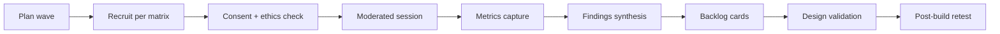

# UXR-001 — Field user research framework

**Card:** UXR-001 (P1-National)  
**Status:** Done  
**Scope:** National field research program for employees, managers, HR, payroll, audit, and support personas across agency archetypes; journey blueprints; usability baselines; ethics protocol.

## Objectives

1. Ground product decisions in moderated field evidence — not team opinion.
2. Cover every PRD-001 agency archetype with representative samples (central ministry, governorate, autonomous institution, branch office, specialized body).
3. Measure task success, time-on-task, error rate, and SUS (or equivalent) for critical journeys before and after build.
4. Convert critical findings into backlog cards with traceability to journey steps.

## Personas in scope

| Persona | Primary journeys |
|---------|------------------|
| Employee (ESS) | Leave request, payslip view, profile correction |
| Manager (MSS) | Leave approval, transfer initiation |
| HR Officer | Hire/onboarding, transfer, separation |
| Payroll Clerk | Payroll cycle, retro correction |
| Internal Auditor | DSAR sample, payroll reconciliation |
| Support / Helpdesk | Case triage, password / access recovery |

## Archetype sampling matrix

Each wave must include at least one participant per archetype from [`prd-product/agency-archetypes.json`](./prd-product/agency-archetypes.json):

- `central-ministry`
- `governorate`
- `autonomous-institution`
- `branch-office`
- `specialized-body`

Additional inclusion criteria: remote/low-bandwidth sites, assistive-technology users, and field workers where MOB-001 applies.

## Critical journeys (blueprints)

Documented in [`uxr/journey-blueprints.md`](./uxr/journey-blueprints.md):

| Journey ID | Flow | Primary personas |
|------------|------|------------------|
| `journey-hire` | Requisition → offer → onboarding | HR Officer, Employee |
| `journey-payroll` | Cycle open → validate → approve → pay | Payroll Clerk, Employee |
| `journey-leave` | Request → manager approval → balance update | Employee, Manager |
| `journey-transfer` | Initiate → approvals → position change | HR Officer, Manager |

## Metrics baseline

Machine-readable targets: [`uxr/usability-metrics-baseline.json`](./uxr/usability-metrics-baseline.json).

| Metric | Baseline target | Measurement |
|--------|-----------------|-------------|
| Task success rate | ≥ 85% per critical task | Moderated study (pass/fail) |
| Time on task | ≤ P75 in baseline JSON | Stopwatch / telemetry |
| Error rate | ≤ 10% recoverable errors | Observer log |
| SUS score | ≥ 68 (national average+) | Post-session questionnaire |
| Accessibility (WCAG 2.1 AA) | 0 blocker findings | AX audit + participant with AT |

## Research ethics

Full protocol: [`uxr/research-ethics-protocol.md`](./uxr/research-ethics-protocol.md).

- Informed consent before recording; right to withdraw without penalty.
- No production PII in prototypes or recordings; synthetic personas only in lab.
- Findings anonymized; no attribution to named officials without written consent.
- DPO review when sessions touch health, payroll, or disciplinary data (PRV-001 alignment).

## Study lifecycle



## Deliverables checklist

| Artifact | Path |
|----------|------|
| Research framework (this doc) | `docs/UXR_001_RESEARCH_FRAMEWORK.md` |
| Journey blueprints | `docs/uxr/journey-blueprints.md` |
| Metrics baseline | `docs/uxr/usability-metrics-baseline.json` |
| Ethics protocol | `docs/uxr/research-ethics-protocol.md` |
| Validation script | `scripts/uxr001-validate.ps1` |
| Unit tests | `Uxr001ResearchTests` |

## Dependencies

- **PRD-001** — capability map and personas define scope.
- **STR-007** — KPI definitions consume UXR metrics for adoption evidence.
- **Downstream:** UAT-001 (acceptance scenarios), TRN-001 (training materials), L10N-001 (bilingual sessions).

## Validation

```powershell
./scripts/uxr001-validate.ps1
dotnet test --filter Uxr001ResearchTests
```
