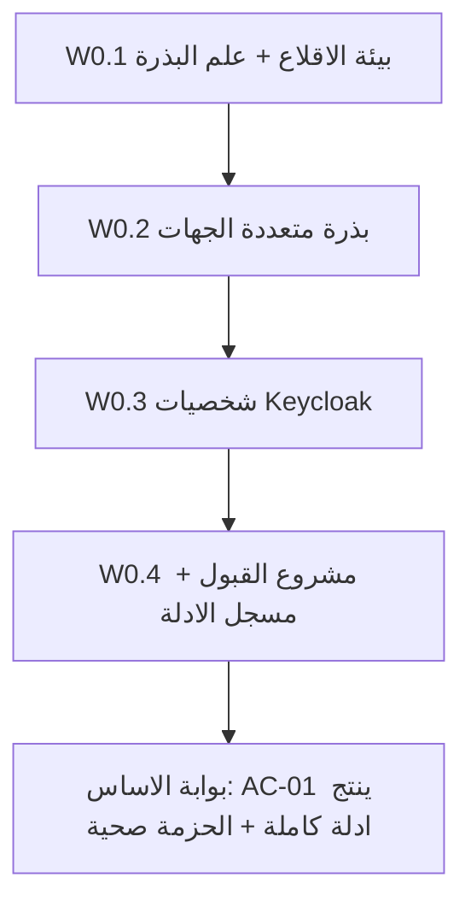

# خطة التنفيذ التفصيلية — PLAN-00 (الأساس)

خطة تنفيذ قابلة للتطبيق خطوةً بخطوة لـ[PLAN-00 — الأساس](../PLAN-00-foundation.md). المرجع للسياق العام: [الفهرس](../README.md). هذه الخطة تُنتج **كوداً وسكربتات ومشروع اختبارات ومُسجِّل أدلة**، وهي بوابة إلزامية قبل PLAN-01..13.

## المخرجات النهائية

- `scripts/acceptance-up.ps1` يرفع الحزمة الكاملة + يستورد realm القبول + يشغّل البذرة + يتحقق من الصحة.
- بذرة متعددة الجهات حتمية (`AcceptanceDataSeeder` + `AcceptanceSeedIds` + `AcceptanceSeedOrchestrator`).
- realm قبول Keycloak + mapper `scope_org_unit_id` + دور `auditor` + 7 مستخدمين بسمات جهة/نطاق.
- مشروع `src/Tests/HRManagement.AcceptanceTests` + `AcceptanceHarness` + `EvidenceRecorder` + سيناريو `AC-01` كتحقق للأنبوب.
- وظيفة CI تشغّل مجموعة القبول وترفع `acceptance-evidence/`.

## المتطلبات المسبقة

- Docker Desktop يعمل، .NET 10 SDK، PowerShell 7 (`pwsh`).
- القدرة على رفع الحزمة الكاملة عبر ملفات compose القائمة.

## ترتيب التنفيذ

---

## W0.1 — بيئة الإقلاع + علم تفعيل البذرة

**نقطة الربط الحالية:** [Program.cs](../../../src/Services/HRCore/HR.Core.Web/Program.cs) (165–187) يستدعي `NationalSeedOrchestrator.ApplyMandatoryAsync` دائماً و`DemoSeedOrchestrator.ApplyAsync` في `IsDevelopment()` فقط، ثم `OrgUnitPathService.RecomputeAllAsync()` و`OrgUnitIntegrationService.PublishAllOrgUnitsAsync()`.

- **الخطوة 1 —** إنشاء `scripts/acceptance-up.ps1` (نمط [run-staging-e2e.ps1](../../../scripts/run-staging-e2e.ps1) + [verify-staging-stack.ps1](../../../scripts/verify-staging-stack.ps1)):
  - يرفع: `docker compose -f docker-compose.yml -f docker-compose.services.yml -f docker-compose.local.yml -f docker-compose.dev-profiles.yml -f docker-compose.full-stack-gateway.yml --profile full-stack up -d --wait`.
  - يستورد realm القبول (W0.3) قبل الإقلاع عبر نمط `scripts/prepare-keycloak-import.ps1` / `prepare-ci-compose-env.sh`.
  - يمرّر `SEED_ACCEPTANCE=true`، ثم يستدعي `verify-staging-stack.ps1`.
- **الخطوة 2 —** إضافة علم تفعيل البذرة: قراءة `SEED_ACCEPTANCE` (أو `Seed:Acceptance`) في [Program.cs](../../../src/Services/HRCore/HR.Core.Web/Program.cs)، لأن الإنتاج يعطّل `DemoSeed` ونحتاج بذرة القبول متاحة في حزمة القبول دون الاعتماد على `IsDevelopment()` وحده.

**تحقق W0.1:** `verify-staging-stack.ps1` يمرّ (كل `/health/upstreams/{slug}` = 200).

---

## W0.2 — بذرة القبول متعددة الجهات (مركز + فروع + Tenant-B)

**النمط المرجعي:** [DemoDataSeeder.cs](../../../src/Services/HRCore/HR.Core.Infrastructure/Data/DemoDataSeeder.cs) (`OrgUnitDefs`, `DemoSeedIds`, idempotency عبر فحص `NationalId`) و[DemoSeedOrchestrator.cs](../../../src/Services/HRCore/HR.Core.Infrastructure/Seeding/DemoSeedOrchestrator.cs). المعرّف الافتراضي في [TenantDefaults.cs](../../../src/Shared/HRManagement.SharedKernel/Tenancy/TenantDefaults.cs) = `00000000-0000-4000-8000-000000000001` (PLATFORM).

- **الخطوة 3 —** إنشاء `AcceptanceSeedIds` (GUIDات حتمية) للجهتين والوحدات والموظفين، ليُشارَك عبر الخدمات (نمط `DemoSeedIds`). معرّفات مقترحة: `AGENCY-A` و`AGENCY-B` بـGUID ثابتين مختلفين عن PLATFORM.
- **الخطوة 4 —** إنشاء `AcceptanceDataSeeder` في `HR.Core.Infrastructure/Seeding/` يُنشئ (idempotent بفحص وجود جهة `AGENCY-A`):
  - **Tenant-A** (`AGENCY-A`): مركز `HQ` (جذر) ← فرع `BR1` ← قسم `BR1-D1`؛ وفرع شقيق `BR2` تحت المركز.
  - **Tenant-B** (`AGENCY-B`): جذر `HQB` + وحدة واحدة + موظف واحد (للعابر السالب).
  - موظفون: `emp-br1` (في BR1)، `emp-d1` (في BR1-D1)، `emp-br2` (في BR2)، `emp-b` (في AGENCY-B).
  - قالب سياسة + إصدارين (لـPLAN-02)، ودورة رواتب تجريبية بلقطة مدخلات ثابتة (لـPLAN-06/10).
- **الخطوة 5 —** إنشاء `AcceptanceSeedOrchestrator.ApplyAsync(db, sp, ct)` بنمط `DemoSeedOrchestrator`؛ **مهم:** ضبط `TenantIdFlow.Set(tenantId)` عند إدراج صفوف كل جهة (بسبب مرشح الجهة/RLS)، وإعادة تعيينه بعد كل جهة.
- **الخطوة 6 —** الربط في [Program.cs](../../../src/Services/HRCore/HR.Core.Web/Program.cs) بعد كتلة `DemoSeed` وضمن الحارس `SEED_ACCEPTANCE`، ثم استدعاء `OrgUnitPathService.RecomputeAllAsync()` (يحسب `MaterializedPath` — أساس توسّع نطاق الفرع) و`OrgUnitIntegrationService.PublishAllOrgUnitsAsync()`.
- **الخطوة 7 —** توحيد المعرفات: مطابقة [testdata/e2e/manifest.json](../../../testdata/e2e/manifest.json) و`tenantCode` في [personas.json](../../../testdata/e2e/personas.json) مع رموز الجهات المبذورة (`AGENCY-A`/`AGENCY-B`)، وإزالة تضارب `1111…/3333…`.

> ملاحظة: إنشاء الشجرة هنا مباشر؛ مسار `AgencyManifest` (إنشاء الوحدات عبر التهيئة) يخص [PLAN-08](../PLAN-08-onboarding-quarantine.md) ويُثبت AC-07.

**تحقق W0.2:** استعلام HR.Core يُظهر جهتين وشجرة مركز/فرع/قسم بـ`MaterializedPath` صحيح وموظفين لكل فرع؛ إعادة تشغيل البذرة لا تُنشئ ازدواجاً.

---

## W0.3 — شخصيات Keycloak (mapper النطاق + دور المدقق + المستخدمون)

**الوضع:** [realm-hrmanagement-dev.template.json](../../../docker/keycloak/realm-hrmanagement-dev.template.json) فيه أدوار وmappers لكن **بلا `scope_org_unit_id`** و**بلا دور `auditor`**. الخريطة في [KeycloakRoleMapping.cs](../../../src/Shared/HRManagement.ServiceDefaults/KeycloakRoleMapping.cs) تتوقع `tenant_id` و`scope_org_unit_id`.

- **الخطوة 8 —** إضافة protocol mapper من نوع User Attribute → claim `scope_org_unit_id` (والتأكد من وجود mapper `tenant_id`) في القالب وفي realm القبول.
- **الخطوة 9 —** إضافة دور realm `auditor`.
- **الخطوة 10 —** إنشاء `docker/keycloak/realm-acceptance.json` (أو توسعة القالب) بالمستخدمين السبعة، لكلٍّ سمتا `tenant_id` (GUID) و`scope_org_unit_id` (GUID الوحدة للمديرين)، وأدواره:

| المستخدم | الجهة | scope_org_unit_id | الأدوار |
|----------|-------|-------------------|---------|
| `acc-central-a` | AGENCY-A | — (المركز كامل) | hr-core, hr-management-approver |
| `acc-br1-mgr` | AGENCY-A | BR1 | branch-manager, hr-core |
| `acc-br2-mgr` | AGENCY-A | BR2 | branch-manager, hr-core |
| `acc-employee-a` | AGENCY-A | BR1 | hr-employee |
| `acc-platform-admin` | (منصّي) | — | platform-admin |
| `acc-auditor` | AGENCY-A | — | auditor |
| `acc-outsider-b` | AGENCY-B | HQB | hr-core |

- **الخطوة 11 —** جعل `acceptance-up.ps1` يستورد realm القبول (نمط `prepare-keycloak-import.ps1`).
- **الخطوة 12 —** إضافة `testdata/acceptance/personas.json` (نمط [personas.json](../../../testdata/e2e/personas.json))، وتوسعة نموذج `E2ePersona` بحقل `ScopeOrgUnitCode`/`OrgUnitId` عند الحاجة.

**تحقق W0.3:** تسجيل دخول كل شخصية عبر نقطة token في Keycloak، وفك JWT، وتأكيد وجود `tenant_id` (و`scope_org_unit_id` للمديرين).

---

## W0.4 — مشروع القبول + مُسجِّل الأدلة

**النمط المرجعي:** [E2eHarness.cs](../../../src/Tests/HRManagement.E2E/E2eHarness.cs) (`E2eEnv`, `E2eHttp`, `E2eSeed`, `E2ePersona`) و`PlaywrightFixture`.

- **الخطوة 13 —** إنشاء مشروع `src/Tests/HRManagement.AcceptanceTests` (xUnit + Microsoft.Playwright + SkippableFact)، يُنسخ فيه `testdata/acceptance/**` و`realm-acceptance.json`، ويُضاف إلى [HRManagement.slnx](../../../HRManagement.slnx). علم التشغيل `RUN_ACCEPTANCE=true`.
- **الخطوة 14 —** `AcceptanceHarness`: إعادة استخدام `E2eEnv/E2eHttp/E2eSeed` + مساعد دخول لكل شخصية يُرجع JWT و`IAPIRequestContext` محمّلاً بـBearer و`X-Correlation-ID` ثابت لكل سيناريو.
- **الخطوة 15 —** `EvidenceRecorder` يكتب `acceptance-evidence/AC-XX/` وفق [عقد الأدلة الثماني](../README.md#عقد-الأدلة-لكل-سيناريو-موحد):
  - `metadata.json` (git sha عبر `git rev-parse HEAD`، وسوم الصور، التاريخ، البيئة).
  - `steps.md`, `http/*.json`, `before.json`/`after.json`, `audit.json` (استعلام تدقيق البوابة + CorrelationId)، `db-checks.json` (استعلامات Npgsql مباشرة)، `timing.json`, `result.json` (Pass/Fail/Blocked + سبب).
  - مُجمِّع `summary.md` لكل السيناريوهات.
- **الخطوة 16 —** تنفيذ سيناريو `AC-01` نموذجياً (المستخدم المركزي يبحث ويرى فرعي Tenant-A فقط) عبر الإطار + المُسجِّل، للتحقق من الأنبوب كاملاً (بوابة الأساس).
- **الخطوة 17 —** توسعة CI: في [.github/workflows/ci.yml](../../../.github/workflows/ci.yml) أو [.github/workflows/e2e-journeys.yml](../../../.github/workflows/e2e-journeys.yml): رفع حزمة القبول + استيراد realm + تشغيل البذرة + `RUN_ACCEPTANCE=true dotnet test` + رفع `acceptance-evidence/` كـartifact.

**تحقق W0.4:** `dotnet build` ينجح؛ `RUN_ACCEPTANCE=true dotnet test` يُنتج مجلد أدلة كامل لـ`AC-01`.

---

## قائمة الملفات (تُنشأ/تُعدَّل)

| الملف | العملية |
|-------|---------|
| `scripts/acceptance-up.ps1` | جديد |
| `src/Services/HRCore/HR.Core.Web/Program.cs` | تعديل (حارس `SEED_ACCEPTANCE` + استدعاء المنظّم) |
| `src/Services/HRCore/HR.Core.Infrastructure/Seeding/AcceptanceSeedIds.cs` | جديد |
| `src/Services/HRCore/HR.Core.Infrastructure/Seeding/AcceptanceDataSeeder.cs` | جديد |
| `src/Services/HRCore/HR.Core.Infrastructure/Seeding/AcceptanceSeedOrchestrator.cs` | جديد |
| `docker/keycloak/realm-hrmanagement-dev.template.json` | تعديل (mapper `scope_org_unit_id` + دور `auditor`) |
| `docker/keycloak/realm-acceptance.json` | جديد |
| `testdata/acceptance/personas.json` | جديد |
| `testdata/e2e/manifest.json` / `testdata/e2e/personas.json` | تعديل (توحيد المعرفات) |
| `src/Tests/HRManagement.AcceptanceTests/**` | جديد (مشروع + Harness + EvidenceRecorder + Ac01) |
| `HRManagement.slnx` | تعديل (إضافة المشروع) |
| `.github/workflows/ci.yml` (أو `e2e-journeys.yml`) | تعديل (وظيفة القبول) |

## مخاطر وملاحظات تنفيذية

- **مرشح الجهة أثناء البذر:** يجب ضبط `TenantIdFlow`/تجاوز المرشح عند إدراج صفوف كل جهة وإلا فشلت الكتابة أو استُبعدت الصفوف (انظر `TenantAwareDbContext` وRLS).
- **`MaterializedPath`:** لا يعمل توسّع نطاق الفرع دون `OrgUnitPathService.RecomputeAllAsync()` بعد بذر الشجرة.
- **الإنتاج يعطّل `DemoSeed`:** لذا نستخدم علم `SEED_ACCEPTANCE` مستقلاً عن `IsDevelopment()`.
- **توحيد المعرفات:** أي تضارب بين رموز الجهات في البذرة وrealm وtestdata سيُضعف السيناريوهات السالبة العابرة.

## بوابة الأساس (تعريف الإنجاز)

كل بنود قبول [PLAN-00](../PLAN-00-foundation.md) مستوفاة: الحزمة صحّية، البذرة تُنتج الجهتين والشجرة والموظفين والمستخدمين بلا ازدواج، كل شخصية تُصدر JWT بالسمات الصحيحة، وسيناريو `AC-01` يُنتج مجلد أدلة كامل. عندها يصبح PLAN-01 قابلاً للتنفيذ.
