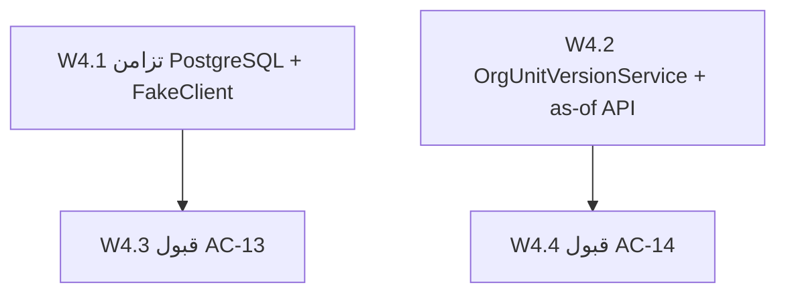

# خطة التنفيذ التفصيلية — PLAN-04 (الرموز المتوازية + الهيكل المؤرخ)

تنفيذ [PLAN-04 — codes-temporal-org](../PLAN-04-codes-temporal-org.md) لإثبات **AC-13** (توليد رموز متوازٍ دون تكرار) و**AC-14** (استعلام as-of للهيكل المؤرخ). يعتمد على [PLAN-00](PLAN-00-EXECUTION.md) (بذرة القبول + `AcceptanceTests` + `EvidenceRecorder`).

## المخرجات النهائية

- `CodeGenerationConcurrencyTests` — 250 توليداً متوازياً على PostgreSQL Testcontainers.
- `FakeCodeGenerationClient` في `HRManagement.TestSupport` + `ReplaceCodeGenerationClientWithFake()`.
- `OrgUnitVersionService` + ترحيل `HeadEmployeeId` على `OrgUnitVersions` + backfill للبذور.
- `GET /api/org-structure/units/{id}/as-of` + `PUT` للتعديل الهيكلي (قبول AC-14).
- `Ac13ParallelCodeGenerationTests` و`Ac14TemporalOrgStructureTests` + أدلة `acceptance-evidence/AC-13/` و`AC-14/`.
- توسيع `scripts/org001-validate.ps1`.

## ترتيب التنفيذ



---

## W4.1 — AC-13: إثبات التزامن

| الملف | الدور |
|-------|-------|
| `src/Tests/HRManagement.IntegrationTests/CodeGenerationConcurrencyTests.cs` | 250× `GenerateAsync` على `AssetTag`؛ تفرد + عداد |
| `src/Tests/HRManagement.TestSupport/CodeGeneration/FakeCodeGenerationClient.cs` | عداد `Interlocked` + DI helper |
| `src/Tests/HRManagement.AcceptanceTests/Ac13ParallelCodeGenerationTests.cs` | 120× POST عبر البوابة + أدلة |

**تحقق:**

```powershell
$env:RUN_TESTCONTAINERS = "true"
dotnet test src/Tests/HRManagement.IntegrationTests --filter CodeGenerationConcurrency
```

```powershell
$env:RUN_ACCEPTANCE = "true"
dotnet test src/Tests/HRManagement.AcceptanceTests --filter Ac13ParallelCodeGeneration
```

---

## W4.2 — AC-14: الهيكل المؤرخ

| الملف | الدور |
|-------|-------|
| `OrgUnitVersion.cs` | حقل `HeadEmployeeId` |
| `Migrations/20260824143317_ORG001_HeadOnVersion.cs` | عمود `HeadEmployeeId` على `OrgUnitVersions` |
| `OrgUnitVersionService.cs` | `AppendVersionAsync`, `ResolveAsOfAsync`, `BackfillMissingVersionsAsync` |
| `OrgStructureApiController.cs` | `GET as-of`, `PUT` rename/head/move |
| `OrgUnitsController.cs` | Create/Edit → `AppendVersionAsync` |
| `AcceptanceTemporalPatch.cs` | BR1 رئيس + وظيفة ممولة للقبول |
| `OrgUnitVersionServiceTests.cs`, `Org001DatedStructureTests.cs` | rename/move/as-of |

**تحقق:**

```powershell
powershell -File scripts/org001-validate.ps1
dotnet test src/Tests/HRManagement.UnitTests --filter "OrgUnitVersionServiceTests|Org001DatedStructure"
```

```powershell
$env:RUN_ACCEPTANCE = "true"
dotnet test src/Tests/HRManagement.AcceptanceTests --filter Ac14TemporalOrgStructure
```

---

## تعريف الإنجاز (DoD)

- [x] اختبار تزامن PostgreSQL (250+) — يمر عند توفر Docker + `RUN_TESTCONTAINERS=true`
- [x] `FakeCodeGenerationClient` مشترك ومستخدم في `HireCaseIntegrationTests`
- [x] Create/Edit يكتبان `OrgUnitVersion`؛ backfill في `NationalSeedOrchestrator` / `AcceptanceSeedOrchestrator`
- [x] `GET /api/org-structure/units/{id}/as-of` يعيد وحدة + رئيس + وظائف ممولة (`CreatedAt <= asOf`)
- [x] اختبارات قبول AC-13/AC-14 + عقد الأدلة الثماني

## مخاطر

- **Serializable retries:** تحت حمل 300+ قد تحدث إعادة محاولة — الاختبار يطلب 0 تكرار فقط.
- **Docker:** Testcontainers وقبول حي يتطلبان Docker Desktop.
- **Merge/Split/Close:** خارج نطاق AC-14 الأول.
