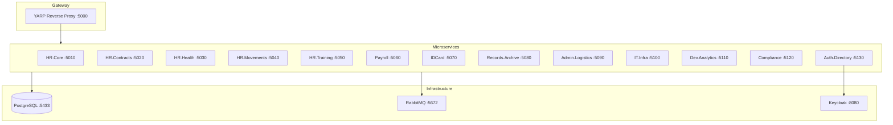
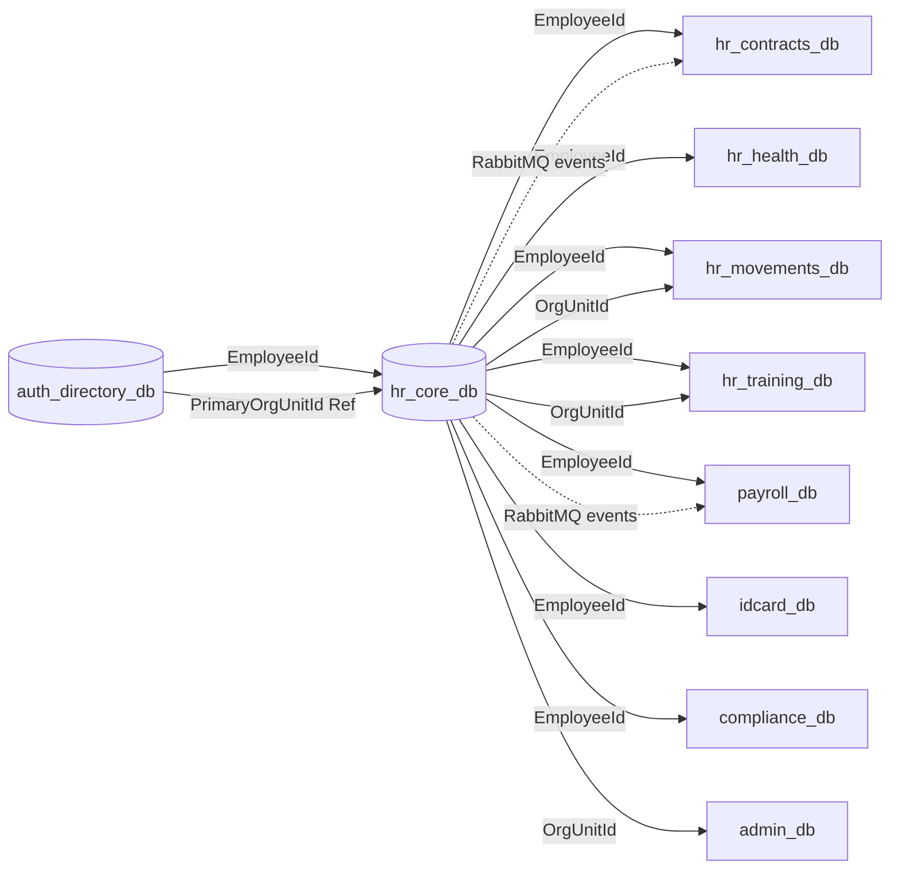

# نظرة عامة — قواعد البيانات والعلاقات بين الخدمات

## المعمارية

النظام يتبع **Database per Service**: كل خدمة مصغرة لها قاعدة PostgreSQL مستقلة. التكامل بين الخدمات عبر **RabbitMQ** (`HRManagement.MessageContracts`) وليس عبر قيود FK عابرة للقواعد.

## جدول مرجعي

| الخدمة | قاعدة البيانات | DbContext | الكيانات | التوثيق |
|--------|----------------|-----------|----------|---------|
| HR.Core | `hr_core_db` | `HRCoreDbContext` | 19 | [01-hr-core.md](01-hr-core.md) |
| HR.Contracts | `hr_contracts_db` | `ContractsDbContext` | 11 | [02-hr-contracts.md](02-hr-contracts.md) |
| HR.Health | `hr_health_db` | `HealthDbContext` | 8 | [03-hr-health.md](03-hr-health.md) |
| HR.Movements | `hr_movements_db` | `MovementsDbContext` | 7 | [04-hr-movements.md](04-hr-movements.md) |
| HR.Training | `hr_training_db` | `TrainingDbContext` | 8 | [05-hr-training.md](05-hr-training.md) |
| Payroll | `payroll_db` | `PayrollDbContext` | 8 | [06-payroll.md](06-payroll.md) |
| IDCard | `idcard_db` | `IDCardDbContext` | 7 | [07-idcard.md](07-idcard.md) |
| Records.Archive | `archive_db` | `ArchiveDbContext` | 7 | [08-records-archive.md](08-records-archive.md) |
| Admin.Logistics | `admin_db` | `AdminLogisticsDbContext` | 7 | [09-admin-logistics.md](09-admin-logistics.md) |
| IT.Infra | `it_infra_db` | `ITInfraDbContext` | 7 | [10-it-infrastructure.md](10-it-infrastructure.md) |
| Dev.Analytics | `analytics_db` | `AnalyticsDbContext` | 7 | [11-dev-analytics.md](11-dev-analytics.md) |
| Compliance | `compliance_db` | `ComplianceDbContext` | 7 | [12-compliance.md](12-compliance.md) |
| Auth.Directory | `auth_directory_db` | `AuthDirectoryDbContext` | 8 | [13-auth-directory.md](13-auth-directory.md) |

## العلاقات المنطقية بين الخدمات

لا توجد FK عابرة للقواعد. المراجع تتم بـ `Guid` (وأحياناً `string`) مع التحقق في التطبيق أو عبر الأحداث.

### مراجع `EmployeeId` (من HR.Core)

| الخدمة | جداول/كيانات تستخدم `EmployeeId` |
|--------|-----------------------------------|
| HR.Contracts | Contract, ProbationRecord, SeparationRecord, LeaveRequest, AdvanceRequest, CommencementRecord, ServiceTransaction |
| HR.Health | MedicalRecord, PeriodicMedicalCheck, InsuranceCard, HealthStatusEntry, MedicalRecommendation, HealthRetirementRecord |
| HR.Movements | TransferRequest, MovementExecutionRecord, SecondmentRequest, TransferFinancialImpact |
| HR.Training | TrainingEnrollment, TrainingNomination, MissionFile |
| Payroll | SalaryLine, AllowanceRecord, DeductionRecord, PayrollAdjustment |
| IDCard | IssuedCard, CardRequest |
| Compliance | DisciplinaryAction |
| Admin.Logistics | AssetAssignment |
| Auth.Directory | AuthUser, DirectoryEntry |

### مراجع `OrgUnitId` (من HR.Core)

| الخدمة | الاستخدام |
|--------|-----------|
| HR.Movements | TransferRequest (From/To), DistributionPlan |
| HR.Training | TrainingPlan |
| Admin.Logistics | SupplyOrder |
| Auth.Directory | DirectoryEntry.PrimaryOrgUnitId (Ref) |

### مراجع المستخدم والمصادقة

| المرجع | المصدر | الاستخدام |
|--------|--------|-----------|
| `AuthUser.Id` | Auth.Directory | SystemPermissionRecord.UserId, ITSupportTicket |
| `EmployeeId` على AuthUser | Ref → HR.Core | ربط حساب الدخول بالموظف |
| `ChangedBy` / `ApprovedBy` / `RequestedBy` | Guid? | عبر معظم الخدمات — Ref لموظف أو مستخدم |

## قناة التكامل

- **تزامني:** البوابة YARP (`/api/...`) بين الواجهات والخدمات.
- **غير متزامن:** MassTransit + RabbitMQ؛ إيصالات idempotency مثل `IntegrationMessageReceipt` في HR.Core.
- **المصادقة:** Keycloak (OIDC)؛ Auth.Directory يخزّن `KeycloakUserId` وربط `EmployeeId`.
