هذا التوصيف يبني **منظومة موارد بشرية مؤسسية كاملة**، وليست مجرد قائمة وظائف.  
الفكرة الأساسية فيه هي أن كل معاملة تمر غالبًا عبر نفس الدورة:

**طلب / ورود بيانات → تدقيق → معالجة → اعتماد → إصدار قرار أو وثيقة → تحديث قواعد البيانات → إشعار الجهات المعنية → أرشفة**

وبناءً على ذلك، فكل فرع له دور محدد داخل هذه الدورة، وليس عمله مستقلًا عن باقي الفروع.

---

## 1) الشعبة الأم: شعبة التنظيم والموارد البشرية

هذه هي **العقل المركزي** لكل ما يتعلق بالقوى البشرية.

### تسلسل عملها من الألف إلى الياء

1. **استقبال البيانات** من الفروع والإدارات: موظف جديد، نقل، تقييم، تقرير طبي، دورة، شكوى، أو احتياج وظيفي.
    
2. **توحيد البيانات** في قاعدة مركزية حتى تصبح مرجعًا واحدًا للموظف.
    
3. **تحليل الاحتياج**: هل المؤسسة تحتاج موظفين إضافيين؟ هل يوجد فائض؟ هل التوزيع الحالي مناسب؟
    
4. **بناء القرارات التنظيمية**: هيكل، توصيف وظيفي، توزيع قوى بشرية، أو تعديلات على الملاكات.
    
5. **إصدار القرارات**: تعيين، تثبيت، نقل، تكليف، إعارة، إيفاد، ترقية، إنهاء خدمة، أو شهادات تقدير.
    
6. **تطبيق المتابعة الميدانية**: جولات تفقد على الفروع للتأكد أن البيانات والأنظمة تطبق فعليًا.
    
7. **إخراج الإحصائيات والتقارير** للإدارة العليا لمساندة القرار.
    
8. **إرسال التوجيهات للفروع** وإلزامها بالتنفيذ.
    
9. **حفظ الأثر الإداري** في الأرشيف والأنظمة الرقمية.
    

### علاقتها بباقي الفروع

- تستقبل من الجميع.
    
- تعطي أوامر للجميع.
    
- تربط بين: الخدمة، الصحة، الرواتب، التنظيم، التنقلات، التدريب، البعثات، الهويات، القانونية، التقنية، والتطوير.
    

---

## 2) إدارة شؤون الكادر الإشرافي

هذه الإدارة تدير فئة **الكادر الإشرافي** من حيث الخدمة والملف الشخصي والصحة والتنقلات والتدريب.

---

### 2.1 فرع الخدمة والعقود

هذا الفرع هو **بوابة دخول الموظف إلى الخدمة** وبوابة خروجه منها أيضًا.

#### التسلسل التشغيلي

1. **استلام المرشح أو الموظف** من جهة التوظيف أو الاستقطاب.
    
2. **تصنيف الحالة**: دائم، إداري، أو متعاقد مؤقت.
    
3. **إعداد العقد المناسب** حسب الفئة.
    
4. **تدقيق البيانات الأساسية** مع الملفات الشخصية والهويات.
    
5. **إبرام العقد أو تفعيله**.
    
    - الدائم والإداري: بعد التثبيت.
        
    - المؤقت: مباشرة حسب الضوابط.
        
6. **إثبات المباشرة** ليبدأ الأثر الإداري والمالي.
    
7. **متابعة الإجازات والسلف** وما يرتبط بالخدمة.
    
8. **تنفيذ التعديلات الوظيفية** مثل تغيير المسمى أو تحديث البطاقة.
    
9. **إنهاء الخدمة** عند الاستقالة أو الفصل أو انتهاء العقد أو الحكم القضائي أو القرار الطبي.
    
10. **إرسال الأثر** إلى الرواتب، الهويات، الأرشيف، والقانوني.
    
11. **حفظ المعاملة** في الديوان والأرشيف.
    

#### الفكرة الجوهرية

هذا الفرع لا “ينشئ موظفًا” فقط، بل **يدير دورة الحياة الإدارية الكاملة للعلاقة بين الموظف والمؤسسة**.

---

### 2.2 فرع الشؤون الشخصية والصحية

هذا الفرع هو **مرآة الموظف الشخصية والصحية** داخل المؤسسة.

#### التسلسل التشغيلي

1. **استلام بيانات الموظف** من التوظيف، التنظيم، الفروع، أو مباشرة للمتعاقدين.
    
2. **فتح الملف الشخصي** وإدخال البيانات: الاسم، الرقم الوطني، الصورة، البصمات، الحالة الاجتماعية، المؤهلات، العنوان، الخبرات.
    
3. **تحديث الملف بشكل دوري** عند أي تغيير رسمي.
    
4. **إعداد الوثائق الثبوتية** والنماذج الرسمية المعتمدة.
    
5. **فتح الملف الصحي** وإدخال المعلومات الطبية والجسدية.
    
6. **تحديث الملف الصحي دوريًا** بالتنسيق مع الصحة المهنية.
    
7. **استقبال قرارات اللجان الطبية**.
    
8. **ترجمة القرار الطبي إلى أثر وظيفي**:
    
    - لياقة كاملة.
        
    - مهام مكتبية.
        
    - مهام محدودة.
        
    - إنهاء خدمة.
        
    - تعويضات.
        
9. **استخراج بطاقات التأمين الصحي للعائلة**.
    
10. **تنسيق تأمين المتقاعدين**.
    
11. **إحالة كل شيء إلى الأرشيف والديون**.
    

#### الفكرة الجوهرية

هذا الفرع يضمن أن **هوية الموظف المدنية والشخصية والصحية متطابقة مع وضعه الوظيفي**.

---

### 2.3 فرع التنقلات والتوزيع

هذا الفرع يدير **حركة الموظفين داخل المؤسسة**.

#### التسلسل التشغيلي

1. **استلام طلب نقل أو توزيع** من الإدارة أو من الموظف وفق الموافقات.
    
2. **تحليل الحاجة**: أين يوجد عجز؟ أين يوجد فائض؟
    
3. **مراجعة البيانات الوظيفية** مع التخطيط والإحصاء والتطوير.
    
4. **إعداد مشروع النقل أو التوزيع**.
    
5. **عرضه على رئيس الشعبة أو الإدارة العليا**.
    
6. **إصدار القرار**.
    
7. **تنفيذ النقل إداريًا** عبر الخدمة والعقود.
    
8. **تحديث الملف الوظيفي** في السيرة والأنظمة.
    
9. **إبلاغ الرواتب إذا وُجد أثر مالي**.
    
10. **إثبات العملية في الديوان والأرشيف**.
    

#### الفكرة الجوهرية

هذا الفرع لا ينقل الموظف فقط، بل **يعيد تموضعه داخل هيكل المؤسسة وفق الحاجة الفعلية**.

---

### 2.4 فرع تخطيط الدورات وتأهيل القوى البشرية

هذا الفرع يهتم بـ **رفع كفاءة الموظفين وبناء التأهيل المطلوب لكل وظيفة**.

#### التسلسل التشغيلي

1. **تحديد الاحتياج المهاري** لكل وظيفة.
    
2. **إنشاء كود تأهيلي** لكل مسمى وظيفي.
    
3. **مطابقة الموظف مع الوظيفة** لمعرفة الفجوة التدريبية.
    
4. **إعداد خطة تدريب سنوية أو دورية**.
    
5. **ترشيح الموظفين للدورات** ورفع الأسماء للإدارة العليا.
    
6. **تنفيذ الدورات** بالتنسيق مع الجهات التدريبية.
    
7. **متابعة الحضور والنجاح والتقييم النهائي**.
    
8. **تخزين النتائج في قاعدة البيانات**.
    
9. **ربط الشهادات بالملف الشخصي والسيرة الوظيفية**.
    
10. **إعداد ملفات البعثات** إذا كان التأهيل خارجيًا أو طويلًا.
    

#### الفكرة الجوهرية

هذا الفرع لا يدرب لأجل التدريب فقط، بل **يبني جاهزية الموظف الحالية والمستقبلية**.

---

## 3) إدارة شؤون الموظفين التنفيذيين

هذه الإدارة **تعمل بنفس منطق الإدارة السابقة تمامًا**، لكن على فئة الموظفين التنفيذيين.

### التسلسل العام

1. ورود الطلب أو المعاملة.
    
2. تدقيق البيانات.
    
3. إصدار العقد أو القرار.
    
4. تحديث الملف الشخصي والصحي.
    
5. تنفيذ النقل أو التدريب أو الإنهاء أو الترقية.
    
6. تحديث السجلات الرسمية.
    
7. إرسال الأثر إلى الرواتب والهويات والأرشيف.
    

### الفرق الوحيد

الاختلاف ليس في الآلية، بل في **الفئة المستهدفة** ونوع الضوابط المرتبطة بها.

---

## 4) إدارة السجلات المؤسسية

هذه الإدارة هي **المرجع التاريخي والرسمي لكل موظف**.

---

### 4.1 فرع السيرة الوظيفية

#### التسلسل التشغيلي

1. **استلام البيانات الوظيفية** من كل الفروع.
    
2. **تدقيقها** قبل إدخالها في النظام المركزي.
    
3. **اعتمادها أو رفضها أو طلب تصحيحها**.
    
4. **تحديث السيرة الوظيفية الشاملة**.
    
5. **إصدار نسخة معتمدة** بعد تصديق رئيس الشعبة.
    
6. **إرسال النسخة** إلى الجهات التي تحتاجها.
    
7. **حفظ السجل** كمرجع رسمي لاحق.
    

#### الفكرة الجوهرية

هو **البوابة التي تجعل البيانات “رسمية ومعتمدة” داخل النظام**.

---

### 4.2 فرع الرواتب والتعويضات

#### التسلسل التشغيلي

1. **استلام البيانات الوظيفية أو التغييرات** من الخدمة والتنقلات والبعثات.
    
2. **مراجعة الأثر المالي** على الراتب والبدلات والتعويضات.
    
3. **مطابقة البيانات قبل الصرف وبعده**.
    
4. **التأكد من سلامة الفروقات**.
    
5. **تمرير الملاحظات للمالية أو الرقابة** عند وجود خلل.
    
6. **أرشفة النتائج**.
    

#### الفكرة الجوهرية

هو **العين المالية على كل تغيير إداري**.

---

### 4.3 فرع أرشفة الملفات والوثائق

#### التسلسل التشغيلي

1. **استلام كل الملفات الرسمية** من الفروع المختلفة.
    
2. **تصنيفها** حسب الفئة: إشرافي أو تنفيذي.
    
3. **فهرستها وحفظها** ورقيًا أو إلكترونيًا.
    
4. **تنظيم الإعارة والإرجاع**.
    
5. **الاستجابة لطلبات الاستدعاء** من الجهات المخولة.
    
6. **حفظ النسخ النهائية** بعد انتهاء الخدمة.
    

#### الفكرة الجوهرية

هو **ذاكرة المؤسسة**.

---

## 5) الفروع المركزية

### 5.1 فرع بطاقات التعريف والهويات

#### التسلسل التشغيلي

1. **استلام بيانات الموظف المعتمدة** من الخدمة أو السيرة أو الصحة أو التدريب.
    
2. **تصميم البطاقة أو الشهادة إلكترونيًا**.
    
3. **التحقق من الصلاحية**.
    
4. **طباعة الوثيقة**.
    
5. **تسليمها عبر المسار الرسمي**.
    
6. **تعطيلها أو تحديثها عند انتهاء الخدمة أو تغيير الوضع**.
    
7. **حفظ سجل الأختام والتصاميم**.
    

#### الفكرة الجوهرية

هذا الفرع يحول البيانات المعتمدة إلى **هوية مادية ورسمية قابلة للاستخدام**.

---

### 5.2 فرع الرقابة

#### التسلسل التشغيلي

1. **استقبال بيانات أو ملاحظات** من الرواتب أو التخطيط أو الشكاوى.
    
2. **التحقق من الالتزام بالأنظمة**.
    
3. **تحليل المخالفات والانحرافات**.
    
4. **إعداد تقرير رقابي**.
    
5. **رفع التوصيات إلى الإدارة العليا**.
    
6. **إحالة المخالفات إلى القانوني عند الحاجة**.
    
7. **متابعة التصحيح حتى الإغلاق**.
    

#### الفكرة الجوهرية

هو **الجهة التي تمنع الخلل من التحول إلى ممارسة دائمة**.

---

### 5.3 فرع التنظيم والتجهيز

#### التسلسل التشغيلي

1. **استلام قرارات الهيكل أو طلبات التعديل**.
    
2. **مراجعة التوصيف الوظيفي والهياكل التنظيمية**.
    
3. **إعداد أو تحديث الملاكات**.
    
4. **تحديد الأصول والتجهيزات اللازمة**.
    
5. **اعتماد معدلات التجهيز**.
    
6. **إرسالها للجهات التنفيذية والمالية**.
    
7. **أرشفة ما تم اعتماده**.
    

#### الفكرة الجوهرية

هذا الفرع يحدد **كيف يجب أن تكون المؤسسة على الورق، وعلى مستوى التجهيز الفعلي**.

---

### 5.4 فرع التخطيط والإحصاء

#### التسلسل التشغيلي

1. **إجراء تفقد دوري** للفروع.
    
2. **استقبال تقرير الحضور اليومي**.
    
3. **إجراء تدقيق مبرمج كل 3 سنوات**.
    
4. **تنفيذ تفتيش مفاجئ عند الحاجة**.
    
5. **تحليل الأعداد والبيانات الاسمية والرقمية**.
    
6. **إعداد التقارير والإحصاءات**.
    
7. **إدارة اللجان الميدانية لوجستيًا**.
    
8. **رفع النتائج إلى الإدارة العليا**.
    
9. **إرسال المخرجات إلى التنقلات والرقابة والتطوير**.
    

#### الفكرة الجوهرية

هذا الفرع هو **العين الإحصائية والميدانية للمؤسسة**.

---

### 5.5 الفرع الإداري

#### التسلسل التشغيلي

1. **استلام احتياجات الفروع الداخلية**.
    
2. **تأمين الإمداد والتموين والمالية والخدمات الفنية**.
    
3. **توفير الدعم التشغيلي اليومي**.
    
4. **متابعة التجهيزات والاحتياجات**.
    
5. **إحالة ما يلزم للجهات المختصة**.
    

#### الفكرة الجوهرية

هو **المساند التشغيلي الذي يبقي الشعبة تعمل**.

---

### 5.6 فرع الشؤون القانونية والانضباط

#### التسلسل التشغيلي

1. **استلام ملف أو إحالة أو مخالفة**.
    
2. **مراجعة قانونية أولية**.
    
3. **تحديد نوع الإجراء**: مخالفة، جزاء، نزاع، اعتراض، قرار إداري.
    
4. **إعداد الرأي القانوني**.
    
5. **التنسيق مع الإدارة العليا**.
    
6. **تحويل القرار إلى إجراء قابل للتنفيذ**.
    
7. **إغلاق الملف بعد التوثيق**.
    

#### الفكرة الجوهرية

هو **ضابط المشروعية النظامية داخل المؤسسة**.

---

### 5.7 فرع الديوان العام

#### التسلسل التشغيلي

1. **استلام المراسلات الواردة**.
    
2. **تسجيلها برقم ومسار**.
    
3. **إحالتها للفرع المختص**.
    
4. **متابعة الردود**.
    
5. **إصدار المراسلات الصادرة**.
    
6. **أرشفتها نهائيًا**.
    

#### الفكرة الجوهرية

هو **الممر الرسمي لكل ورقة أو خطاب أو تعميم**.

---

### 5.8 فرع البعثات

#### التسلسل التشغيلي

1. **استلام طلب أو ترشيح البعثة**.
    
2. **مراجعة شروط الأهلية**.
    
3. **رفع الملف للاعتماد**.
    
4. **التنسيق مع الجهات التعليمية أو الخارجية**.
    
5. **تنفيذ الابتعاث أو التمديد أو الإنهاء**.
    
6. **متابعة تقارير المبتعث**.
    
7. **إرسال المخرجات إلى الرواتب والسيرة والملفات الشخصية**.
    
8. **أرشفة كل شيء**.
    

#### الفكرة الجوهرية

هو **المسار الرسمي لتطوير الموظف خارج المؤسسة**.

---

### 5.9 فرع تقنية المعلومات

#### التسلسل التشغيلي

1. **استلام طلبات الدعم أو الصلاحيات أو الربط**.
    
2. **تجهيز الشبكات والخوادم والأجهزة**.
    
3. **إدارة النسخ الاحتياطي والحماية**.
    
4. **مراقبة الأمن السيبراني**.
    
5. **تقديم خدمات الاستعلام والتبادل** للجهات المخولة.
    
6. **توثيق الحوادث والأعطال**.
    
7. **تسليم الأصول واستردادها عند الحاجة**.
    

#### الفكرة الجوهرية

هو **البنية التحتية التقنية لكل النظام**.

---

### 5.10 فرع التطوير البرمجي وتحليل المعلومات

#### التسلسل التشغيلي

1. **تحليل احتياج العمل**.
    
2. **تصميم النظام أو التعديل المطلوب**.
    
3. **برمجة الوظائف**.
    
4. **مراجعة الصلاحيات والأمان**.
    
5. **اختبار الكود قبل النشر وبعده**.
    
6. **تشغيل التحليلات ولوحات المؤشرات**.
    
7. **إخراج تقارير للإدارة العليا**.
    
8. **تغذية بقية الفروع بالنماذج والمنطق البرمجي**.
    

#### الفكرة الجوهرية

هو **العقل الرقمي الذي يحول العمل الإداري إلى نظام مؤتمت**.

---

## 6) التسلسل العملي لأهم المعاملات

حتى يكون الأمر أوضح، هذا هو المسار التشغيلي الحقيقي لبعض الحالات:

### أ) موظف جديد

توظيف → خدمة وعقود → ملفات شخصية → هويات → رواتب → سيرة وظيفية → أرشيف

### ب) نقل موظف

طلب نقل → تخطيط/إحصاء → تنقلات وتوزيع → اعتماد → خدمة وعقود → رواتب → سيرة وظيفية → أرشيف

### ج) ملف طبي

صحة مهنية أو لجنة طبية → شؤون صحية → خدمة وعقود → رواتب → سيرة وظيفية → أرشيف

### د) دورة أو بعثة

ترشيح → تدريب وتأهيل → اعتماد → بعثات → رواتب → توثيق في الملف الشخصي والسيرة → أرشيف

### هـ) شكوى

استقبال في الرقابة → تحليل → إحالة للجهة المختصة → قرار → توثيق → إشعار صاحب الشكوى


States:
  - DRAFT                # إنشاء الطلب
  - SUBMITTED            # تم الإرسال
  - UNDER_REVIEW         # تدقيق أولي
  - NEEDS_INFO           # نقص بيانات
  - IN_PROCESS           # قيد المعالجة
  - PENDING_APPROVAL     # بانتظار اعتماد
  - APPROVED             # تمت الموافقة
  - REJECTED             # مرفوض
  - EXECUTING            # قيد التنفيذ
  - POST_PROCESSING      # تحديث الأنظمة المرتبطة
  - COMPLETED            # مكتمل
  - ARCHIVED             # مؤرشف
  - CANCELLED            # ملغى


Transitions:

  - from: DRAFT
    to: SUBMITTED
    event: submit_request

  - from: SUBMITTED
    to: UNDER_REVIEW
    event: assign_reviewer

  - from: UNDER_REVIEW
    to: NEEDS_INFO
    event: request_more_info
    condition: missing_data == true

  - from: NEEDS_INFO
    to: UNDER_REVIEW
    event: resubmit

  - from: UNDER_REVIEW
    to: IN_PROCESS
    event: validate
    condition: data_valid == true

  - from: IN_PROCESS
    to: PENDING_APPROVAL
    event: prepare_decision

  - from: PENDING_APPROVAL
    to: APPROVED
    event: approve

  - from: PENDING_APPROVAL
    to: REJECTED
    event: reject

  - from: APPROVED
    to: EXECUTING
    event: start_execution

  - from: EXECUTING
    to: POST_PROCESSING
    event: execution_done

  - from: POST_PROCESSING
    to: COMPLETED
    event: finalize

  - from: COMPLETED
    to: ARCHIVED
    event: archive

  - from: "*"
    to: CANCELLED
    event: cancel

Actions:

  on_submit:
    - create_record
    - assign_tracking_number

  on_review:
    - validate_documents
    - cross_check_with_core_data

  on_process:
    - call_related_departments
    - generate_internal_decision

  on_approval:
    - notify_management
    - log_decision

  on_execution:
    - apply_changes_to_systems
    - trigger_integrations

  on_post_processing:
    - update_employee_master
    - update_payroll_if_needed
    - update_medical_or_training_records

  on_archive:
    - store_in_archive
    - close_workflow


**جداول تشغيلية واضحة** تربط كل فرع بـ:  
**(المهمة → المدخلات → المخرجات → الجهات المرتبطة)**  

---

# 🔷 1) فرع الخدمة والعقود

|الفرع|المهمة|المدخلات|المخرجات|الجهات المرتبطة|
|---|---|---|---|---|
|الخدمة والعقود|تعيين موظف|بيانات من التوظيف|عقد موقع + مباشرة|التوظيف، الملفات الشخصية، الرواتب، السيرة|
|الخدمة والعقود|تثبيت موظف|نتائج فترة التجربة|قرار تثبيت|الإدارة العليا، الرواتب|
|الخدمة والعقود|إدارة الإجازات والسلف|طلب الموظف|موافقة/رفض + تسجيل|الرواتب، الإدارة المباشرة|
|الخدمة والعقود|تعديل بيانات وظيفية|طلب تغيير مسمى/حالة|قرار إداري محدث|الهويات، السيرة، الرواتب|
|الخدمة والعقود|إنهاء خدمة|استقالة/قرار/حكم/تقرير طبي|قرار إنهاء + إيقاف خدمة|الرواتب، القانونية، الأرشيف|

---

# 🔷 2) فرع الشؤون الشخصية والصحية

|الفرع|المهمة|المدخلات|المخرجات|الجهات المرتبطة|
|---|---|---|---|---|
|الشؤون الشخصية|إنشاء ملف شخصي|بيانات من التوظيف/الفروع|ملف موظف كامل|الخدمة، السيرة|
|الشؤون الشخصية|تحديث بيانات|تغييرات (عنوان، حالة...)|سجل محدث|السيرة، الهويات|
|الشؤون الصحية|إنشاء ملف صحي|بيانات طبية أولية|سجل صحي|الصحة المهنية|
|الشؤون الصحية|تحديث صحي دوري|تقارير طبية|بيانات صحية محدثة|الصحة المهنية|
|الشؤون الصحية|معالجة قرار طبي|تقرير لجنة طبية|قرار (قيود/إنهاء/تعويض)|الخدمة، الرواتب، القانونية|
|الشؤون الصحية|إصدار تأمين صحي|بيانات الموظف والعائلة|بطاقة تأمين|الهويات|

---

# 🔷 3) فرع التنقلات والتوزيع

|الفرع|المهمة|المدخلات|المخرجات|الجهات المرتبطة|
|---|---|---|---|---|
|التنقلات|طلب نقل|طلب إدارة/موظف|دراسة نقل|التخطيط، التطوير|
|التنقلات|تحليل احتياج|بيانات عجز/فائض|توصية توزيع|التخطيط والإحصاء|
|التنقلات|إعداد نشرة تنقلات|بيانات + تحليل|نشرة رسمية|الإدارة العليا|
|التوزيع|توزيع الموظفين|خطة القوى البشرية|قائمة توزيع|الخدمة، الإدارات|
|التنقلات|تنفيذ النقل|قرار معتمد|تحديث موقع الموظف|الخدمة، الرواتب، السيرة|

---

# 🔷 4) فرع التدريب والتأهيل

|الفرع|المهمة|المدخلات|المخرجات|الجهات المرتبطة|
|---|---|---|---|---|
|التدريب|تحديد كود التأهيل|توصيف وظيفي|كود تأهيل لكل وظيفة|التنظيم|
|التدريب|تحليل فجوة المهارات|بيانات الموظف|تقرير فجوة|التطوير|
|التدريب|إعداد خطة تدريب|احتياجات الإدارات|خطة سنوية|الإدارة العليا|
|التدريب|ترشيح موظفين|قائمة احتياج|قوائم تدريب|الإدارات|
|التدريب|تنفيذ الدورات|برنامج تدريبي|نتائج وتقييم|جهات تدريب|
|التدريب|توثيق الشهادات|نتائج التدريب|تحديث الملف|الملفات الشخصية، السيرة|
|البعثات|إدارة الابتعاث|ترشيحات|ملف بعثة|الرواتب، الجهات الخارجية|

---

# 🔷 5) فرع السيرة الوظيفية

|الفرع|المهمة|المدخلات|المخرجات|الجهات المرتبطة|
|---|---|---|---|---|
|السيرة الوظيفية|إدخال بيانات|بيانات من الفروع|سجل وظيفي|جميع الفروع|
|السيرة الوظيفية|تدقيق البيانات|تحديثات|قبول/رفض|الملفات الشخصية|
|السيرة الوظيفية|اعتماد السجل|بيانات مكتملة|سيرة معتمدة|الإدارة العليا|
|السيرة الوظيفية|إصدار السيرة|طلب رسمي|وثيقة سيرة|الجهات الطالبة|

---

# 🔷 6) فرع الرواتب والتعويضات

|الفرع|المهمة|المدخلات|المخرجات|الجهات المرتبطة|
|---|---|---|---|---|
|الرواتب|ربط موظف جديد|بيانات تعيين|ملف راتب|الخدمة|
|الرواتب|تحديث راتب|نقل/ترقية/إجازة|راتب محدث|التنقلات، الخدمة|
|الرواتب|تدقيق قبل الصرف|بيانات مالية|قائمة جاهزة للصرف|المالية|
|الرواتب|تدقيق بعد الصرف|نتائج الدفع|تقرير فروقات|الرقابة|
|الرواتب|إدارة التعويضات|قرارات/حوادث|تعويض مالي|القانونية|

---

# 🔷 7) فرع الأرشفة

|الفرع|المهمة|المدخلات|المخرجات|الجهات المرتبطة|
|---|---|---|---|---|
|الأرشفة|حفظ ملفات|جميع الفروع|أرشيف منظم|الجميع|
|الأرشفة|استرجاع وثائق|طلب رسمي|نسخة وثيقة|الإدارات|
|الأرشفة|إدارة دورة حياة الملف|ملفات قديمة|إتلاف/حفظ نهائي|القانونية|

---

# 🔷 8) فرع الهويات

|الفرع|المهمة|المدخلات|المخرجات|الجهات المرتبطة|
|---|---|---|---|---|
|الهويات|إصدار بطاقة|بيانات موظف|بطاقة هوية|الخدمة|
|الهويات|تحديث بطاقة|تغيير بيانات|بطاقة جديدة|الملفات الشخصية|
|الهويات|إصدار شهادات|بيانات تدريب|شهادة|التدريب|
|الهويات|إدارة الأختام|طلب إداري|ختم رسمي|الإدارات|

---

# 🔷 9) فرع الرقابة

|الفرع|المهمة|المدخلات|المخرجات|الجهات المرتبطة|
|---|---|---|---|---|
|الرقابة|تدقيق عمليات|بيانات مالية/إدارية|تقرير رقابي|الإدارة العليا|
|الرقابة|متابعة مخالفات|تقارير/شكاوى|توصيات|القانونية|
|الرقابة|تحليل الأداء|بيانات إحصائية|مؤشرات|التخطيط|
|الشكاوى|معالجة شكوى|طلب موظف|حل موثق|جميع الفروع|

---

# 🔷 10) فرع التنظيم والتجهيز

|الفرع|المهمة|المدخلات|المخرجات|الجهات المرتبطة|
|---|---|---|---|---|
|التنظيم|بناء هيكل|قرار إداري|هيكل تنظيمي|الإدارة العليا|
|التنظيم|توصيف وظائف|احتياج|وصف وظيفي|التدريب|
|التجهيز|توزيع أصول|طلب تجهيز|خطة توزيع|المالية|

---

# 🔷 11) فرع التخطيط والإحصاء

|الفرع|المهمة|المدخلات|المخرجات|الجهات المرتبطة|
|---|---|---|---|---|
|التخطيط|جمع بيانات|تقارير الفروع|قاعدة بيانات|الجميع|
|الإحصاء|تحليل البيانات|بيانات بشرية|تقارير|الإدارة العليا|
|التفقد|متابعة الحضور|تقارير يومية|تقرير حضور|الإدارة|
|التدقيق|مراجعة دورية|بيانات الموظفين|تدقيق شامل|الرقابة|

---

# 🔷 12) فرع تقنية المعلومات

|الفرع|المهمة|المدخلات|المخرجات|الجهات المرتبطة|
|---|---|---|---|---|
|IT|إدارة الشبكات|طلبات|شبكة فعالة|الجميع|
|IT|دعم فني|تذاكر|حل المشكلة|المستخدمين|
|IT|أمن سيبراني|سجلات|حماية النظام|الرقابة|
|IT|استعلام بيانات|طلب تحقق|نتيجة تحقق|الإدارات|

---

# 🔷 13) فرع التطوير وتحليل المعلومات

|الفرع|المهمة|المدخلات|المخرجات|الجهات المرتبطة|
|---|---|---|---|---|
|التطوير|تطوير الأنظمة|احتياج|نظام جديد|IT|
|الأمن|إدارة الصلاحيات|مستخدمين|صلاحيات|جميع الفروع|
|التحليل|تحليل بيانات|بيانات HR|تقارير BI|الإدارة العليا|
|التحليل|دعم القرار|مؤشرات|توصيات|التنقلات، التخطيط|


**مخطط التدفق:**
# 🔷 1) المخطط العام (General Workflow)

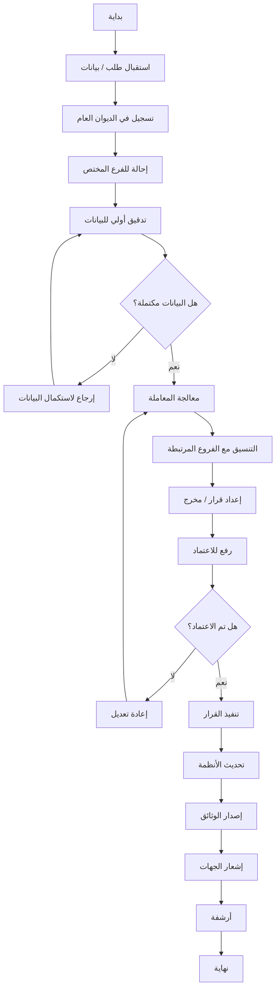

---

# 🔷 2) مخطط التوظيف (Hiring)

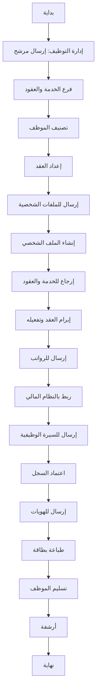

---

# 🔷 3) مخطط النقل (Transfer)

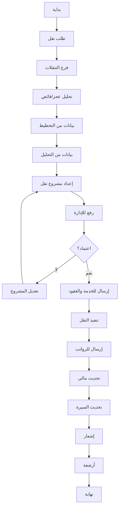

---

# 🔷 4) مخطط التدريب (Training)

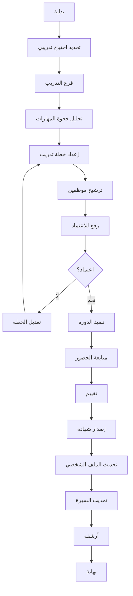

---

# 🔷 5) مخطط الحالة الطبية

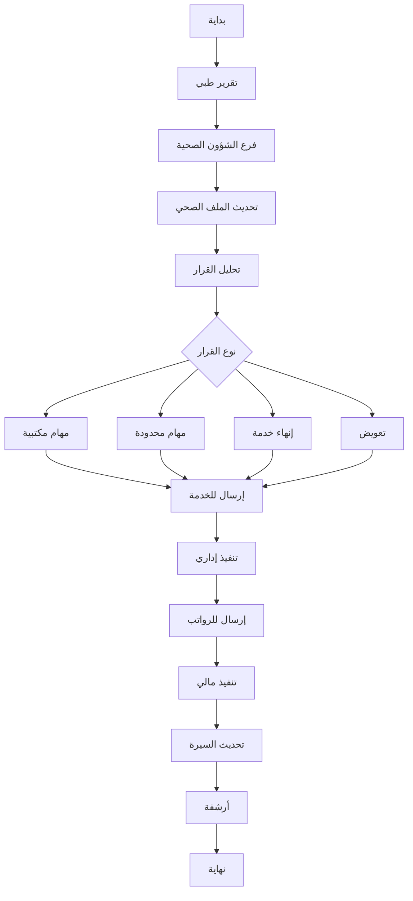

---

# 🔷 6) مخطط الشكاوى

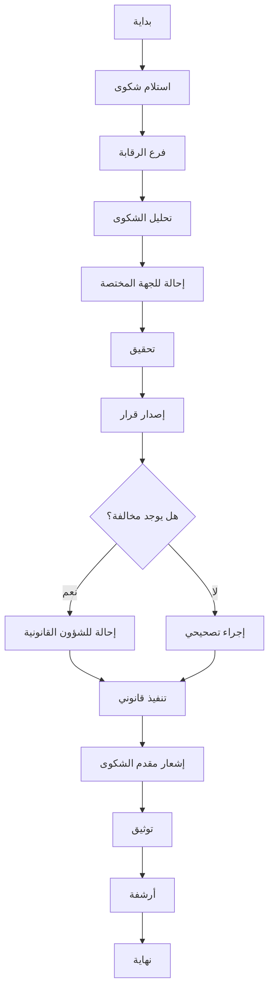

---

# 🔷 7) مخطط الرواتب

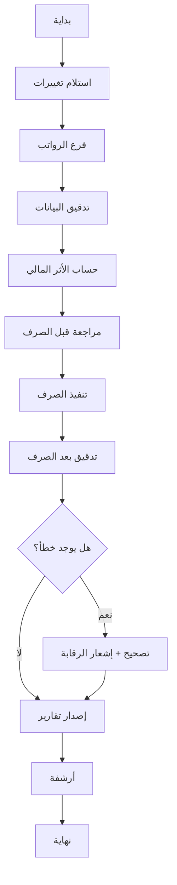


**مخططات التفاعل بين الأنظمة (Sequence Diagrams):**

---

# 🔷 1) المخطط العام (General Interaction)

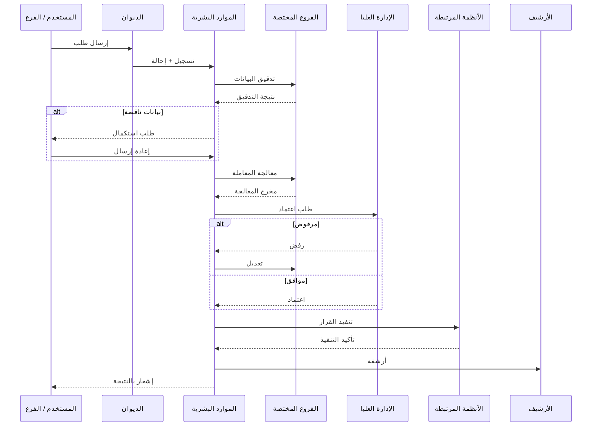

---

# 🔷 2) مخطط التوظيف (Hiring Interaction)

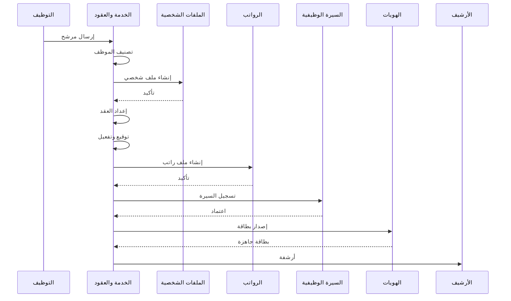

---

# 🔷 3) مخطط النقل (Transfer Interaction)

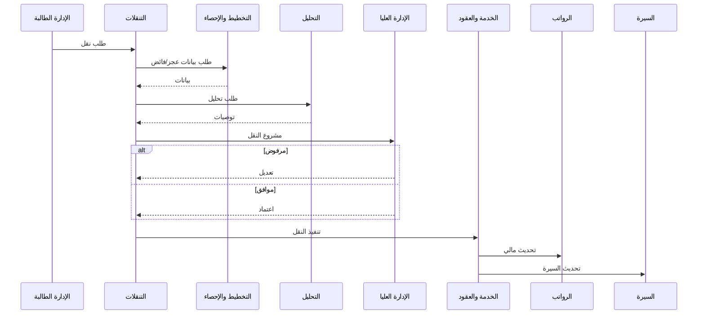

---

# 🔷 4) مخطط التدريب (Training Interaction)

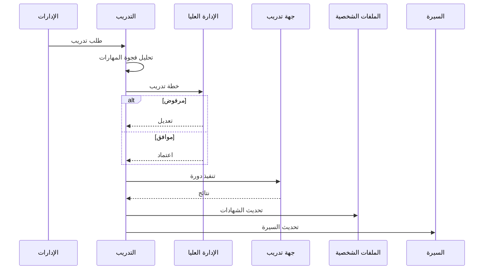

---

# 🔷 5) مخطط الحالة الطبية (Medical Interaction)

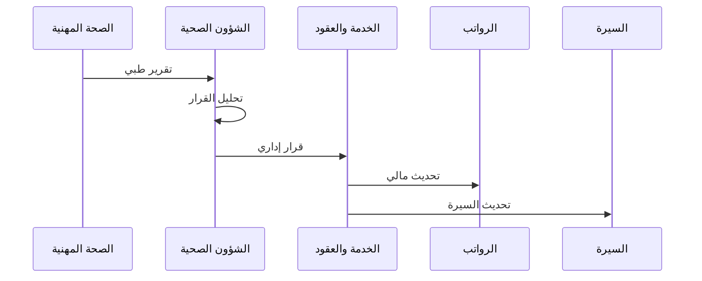

---

# 🔷 6) مخطط الشكاوى (Complaints Interaction)

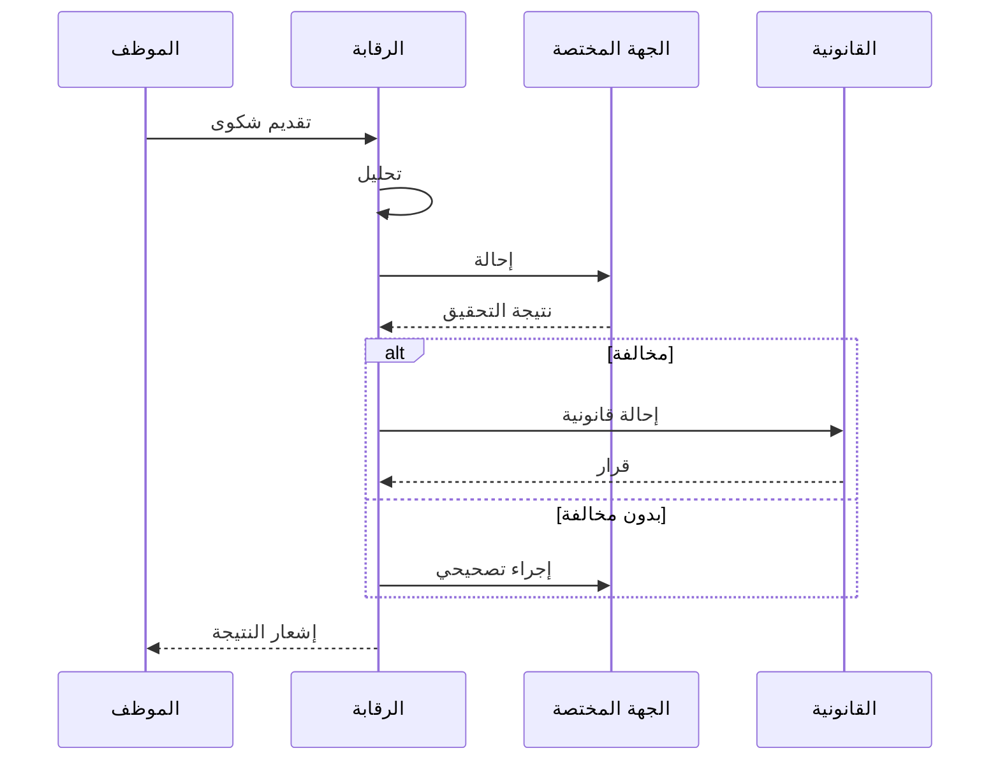

---

# 🔷 7) مخطط الرواتب (Payroll Interaction)

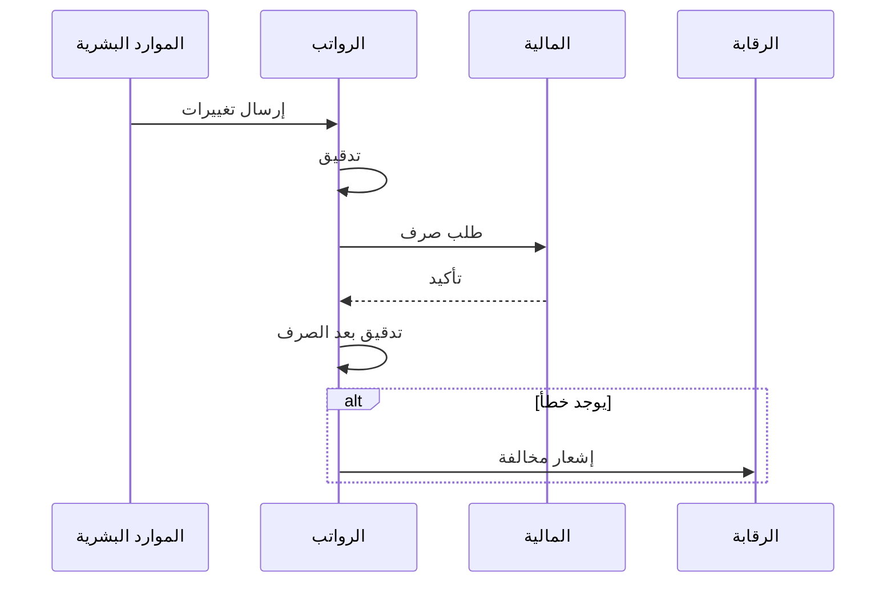

---


 مخططات **State Machine (FSM)**  (حالات + أحداث + انتقالات):

---

# 🔷 1) المخطط العام (محرك سير العمل العام)

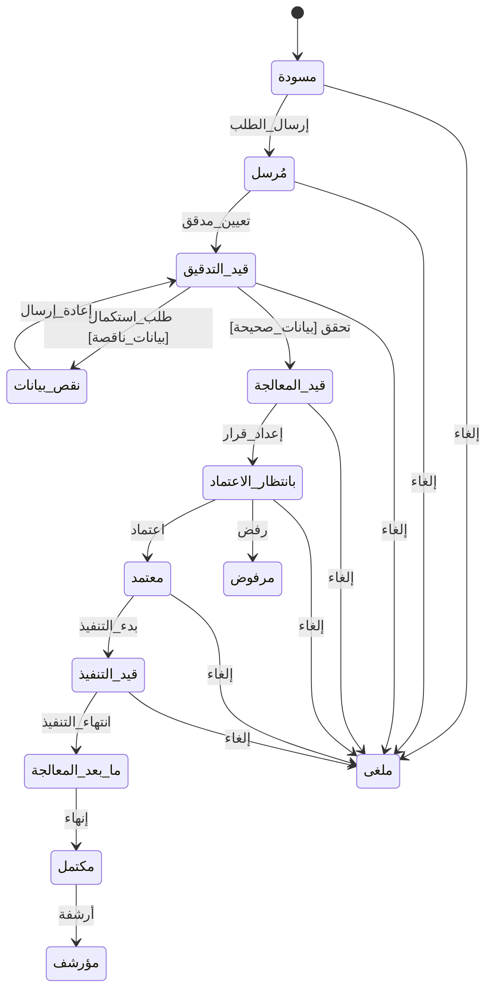

---

# 🔷 2) سير عمل التوظيف

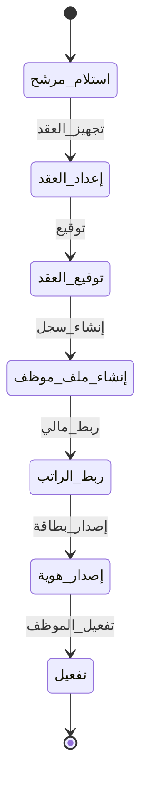

---

# 🔷 3) سير عمل النقل

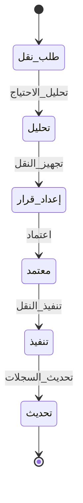

---

# 🔷 4) سير عمل التدريب

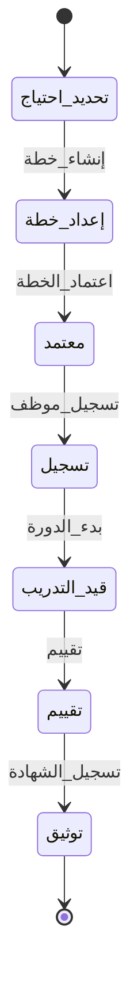

---

# 🔷 5) سير عمل الحالة الطبية

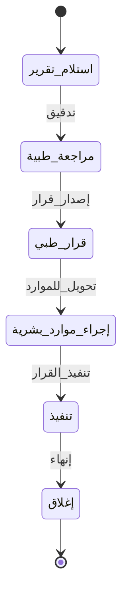

---

# 🔷 6) سير عمل الشكاوى

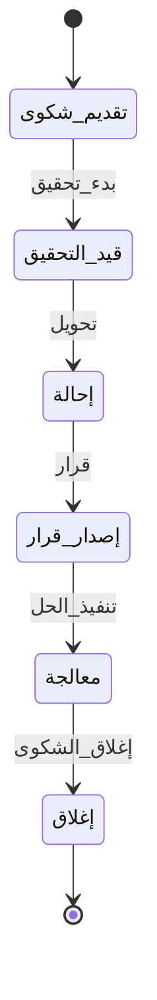

---

# 🔥 ملاحظات مهمة (هندسية)

### ✔️ 1. كل حالة = State في النظام

مثال:

```json
"state": "قيد_التدقيق"
```

---

### ✔️ 2. كل انتقال = Event

```json
"event": "اعتماد"
```

---

### ✔️ 3. الشروط (Guards)

```js
if (بيانات_ناقصة) → نقص_بيانات
```

---

### ✔️ 4. التنفيذ الفعلي

```python
if state == "بانتظار_الاعتماد" and event == "اعتماد":
    state = "معتمد"
```


---

# 🔷 مخطط Use Case العام لنظام الموارد البشرية

```mermaid
flowchart LR
    %% Actors
    EMP[الموظف]
    HR[الموارد البشرية]
    MGR[الإدارة العليا]
    FIN[المالية]
    MED[الصحة المهنية]
    IT[تقنية المعلومات]
    AUD[الرقابة]
    SYS[النظام]

    %% Employee Actions
    EMP --> UC1[تقديم طلب توظيف]
    EMP --> UC2[طلب إجازة / سلفة]
    EMP --> UC3[طلب نقل]
    EMP --> UC4[التسجيل في دورة]
    EMP --> UC5[تقديم شكوى]

    %% HR Actions
    HR --> UC6[إدارة العقود]
    HR --> UC7[إدارة بيانات الموظفين]
    HR --> UC8[تنفيذ التعيين]
    HR --> UC9[تنفيذ النقل]
    HR --> UC10[إدارة التدريب]
    HR --> UC11[تنفيذ قرارات طبية]

    %% Management
    MGR --> UC12[اعتماد القرارات]
    MGR --> UC13[مراجعة التقارير]

    %% Finance
    FIN --> UC14[إدارة الرواتب]
    FIN --> UC15[تنفيذ المدفوعات]

    %% Medical
    MED --> UC16[إصدار تقارير طبية]

    %% IT
    IT --> UC17[إدارة الحسابات والصلاحيات]

    %% Audit
    AUD --> UC18[مراجعة الشكاوى]
    AUD --> UC19[مراقبة الامتثال]

    %% System internal
    SYS --> UC20[إدارة سير العمل]
    SYS --> UC21[تحديث السجلات]
    SYS --> UC22[الأرشفة]
```

---

# 🔷 مخطط Use Case مفصل (التوظيف)

```mermaid
flowchart LR
    ACT1[إدارة التوظيف]
    ACT2[الموارد البشرية]
    ACT3[المالية]
    ACT4[الهويات]

    ACT1 --> UC1[إرسال مرشح]
    ACT2 --> UC2[إعداد عقد]
    ACT2 --> UC3[تفعيل الموظف]
    ACT3 --> UC4[ربط الراتب]
    ACT4 --> UC5[إصدار بطاقة]

    UC1 --> UC2
    UC2 --> UC3
    UC3 --> UC4
    UC4 --> UC5
```

---

# 🔷 مخطط Use Case (النقل)

```mermaid
flowchart LR
    EMP[الموظف]
    HR[الموارد البشرية]
    MGR[الإدارة العليا]

    EMP --> UC1[طلب نقل]
    HR --> UC2[تحليل الطلب]
    HR --> UC3[إعداد قرار]

    MGR --> UC4[اعتماد النقل]

    UC1 --> UC2
    UC2 --> UC3
    UC3 --> UC4
```

---

# 🔷 مخطط Use Case (التدريب)

```mermaid
flowchart LR
    EMP[الموظف]
    HR[التدريب]
    MGR[الإدارة العليا]

    EMP --> UC1[طلب تدريب]
    HR --> UC2[تحليل الاحتياج]
    HR --> UC3[إعداد خطة]

    MGR --> UC4[اعتماد الخطة]

    HR --> UC5[تنفيذ التدريب]
    HR --> UC6[تقييم]

    UC1 --> UC2 --> UC3 --> UC4 --> UC5 --> UC6
```

---

# 🔷 مخطط Use Case (الشكاوى)

```mermaid
flowchart LR
    EMP[الموظف]
    AUD[الرقابة]
    LEG[القانونية]

    EMP --> UC1[تقديم شكوى]
    AUD --> UC2[تحقيق]
    AUD --> UC3[إصدار قرار]

    LEG --> UC4[إجراء قانوني]

    UC1 --> UC2 --> UC3
    UC3 --> UC4
```

---

# 🔥 ملاحظات مهمة

### ✔️ هذا المخطط يوضح:

- من يستخدم النظام
    
- ما الذي يمكنه فعله
    
- العلاقات بين العمليات
    


---

# 🔷 Use Case Diagram احترافي (النظام الكامل)

```mermaid
flowchart LR
    %% ========= Actors =========
    EMP[👤 الموظف]
    HR[🏢 الموارد البشرية]
    MGR[👔 الإدارة العليا]
    FIN[💰 المالية]
    MED[🩺 الصحة المهنية]
    IT[💻 تقنية المعلومات]
    AUD[🔍 الرقابة]
    LEG[⚖️ الشؤون القانونية]

    %% ========= Core Use Cases =========
    UC_MAIN[إدارة الموارد البشرية]

    UC_HIRE[تعيين موظف]
    UC_TRANSFER[نقل موظف]
    UC_TRAIN[إدارة التدريب]
    UC_MEDICAL[إدارة الحالة الطبية]
    UC_COMPLAINT[إدارة الشكاوى]
    UC_PAYROLL[إدارة الرواتب]
    UC_ID[إدارة الهوية]
    UC_SYSTEM[إدارة النظام]

    %% ========= Sub Use Cases =========
    UC_CONTRACT[إعداد العقد]
    UC_EMP_RECORD[إنشاء سجل موظف]
    UC_PAY_LINK[ربط الراتب]
    UC_ID_GEN[إصدار بطاقة]

    UC_ANALYZE[تحليل الطلب]
    UC_DECISION[إعداد قرار]
    UC_APPROVE[اعتماد]

    UC_TRAIN_PLAN[إعداد خطة تدريب]
    UC_EVALUATE[تقييم التدريب]

    UC_MED_REPORT[تقرير طبي]
    UC_HR_ACTION[تنفيذ إجراء إداري]

    UC_INVESTIGATE[تحقيق]
    UC_LEGAL[إجراء قانوني]

    UC_EXEC_PAY[تنفيذ الرواتب]

    %% ========= Actor روابط =========
    EMP --> UC_HIRE
    EMP --> UC_TRANSFER
    EMP --> UC_TRAIN
    EMP --> UC_COMPLAINT

    HR --> UC_HIRE
    HR --> UC_TRANSFER
    HR --> UC_TRAIN
    HR --> UC_MEDICAL

    MGR --> UC_APPROVE

    FIN --> UC_PAYROLL
    MED --> UC_MED_REPORT
    IT --> UC_SYSTEM
    AUD --> UC_COMPLAINT
    LEG --> UC_LEGAL

    %% ========= INCLUDE (إلزامي) =========
    UC_HIRE -->|<<include>>| UC_CONTRACT
    UC_HIRE -->|<<include>>| UC_EMP_RECORD
    UC_HIRE -->|<<include>>| UC_PAY_LINK
    UC_HIRE -->|<<include>>| UC_ID_GEN

    UC_TRANSFER -->|<<include>>| UC_ANALYZE
    UC_TRANSFER -->|<<include>>| UC_DECISION
    UC_TRANSFER -->|<<include>>| UC_APPROVE

    UC_TRAIN -->|<<include>>| UC_TRAIN_PLAN
    UC_TRAIN -->|<<include>>| UC_EVALUATE

    UC_MEDICAL -->|<<include>>| UC_MED_REPORT
    UC_MEDICAL -->|<<include>>| UC_HR_ACTION

    UC_PAYROLL -->|<<include>>| UC_EXEC_PAY

    UC_COMPLAINT -->|<<include>>| UC_INVESTIGATE

    %% ========= EXTEND (اختياري / مشروط) =========
    UC_COMPLAINT -->|<<extend>>| UC_LEGAL
    UC_MEDICAL -->|<<extend>>| UC_TRANSFER
    UC_TRAIN -->|<<extend>>| UC_TRANSFER
    UC_TRANSFER -->|<<extend>>| UC_PAYROLL
```

---

# 🔥 شرح العلاقات (بشكل احترافي مختصر)

## 🔷 1. التوظيف (Hiring)

- دائمًا يشمل:
    
    - إعداد عقد
        
    - إنشاء سجل
        
    - ربط راتب
        
    - إصدار هوية  
        ✔️ لذلك استخدمنا **<>**
        

---

## 🔷 2. النقل (Transfer)

- يتطلب:
    
    - تحليل
        
    - قرار
        
    - اعتماد  
        ✔️ كلها **إلزامية**
        

---

## 🔷 3. التدريب

- دائمًا:
    
    - خطة تدريب
        
    - تقييم  
        ✔️ include
        
- أحيانًا يؤدي إلى:
    
    - نقل موظف  
        ✔️ extend
        

---

## 🔷 4. الحالة الطبية

- دائمًا:
    
    - تقرير طبي
        
    - إجراء HR  
        ✔️ include
        
- أحيانًا:
    
    - نقل أو إنهاء خدمة  
        ✔️ extend
        

---

## 🔷 5. الشكاوى

- دائمًا:
    
    - تحقيق  
        ✔️ include
        
- أحيانًا:
    
    - إجراء قانوني  
        ✔️ extend
        

---

## 🔷 6. الرواتب

- يتم تضمينها داخل:
    
    - التوظيف
        
    - النقل  
        ✔️ كـ include أو extend حسب السيناريو
        
